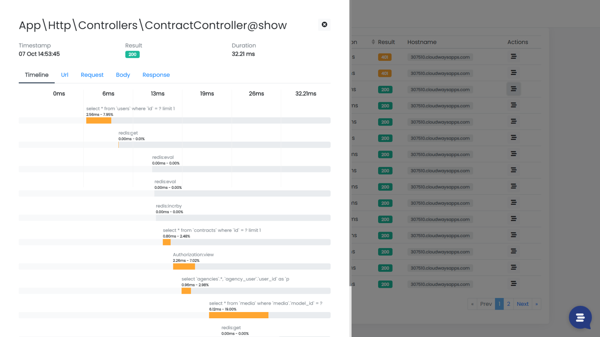

If you are responsible for the development of a software product you probably know that in one way or another if you can’t scale your application, if the software is slow or crashes, **you can’t move your business forward**. It’s basically locked.

On the other hand, adding additional app servers isn’t just a click on the “new server” button in your cloud console. It requires adapting many components in your infrastructure and meeting a lot of preconditions on the software side.

Scalability is a critical business problem because it’s impossible to increase the resources allocated to the application (budget, team, hardware, etc.) at the same rate as the volume of traffic and data increases. The system must therefore anticipate the sudden increase of the workload;

**Monitoring is the only way forward in any software driven organization to prevent scalability issues and detect resource bottlenecks early. The alternative is to risk disappointing your customers due to continuous technical problems in your application.**

A simple and effective monitoring system must allow you to:

- Ensure maximum productivity for the people using your applications;
- Make sure your applications are working properly and without errors;
- Say goodbye to unexpected incidents, late nights or weekend emergencies.

## What is Inspector?

Inspector is a “Code Execution Monitoring” tool designed to help developers find out bugs and bottlenecks in their applications before customers stumble onto the problem.

You'll be able to visually explore the code execution flow inside your application monitoring throughput, performance, memory consumption and more.

## Plug & Play

All you need is a software library based on the technology you use. No need to learn big data stuff, install servers in the Cloud or become a master of internet security.

Inspector offers integration libraries for PHP, Laravel, Symfony, Nodejs, ExpressJs, and Fastify. [Take a look at our GitHub organization](https://github.com/inspector-apm).

## Easy to install and use

We are a team of developers like you, so we understand the value of a technical tool that works great from the minute one. A stunning developer's experience is our top priority.

Our libraries are designed to require the least steps possible to get started with them, with a lot of additional customizations as you go deeper in their use. [Take a look at our documentation](https://docs.inspector.dev/).

## Best in class customer support

We built Inspector to be small/medium business friendly, so that businesses like yours could have the tools they need to save time, money, and build profitable software products.

Supporting our users in their journey takes priority over everything in our team. To read more about our approach visit the [Testimonials](/testimonials/) page!

## Scalable Applications community

We know what it takes to build and scale cloud applications. Inspector started small and is becoming a globally available Code Execution Monitoring solution, with customers in over 20 countries.

The digital world we are building will be more demanding than ever and is under close scrutiny by all stakeholders, clients, colleagues, and regulators alike.

To retain customers, software houses need to be very deliberate in the companies, human resources, and tools they choose to work with. Tech leaders need partnerships more than just providers.

We created an international community of professional developers and engineers to exchange point of views, best practices, mistakes, tools and strategies about scaling software driven businesses and learn from each other's experience.

**Join in the facebook group: [https://www.facebook.com/groups/scalableapplications](https://www.facebook.com/groups/scalableapplications)**

I think, as a community, we’ll have more power to open the doors for benefits and attract new opportunities for all members that would be impossible to achieve if we all continue to work alone.

**Join us, interact with your peers and get inspired by their success: [https://www.facebook.com/groups/scalableapplications](https://www.facebook.com/groups/scalableapplications)**
