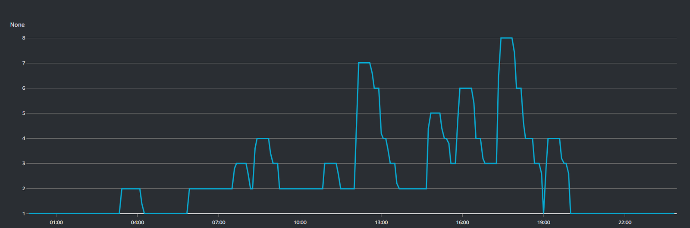
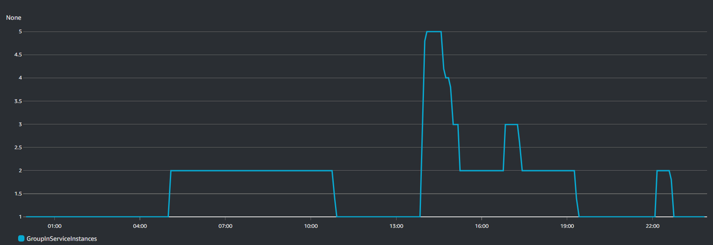
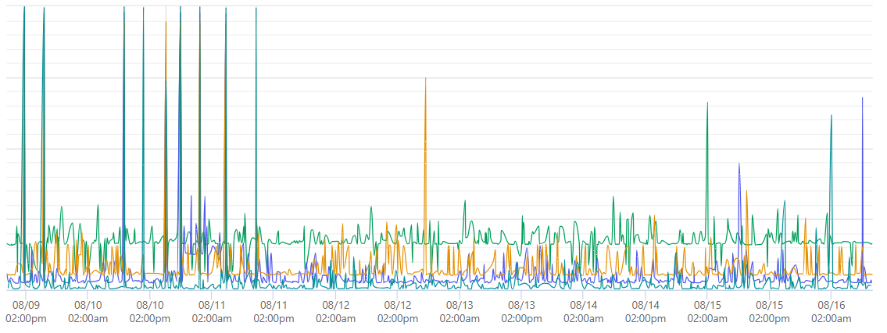

Working in software and cloud services you've probably already heard about the launch of new the Graviton machines based on custom ARM CPUs from AWS (Amazon Web Services).

In this article you can learn the fundamental differences between ARM and x86 architecture and the results we've achieved after the adoption of Graviton ARM machines in our computing platform.

If you are looking for a way to cut 40% of your cloud bills in one shot, give it a read.

## Introduction

Since Inspector has reached 30 million requests processed per day I started spending more time every week looking for new technological solutions that allow the product to grow without being crushed by costs. Instead, we would like to find new spaces to increase the value of our services for software development teams around the globe.

For several months I have been reading very promising benchmarks reported by many developers and companies on the performance of the new AWS Graviton ARM chips compared to the performance of x86 servers.

Studying the type of workloads Graviton ARMs are really good at, I’ve identified our data-ingestion software as a perfect use case.

I spoke with the AWS startup support team, and I decided to conduct the first test by migrating only the infrastructure on which the data ingestion pipeline runs. This is the most resource consuming part of our system.

## Why ARM is cheaper

Hyperscalers want YOU to help them solve their real estate problems. They want to do it by shifting your workloads to ARM and they will pass savings to you.

Considering at least performance parity between x86 and ARM chip boards, it gets into these really simple concepts:

- More computer density for square foot (get more compute cores on a single CPU socket)
- Less energy consumption (drawing less power they need less cooling)

in the same time.

In these terms it’s like the early 2010 when SSD came out to replace HDD. It was a big win for everyone. You have a computer with a slow hard drive, you put in an SSD, reinstall your operating system, and your computer is just faster and consumes less battery.

You didn’t change what programs you use, no compatibility issues.

I myself did this cheap upgrade to my old notebook in 2015 and it resulted in two years of extra life for my workstation.

The cloud servers landscape right now seems in the same shape. Great innovations to come.

## How is it possible? (The Noisy Neighbor Problem)

In the context of virtualized servers the most interesting thing that really plagues the hyperscalers is the challenge about multi-tenancy.

As tech guys, many of us could be pretty familiar with the concept of hyperthreading.

Hyper-threading is a process by which a CPU divides up its physical cores into virtual cores that are treated as if they are actually physical cores by the operating system. These virtual cores are also called threads. Most of Intel’s CPUs with 2 cores use this process to create 4 threads or 4 virtual cores. Intel CPUs with 4 cores use hyper-threading to create more power in the form of 8 virtual cores, or 8 threads.

What that translates to is when whatever you ask for a compute instance in the cloud with four vCPUs, these four virtual CPUs are not pointing to a real CPU core, but they’re pointing to a thread.

It’s sharing real estate with an adjacent thread that somebody else might have for a completely different purpose. You share the same CPU cache and fight for it.

This implementation creates a lot of unpredictability at peak. When utilization gets higher this fighting process becomes unstable and it crashes and burns processes. It’s often because at peak hours with other workloads in concurrency on the same CPU core your processes may not get the cache so they can spiral.

This is the main reason why this new chips like [Graviton](https://docs.aws.amazon.com/whitepapers/latest/aws-graviton2-for-isv/optimizing-for-performance.html), [Altra](https://www.crn.com/news/components-peripherals/ampere-s-new-128-core-altra-cpu-targets-intel-amd-in-the-cloud), etc opted not to use hyperthreading. They’re deliberately not putting that feature set on these chips because it is too challenging to manage. **In fact, in these instances each vCPU is a physical core not a shared thread**.

The cloud providers can’t account for the obscurity of your workload and your neighbor's workload effectively. It’s better to just not have that. It’s a feature that you just don't need when the job of your computer is to serve the workloads that other people choose. It's a bad fit.

In a nutshell these chips have simplified the machine. They have less gears, so they can run instructions faster.

## What results we’ve seen with Graviton ARM CPUs

The first impact was in the way the autoscaling group reacts at peak workload.

The image below shows the scaling in/out activity with x86 instances:

And here is the same metric with ARM instances:

It’s quite clear how much more stable and efficient ARM instances are.

x86 instances keep climbing up and down compared to ARMs. This translates into a higher average number of machines used, and higher costs.

The autoscaling group with ARM instances is much more stable and uses less machines for the same workload.

The same feedback comes from our uptime monitoring tool which looks at our system from the outside:

You can see how jittery and choppy the chart is until we introduced ARM instances.

For our use case, Graviton ARM instances are superior in every aspect to x86. They cost less on-demand, exhibit lower median CPU consumption, and run cooler with the same workload per host.

With ARM we could run 30% fewer instances in total, and each instance would cost 10% less on-demand versus x86. Was it worth it to port? I personally approached it as an idle experiment with a few spare afternoons, and was surprised by how compelling the results were. Saving 40% on the EC2 instance bill for this service is well worth the investment, especially in this new economic climate.

## Announcing increased data retention

Thanks to these optimizations we are increasing our computational capacity, and data processing performance, in order to provide more support for your business growth.

We’ve extended the data retention period by one week for all subscription plans.

Read the announcement below:

[Announcing increased data retention for monitoring data](/announcing-increased-data-retention-for-monitoring-data/)

## New to Inspector? Try it for free now

Are you responsible for application development in your company? Consider trying my product [**Inspector**](/) to find out bugs and bottlenecks in your code automatically. Before your customers stumble onto the problem.

Inspector is usable by any IT leader who doesn’t need anything complicated. If you want effective automation, deep insights, and the ability to forward alerts and notifications into your preferred messaging environment try Inspector for free. [**Register your account**](https://app.inspector.dev/register).Or learn more on the website: [**https://inspector.dev**](/)
