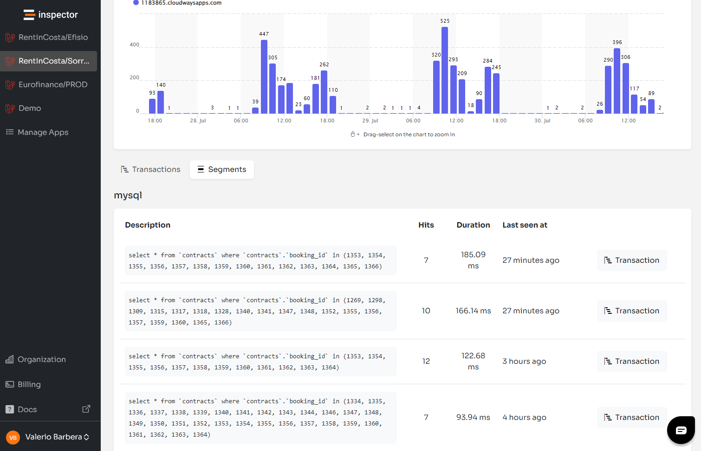

How to compete in a market dominated by giants? This was my biggest fear when I launched Inspector in July 2020. While New Relic has been a dominant force in the realm of application monitoring, it’s time to consider a more developer-centric New Relic alternative for several reasons:

- **Complexity** - This kind of platforms, not just NewRelic but also others like Dynatrace, Datadog, AppDynamics, etc, have grown overtime to help large enterprises to address big and complex scenarios, becoming big and complex platforms as a consequence.
- **SMBs needs** - The extensive features of New Relic, while beneficial for large enterprises, often overshoot the needs of small to medium-sized businesses. These  
  businesses typically require straightforward solutions for specific problems without the hefty price tag and the complexity that comes with large platforms.
- **Cost Burden** - Sale big services require to ask for big price. The cost associated with this kind of platforms imply also high skilled DevOps engineer that you need to make this tool in place and maintain their operations.

Here's why Inspector stands out as a preferable choice for software developers, particularly for those working in PHP and Java backend environments.

## Understanding the Challenges with New Relic

New Relic offers a comprehensive suite of monitoring tools that cater to a broad spectrum of monitoring needs, including complex cloud infrastructure monitoring. However, this breadth comes with complexities.

New Relic requires **installation at the infrastructure level**, which can be cumbersome and disruptive for software development teams. Their approach necessitates involvement from the Ops team, complicating the developers' workflow. New Relic's emphasis on infrastructure monitoring makes it too intricate for developers who need a more focused and accessible tool just to monitor the code execution.

DevOps and infrastructure management can be an overload for software development teams for several reasons:

### Complexity and Specialization

<u>Skill Set Requirements</u>: DevOps and infrastructure management require specialized skills, including knowledge of continuous integration/continuous deployment (CI/CD) pipelines, cloud platforms, containerization, orchestration tools, and monitoring systems. Software developers may not have expertise in these areas, which can lead to inefficiencies and mistakes.

<u>Rapid Technological Changes</u>: The DevOps landscape is continually evolving with new tools, practices, and paradigms. Keeping up with these changes can be challenging for developers who are also focused on writing and maintaining code.

### Resource Constraints

<u>Time Management</u>: Balancing development tasks with DevOps responsibilities can lead to time management issues. Developers may find it difficult to allocate sufficient time to both areas, resulting in delays and reduced productivity.

<u>Cognitive Load</u>: Managing infrastructure and deployment processes adds to the cognitive load of developers, potentially leading to burnout and decreased job satisfaction.

### Focus on Core Competencies

<u>Primary Responsibilities</u>: Software developers are primarily focused on writing, testing, and maintaining code. Adding infrastructure management to their responsibilities can distract them from their core tasks and lead to a decline in code quality and innovation.

<u>Efficiency</u>: Specialized DevOps teams can often manage infrastructure more efficiently and effectively than developers who split their focus between coding and operations.

## The Inspector Advantage

In contrast, Inspector is designed with the needs of software developers in mind, particularly those specializing in PHP and Java applications. The main goal is to make the developers life easier reducing costs and work overload.

There are three main aspects that make Inspector the best New Relic alternative:

**Developer-Friendly Installation**: Unlike New Relic, Inspector utilizes pure software libraries that are easily integrated as an application dependency. This means no infrastructure-level installation is required, and the monitoring setup can be handled entirely by software developers inside the application (Code-Driven).

**Simplicity and Focus**: Inspector offers a streamlined interface that is intuitive and tailored  
to software developers rather than Ops engineers. This focus makes it an ideal solution for real-time error tracking, debugging, and performance insights within the code itself.

**AI-Powered Bug Fixing**: At its core, Inspector is an AI bug fixer capable of detecting and  
resolving software anomalies in real time. This functionality not only minimizes downtime  
but also significantly cuts development costs by up to 50%, making it an economically  
viable solution for small to medium sized team.

In the article below you can read about a typical use case where Inspector can help you when New Relic can't:

[NewRelic Alternative For Monitoring Laravel Octane](/newrelic-alternative-for-monitoring-laravel-octane/)

## Inspector as a New Relic Alternative

Here’s how Inspector compares to New Relic in key areas:

| Feature | Inspector | New Relic |
| --- | --- | --- |
| **Integration Complexity** | ✅ No infrastructure changes | ⛔ Requires infrastructure-level integration |
| **Target users** | ✅ Software Developers | ⛔ Ops Engineer and large infrastructure |
| **User Interface** | ✅ Intuitive and Simple | ⛔ Complex and Broad |
| **Cost** | ✅ More affordable - Clear Pricing | ⛔ Can be expensive and complex to predict |
| **Focus** | ✅ Code Monitoring for PHP and Java backend | ⛔ Broad including infrastructure |

## Try Inspector for Free

Experience the simplicity and effectiveness of Inspector firsthand. We invite you to try Inspector for free as a New Relic alternative, and see how it can transform your application monitoring strategy without the complexities and high costs associated with larger platforms like New Relic.

**[Getting Started Free with Inspector Now](https://app.inspector.dev/register)**

Join us at Inspector as we revolutionize the way developers monitor and optimize their applications. Simplify your monitoring, focus on development, and let Inspector handle the complexities of error tracking and performance optimization.
