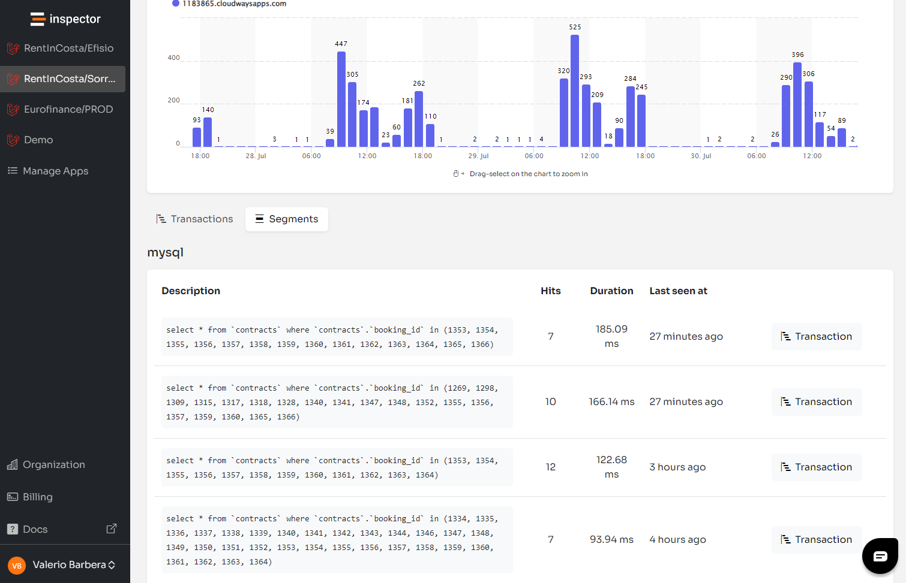

Recently I’m meeting the Inspector customers in a live call almost every week. I’m learning a lot of stories about the developer journey looking for new dev tools, and how they compare different solutions to make the final decision.

It’s clear that today monitoring application performance and swiftly resolving errors is not just a necessity; it’s a competitive advantage.

While Sentry has been a significant player in the monitoring space, Inspector has emerged as a compelling Sentry alternative, especially for PHP (Laravel, Symfony) and Java (SpringBoot) backend developers.

Let’s explore how Inspector distinguishes itself by simplifying complexity and focusing on efficiency and developer-friendly solutions.

## Understanding the limitations of Sentry

Sentry offers a wide range of libraries across many technologies, which is undoubtedly beneficial for teams working with a diverse tech stack.

The billing model in Sentry can be particularly baffling. It's characterized by numerous variables and constraints that might not suit every team, and make the monthly bill difficult to predict. Moreover, while Sentry provides performance monitoring, it often feels like an afterthought rather than the core of the product, resulting in a steep learning curve and a platform that can be overwhelming for many developers.

## The Inspector advantage

Inspector, in contrast, is designed with simplicity and effectiveness at its core. Here are some distinct advantages of using Inspector as the Sentry alternative:

**Simplified Pricing**: Unlike Sentry’s complex billing, Inspector offers pre-packaged tiers based on data volume, with flexible pay-as-you-go options that can be enabled or disabled on demand. This transparency in pricing ensures that teams can predict their expenses without unexpected charges.

**Focused Performance Monitoring**: Inspector is tailored specifically for PHP and Java applications. It provides a laser-focused tool that avoids the dilution of capabilities seen in more generalized platforms. This specialization ensures that the features and functionalities are highly optimized for the supported technologies.

**User-Friendly Interface**: Inspector boasts one of the most user-friendly interfaces in the market, designed to minimize confusion and maximize productivity. This makes it an ideal solution for developers who want to spend less time configuring their monitoring tools and more time optimizing their applications.

**Real-Time AI Bug Fixing**: Perhaps the most significant advantage of Inspector is its capability as an AI Bug Fixer. It can detect and resolve software anomalies in real time, without developer intervention, thereby reducing the downtime and manpower typically required for troubleshooting.

**Cost Reduction**: By automating the debugging and error tracking processes. Inspector shows you database queries and their impacts directly, and helps reduce development costs by up to 50%. This is not just a boost to efficiency but also a substantial financial advantage.

## Features comparison table

Here’s a detailed look at how Inspector stacks up against Sentry:

| Feature | Inspector | Sentry |
| --- | --- | --- |
| **Clear Pricing** | ✅ Simple, Flexible tiers | ⛔ Complex with variables |
| **Technology Focus** | ✅ PHP, Java | ⛔ Multiple, broader scope |
| **UI/UX** | ✅ User-Friendly | ⛔ Complex |
| **Real-Time Error Resolution** | ✅ AI-driven | ⛔ Manual |
| **Cost Effectiveness** | ✅ Reduce cost by up to 50% | ⛔ Potentially higher cost |

## Monitor your application for free

If you’re looking for a Sentry alternative that fits better for your needs, and works perfectly with the PHP environment, try Inspector for free.

You can experience our focused approach to help developers stay smart, and make their life easier.

Click here to start your journey: [**Start Using Inspector for Free**](/)

