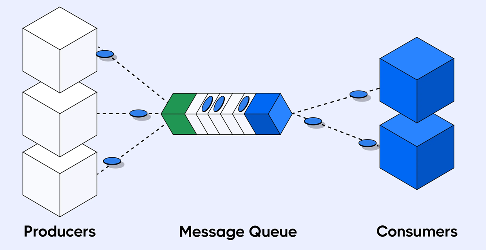
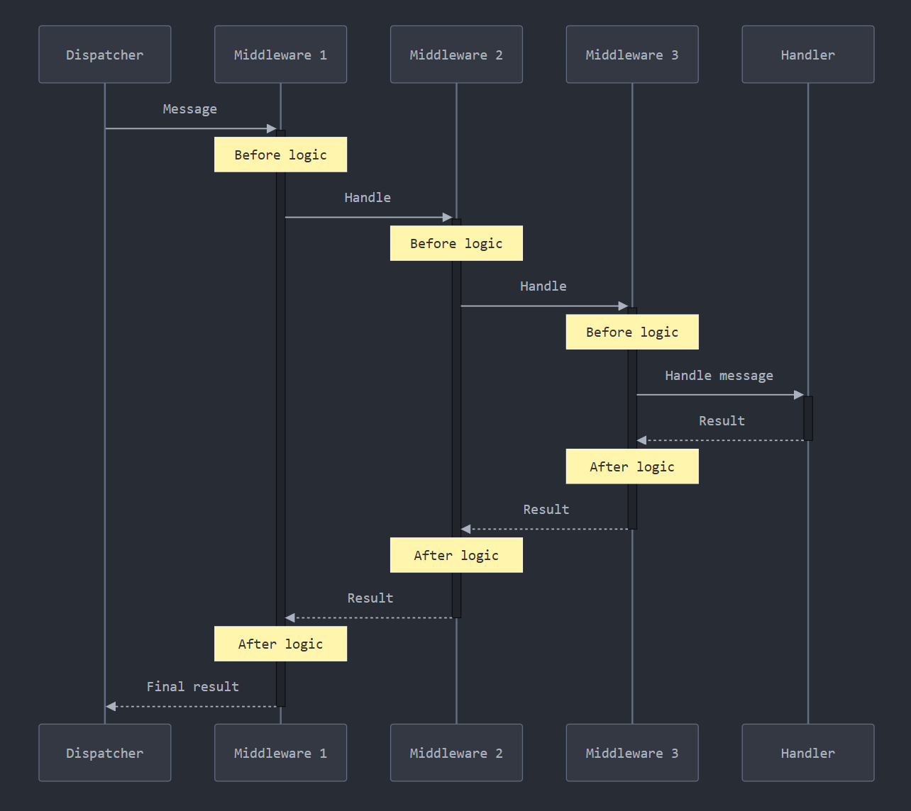
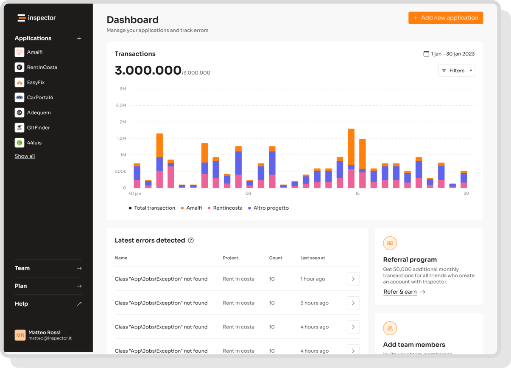

As a Symfony developer, you’ve probably faced the challenge of adopting the [Symfony Messenger](https://symfony.com/doc/current/messenger.html) component to improve application scalability and general performance.

That's why I’m excited to announce a new feature in our [Inspector bundle](https://github.com/inspector-apm/inspector-symfony) that brings **complete visibility into your Symfony Messenger background operations**.

Now you can automatically monitor every aspect of your background jobs - from execution times and memory usage, to database statements, errors and bottlenecks - all through an intuitive dashboard that requires zero configuration.

No more digging through logs or writing custom monitoring code; Inspector gives you instant insights and alerts into what's happening behind the scenes of your Symfony application.

The challenge is always the same for every developer: Deploying your application with async message handling and then crossing your fingers hoping everything runs smoothly in the background. While Symfony's Messenger component is incredibly powerful, monitoring those background processes has always been a bit of a blind spot.

In this article I go deeper into this implementation so you can better understand the huge advantage it can bring in your daily work.

## What is a Queue System



A queue system is a fundamental component in modern web applications that enables the separation of time-consuming tasks from the immediate request-response cycle.

Instead of processing resource-intensive operations during a user's request (like sending emails, processing images, or generating reports), these tasks are placed in a queue to be handled asynchronously by background workers.

This architecture significantly improves application responsiveness since users don't have to wait for long-running tasks to complete, and it allows better resource management by controlling when and how many tasks are processed simultaneously. If a task fails, queue systems typically provide retry mechanisms to ensure a certain level of reliability.

As your software product matures, you will need to adopt this new approach to make your application able to serve more and more customers without increasing infrastructure costs.

## Symfony Messenger Component

The Symfony Messenger component is a powerful queuing system built into the Symfony framework that allows you to publish and consume messages from a queue provider (AMQP, Redis, or Doctrine).

Messages are simple classes where you can store pieces of information that represent a job to be done when the message will be consumed from the queue later in time.

Here is an example of a Message for Symfony messenger:

```php
namespace App\Messenger;

class SmsNotification
{
    public function __construct(
        private string $content,
    ) {
    }

    public function getContent(): string
    {
        return $this->content;
    }
}
```

On the other side you can create a handler class that will be in charge to process the message when it is pulled out from the queue.

```php
namespace App\Messenger;

use Symfony\Component\Messenger\Attribute\AsMessageHandler;

#[AsMessageHandler]
class SmsNotificationHandler
{
    public function __invoke(SmsNotification $message)
    {
        // ... do some work - like sending an SMS message!
    }
}
```

Notice the *[#AsMessageHandler]* attribute and the type hint of the `SmsNotification` in the `__invoke` method. They are the way Symfony understands what handlers are responsible to process a specific message.

In the middle there is the `messenger:consume` command that runs a background worker to grab messages from queues and execute the appropriate handlers in the background, out of the request-response lifecycle.

With this system in place, when you want to run something asynchronously you just have to "dispatch" a message onto the queue:

```php
namespace App\Controller;

use App\Messenger\SmsNotification;
use Symfony\Bundle\FrameworkBundle\Controller\AbstractController;
use Symfony\Component\HttpFoundation\Response;
use Symfony\Component\Messenger\MessageBusInterface;
use Symfony\Component\Routing\Attribute\Route;

class HomeController extends AbstractController
{
    #[Route('/', name: 'home')]
    public function home(MessageBusInterface $bus)
    {
        $bus->dispatch(new SmsNotification("Nuovo Messaggio!"));

        return new Response('SMS notification dispatched.');
    }
}
```

Messenger simplifies the implementation of complex asynchronous processing while maintaining the robustness needed for production applications. Now we take a look on more advanced features like automatic message serialization, middleware support, and retry strategies.

## Symfony Messenger Monitoring Middleware

After this gentle introduction you can understand how hard it is to be aware of what happen in the background processes, since they are performed out of sight of your users and yours.

If you are new to queue systems and background processing, it can brings new questions in your mind:

- **How can I know if an handler takes too long to be processed?**
- **Am I running too expensive database operations?**
- **Are background jobs failing?**

Answering these questions is quite easy when you work on the "web" part of your app. Simply because if something goes wrong you receive customer complaints or you can immediately see red messages bubbling up into your application user interface.

Background jobs can fail silently for days without anyone noticing.

Inspector basically brings a beautiful interface to monitor what’s happening in the background part of your system with the same efficiency and simplicity you love.

### Symfony Messenger Middleware

The package automatically registers a messenger middleware to trace the start and end of message processing. Then the Inspector bundle leverages the same features it already has for collecting database queries and other tasks executed during the message handling.

A middleware in Symfony Messenger is a layer of code that wraps around the handling of messages, allowing you to perform actions before or after a message is handled. Think of it like a series of nested layers around your message handling - each middleware gets a chance to process the message before passing it to the next one, and then process it again on the way back out.

Here is a visual representation to better explain this concept:



This architecture is based on the **[Chain Of Responsibility](https://refactoring.guru/design-patterns/chain-of-responsibility/php/example)** design pattern. Here is an example:

```php
namespace App\Messenger\Middlewares;

use Symfony\Component\Messenger\Middleware\MiddlewareInterface;
use Symfony\Component\Messenger\Middleware\StackInterface;

class MessengerMonitoringMiddleware implements MiddlewareInterface
{
    public function handle(Envelope $envelope, StackInterface $stack): Envelope
    {
        // Your code here...
        
        return $stack->next()->handle($envelope, $stack);
    }
}
```

Every middleware return the next one in the stack, creating a sort of chain. So when a message is pulled out from the queue it will be passed onto this chain to make developers able to operate before and after a message is processed by the handler.

## The Inspector Middleware

To run the middleware before and after the handler you have to hack a bit the code example above:

```php
namespace App\Messenger\Middlewares;

use Symfony\Component\Messenger\Middleware\MiddlewareInterface;
use Symfony\Component\Messenger\Middleware\StackInterface;

class MessengerMonitoringMiddleware implements MiddlewareInterface
{
    public function handle(Envelope $envelope, StackInterface $stack): Envelope
    {
        // Before handling the message in sync mode
        $this->beforeHandle($envelope);

        // Handle the message
        $envelope = $stack->next()->handle($envelope, $stack);

        // After handling the message in sync mode
        $this->afterHandle($envelope);
    }
}
```

In this way we had the opportunity to add a plug-&-play component into the library to start monitoring your background processes the moment you update the application dependencies. The kind of developer experience I always love to ship.

## Upgrading to 1.7 version

The first benefit of this release is that it ships as a minor change so you can get this latest version just updating your application dependencies with a simple “*composer update*”.

The package automatically integrates the Messenger Monitoring capabilities without requiring any code changes from your side.

## Ignore Messages

There may be parts of the application that you are not interested in monitoring. Maybe they were created for internal use, or for application maintenance, and have no impact on the user experience in production.

Inspector provides you with a simple option to keep off the noise, and only monitor what matters. You can easily exclude messages from your monitoring data just listing them in the `ignore_messages` property in the `inspector.yaml` configuration file.

```yaml
inspector:
    ingestion_key: '%env(INSPECTOR_INGESTION_KEY)%'
    
    ignore_messages:
        - 'App\Messenger\Messages\SmsNotification'
        - 'App\Messenger\Messages\EmailInternal*' # Also with wildcard
```

As you can see from the snippet above you can use the wildcard character **“\*”** to exclude entire patterns or namespaces.

## Monitor your Symfony application for free

If you are looking for HTTP monitoring, database query insights, and the ability to forward alerts and notifications into your preferred messaging environment try Inspector for free. [**Register your account**](https://app.inspector.dev/register).

Inspector is a Code Execution Monitoring tool specifically designed for software developers. You don’t need to install anything on the infrastructure, just install the [**Symfony package**](https://github.com/inspector-apm/inspector-symfony) and you are ready to go.

Or learn more on the website: [**https://inspector.dev**](/)


