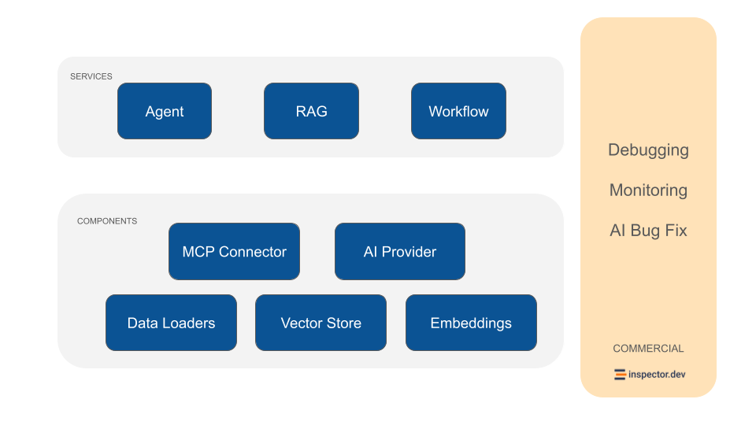
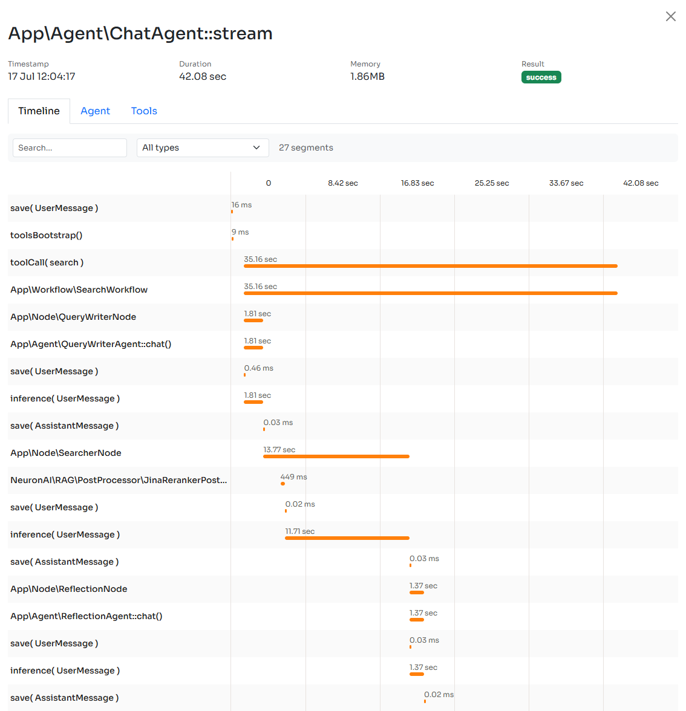

In the last few months I heavily worked to push the AI agents integration into my SaaS product to a higher level. It was a very long journey, started more than a year ago with the first experiments. I had to say that understanding all the moving parts of an AI driven system was far from easy.

As a PHP developer I struggled a lot, mainly because the PHP ecosystem to develop this kind of “Agentic” features into existing applications it’s not as advanced and rich as it is in other technologies.

Python is “driving the bus”, and obviously other developers working with different programming languages are creating their artifacts to get the opportunity to start their journey too.

Six months ago when I started working on this chapter I took in consideration some packages that were getting attention like [LLPhant](https://github.com/LLPhant/LLPhant), or [Prism](https://prism.echolabs.dev/). There was a lot of development behind these packages and they have already implemented a lot of things. But compared to the state of the art of the agentic ecosystem, and ultimately for my needs, they had too serious weaknesses to consider ​​building the foundation of this chapter for my business on these libraries. Prism is exclusively for Laravel, so you are locked in, and it misses all the RAG needs and complemetary abstractions. LLPhant has a lot of different classes and looks more like a library than a framework. They also lacks features like Memory, chat history, monitoring, and more.

Yet, the opportunity is too great to pass up.

## The unsustainable path

From the beginning I realized that I could not look at other programming languages. It's not sustainable. And I am sure that is the same for most developers who specialize in a particular programming language.

If you have a PHP application you can’t implement an agent in javascript or Python, because they need your application data and context to generate their magic (authentication, authorizations, database connection, cache, etc). Transferring this data and context to an external entity written in another language leads to a lot of code duplication, or technical constraint that are not sustainable.

After six months of non-stop working I started believing that the artifact I created for myself was so good that it could help so many developers out there jump into the AI agents train.

So, I decided to release this internal tool as an open source project: [Neuron AI](https://docs.neuron-ai.dev/), the first PHP Framework to create fully-featured agentic applications in PHP.

[**https://docs.neuron-ai.dev**](https://docs.neuron-ai.dev)

## Why I decided to make it open source

The journey I would like to explore is inspired by LangChain, LLamaIndex, and others, giving people the power to create agentic applications natively in PHP, with a complete open source toolkit. And provide support and long term visibility thanks to the professional monitoring and debugging service powered by [Inspector.dev](/)

At the same time I believe it can really help PHP developers "jump into the AI story" with stronger foundations.

It seemed to me a clear opportunity. I hope it can get you the answers you are looking for to continue to build great software with the programming language you know and love.

Here is a how the project is organized:



## Key concepts

Neuron AI is designed to provide you with a complete toolkit to implement AI driven applications, making it easy to work with them into your existing system, integrate with your data, and provide more value to your users.

All the Neuron AI framework components implement well defined interfaces. They just provide you with features to create agents with behaviors and abilities you need in a vary composable fashion. The most important entity, [Agent](https://docs.neuron-ai.dev/agent), is designed to be extended to encapsulate your specific implementation.

This ensures the portability of your agent, because all the moving parts are encapsulated into a single entity that you can just run wherever you want in your application, or ship as a standalone package.

```php
namespace App\Agents;

use NeuronAI\Agent;
use NeuronAI\Providers\Anthropic;
use NeuronAI\Tools\Tool;
use NeuronAI\Tools\ToolProperty;

class SEOAgent extends Agent
{
    public function provider(): AIProviderInterface
    {
        // return an AI provider instance (Anthropic, OpenAI, Mistral, etc.)
        return new Anthropic(
            key: 'ANTHROPIC_API_KEY',
            model: 'ANTHROPIC_MODEL',
        );
    }
    
    public function instructions(): string 
    {
        return "Act as an expert of SEO (Search Engine Optimization). ".
            "Your role is to analyze a text and provide suggestions on how the content can be improved to better rank on Google search.";
    }
    
    public function tools(): array
    {
        return [
            Tool::make(
                "get_file_content", 
                "Use the url to get the content in plain text."
            )->addProperty(
                new ToolProperty(
                    name: 'url',
                    type: 'string',
                    description: 'The URL of the article you want to analyze.',
                    required: true
                )
            )->setCallable(function (string $url) {
                return file_get_contents($url);
            })
        ];
    }
}
```

Talk to the agent:

```php
use NeuronAI\Chat\Messages\UserMessage;

$response = SEOAgent::make()
    ->chat(
        new UserMessage("Give me your feedback about this article: https://inspector.dev/introduction-to-neuron-ai-create-full-featured-ai-agents-in-php/")
    )
    ->getMessage();
    
echo $response->getContent();

// It seems like a good job has been done on the article, 
// however I can give you some tips to improve SEO:...
```

## Extensibility

Every component of the framework depends on its own interface. This guarantees you the ability to create new concrete implementations of every component to interact with external systems and pass them to your agents with confidence.

In the components documentation you will find the dedicated section of how to implement a new one, basically extending its interface.

Do you want to implement a new [Vector Store](https://docs.neuron-ai.dev/components/vector-store), or an [Embeddings Provider](https://docs.neuron-ai.dev/components/embeddings-provider)? Follow the documentation and feel free to send us a PR with your new module. We will be happy to integrate them as a part of the framework to ensure first party support and maintenance.

## MCP server connector

Neuron has a built-in component to connect with MCP servers to instantly give Agents tools to perform actions on external services like Stripe, Discord, Slack, and many more.

MCP is a relatively new protocol, but it’s already getting a lot of popularity because it makes it so easy to connect external APIs in a way that makes sense for LLMs. You can learn more about MCP and PHP Agents on our extensive article:

[AI Agents in PHP with MCP (Model Context Protocol)](/ai-agents-in-php-with-mcp-model-context-protocol/)

## Monitoring & Debugging

Integrating AI Agents into your application you’re not working only with functions and deterministic code, you program your agent also influencing probability distributions. Same input ≠ output. That means reproducibility, versioning, and debugging become real problems.

The [Inspector](/) team designed NeuronAI with built-in observability features, so you can monitor AI agents were running, helping you maintain production-grade implementations with confidence.



Error handling and retry mechanisms are built into the framework, ensuring your agents can gracefully handle failures, rate limits, and other common issues in production environments.

## Unified interface to multiple providers

When you build your application directly against OpenAI's API or Claude's API, you're essentially writing vendor-specific code that becomes deeply embedded in your business logic. Every API call, every parameter, every response format ties you tighter to that single provider. If pricing changes dramatically, if service quality degrades, or if a competitor releases a significantly better model, you're facing a substantial rewrite to switch.

With Neuron providing a single, consistent interface across providers, you're writing against an abstraction layer that keeps your options open. Your application code remains unchanged whether you're using GPT-4, Claude, Gemini, or any other model that Neuron supports. This means you can make strategic decisions about which provider to use based on current performance, cost, and features rather than being locked into a choice you made months or years ago when the landscape was completely different.

You can even route different types of requests to different models based on their strengths - using a cheaper model for simple tasks and reserving premium models for complex reasoning - all without maintaining multiple integration codebases.

From an engineering perspective, it dramatically reduces technical debt.

## AI Toolkit

To create a fully functional AI agent you have to make several things work together. Apart from the LLM, you need to constantly process data, create and store embeddings to feed your agent with fresh information.

The project provides easy to implement components for all of these areas. Neuron uses a common interface for large language models (`AIProviderInterface`) as well as for the other components, such as [embedding](https://docs.neuron-ai.dev/components/embeddings-provider), [vector stores](https://docs.neuron-ai.dev/components/vector-store), [toolkits](https://docs.neuron-ai.dev/tools#toolkits-composable-agent-capabilities), etc. The modular architecture allows you to swap components as needed, whether you're changing language model providers, adjusting memory backends, or scaling across multiple servers.

## What’s next after the launch

At Inspector we embrace organic growth. So we would like to start helping developers create their first agents to discover edge cases, new needs, and obviously bug fix.

We are already at work with our internal user base of +10K PHP developers that are starting their Agents right now and a lot of exciting things are emerging yet.

Real use cases will be the driver of the framework evolution, so don’t hesitate to contact us if you want to grab some knowledge from our experience. We are here to help.

## Conclusion

If your customers are pushing you to implement AI features into your application, try Neuron, it takes just a few lines of code to implement your first full featured agent.

Thank you for reading this article, I invite you to contact me for any questions, curiosities, or just to give me your feedback. And if you think this tool could be useful to others PHP developers, please share it on your blog, social media and YouTube channels.

Learn more about Neuron AI on the documentation: [https://docs.neuron-ai.dev](https://docs.neuron-ai.dev)

Best,

Valerio
