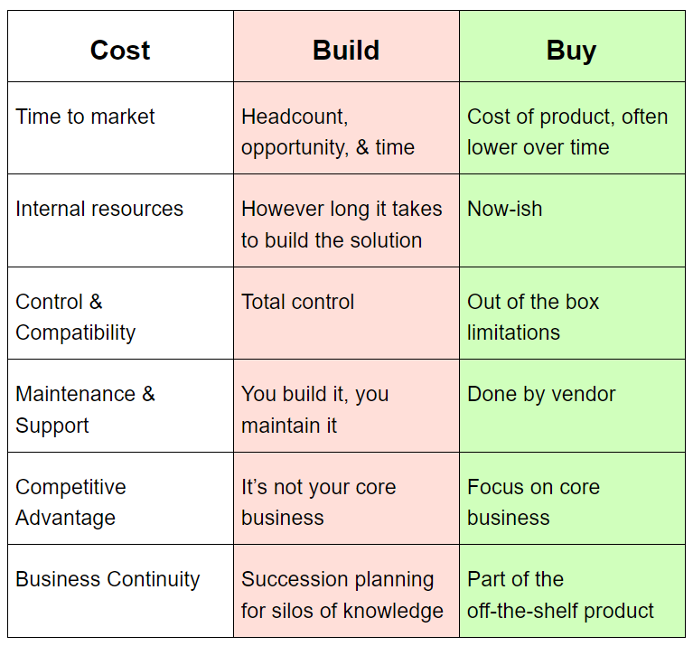
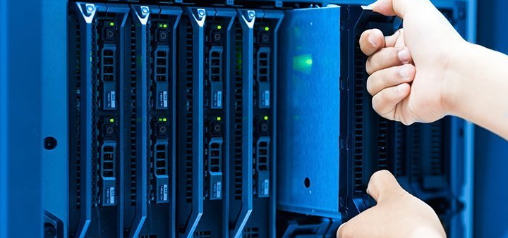

## "Build vs Buy" Bake-off: Which should you choose?

Every monitoring use case is different, and all of these factors should be considered carefully before making a decision.

There are situations where building a solution makes sense. Either because you have the time or your requirements aren't very complex. Or if your applications don't have enough load to justify an off-the-shelf solution.

## Summary

## Introduction

Historically, implementing monitoring systems has meant building bespoke, custom architecture putting together several technologies (data processing, databases, storage systems, analytics dashboard, etc.); costing time, resources, and money.

That's all changing. Now, there are more choices. But, that means more consideration must be given to planning the way forward. For example, when determining how (and if) to implement a custom monitoring environment, engineering, and product teams must ask:

**Is it better to BUILD a monitoring environment from scratch, or BUY a prepackaged solution?**

Which provides the most future-forward flexibility, with the fewest roadblocks? Factors like cost, internal resource capacity, control and compatibility, maintenance and support, and core business competitive advantage should all weigh in when it comes to making this decision.

There is no blanket answer to the question of whether to build or buy. But the details that we explore in this eBook can guide you to the right decision –– specific to your company's needs.

## Why Monitoring Matters

Many developers first feel the need to monitor their applications when they start working on a medium / large project.

The reason is simple. When your software becomes complex or serves precious customers, software bugs become expensive. It's doubly so when your customers find them! As a result, customers may rate you as unreliable and search for alternatives.

Solving critical customer problems can generate significant business opportunities. But, the more critical the problem is, the more you need to be ready for higher customer expectations.

Monitoring is the way for developers to avoid unexpected incidents. And it helps retain customers or contracts as for long as possible. Of course, this means more stable income for your business over time.

Let's look at some common reasons developers are not in the right position to monitor applications properly.

**1) Work overload**

Most monitoring platforms require installing and configuring at the server level or on IT infrastructure. But many developers hate dealing with it and instead want to focus on coding.

Dealing with infrastructure is a concern for many developers for several reasons:

1 - Managing the IT infrastructure is a profession in itself. It requires many vertical skills in server environments and involves complicated technologies (like Kubernetes).

2 - For basic needs, developers tend to rely on external tools to automate server provisioning. These include Cloud Hosting panels, PaaS platforms, etc., to reduce this concern.

But in large organizations or when the company scales up, it may be necessary to have a dedicated team to take care of infrastructure. This extra is mandatory to allow developers to stay focused on application code and implement new features.

**2) Everything configured at the server level tends to be out of the developer's control**

Whether you're using infrastructure automation or have external teams to take care of it, everything configured at the server level is out of the software development lifecycle. And developers tend to lose their autonomy.

Each team in your company has its own monitoring needs (Kubernetes, Cyber Security, Networking & Infrastructure, Privacy & Compliance, Software developers, etc.). So, something that works for one environment may be useless in another.

Forcing the collaboration of different teams on the same tool can create confusion and constant email exchanges to adjust configurations and customizations. And in the end, developers have the worst experience because they have no control over what resides in the infrastructure.

## Build vs Buy Considerations

- Cost
- Time To Market
- Internal Resources
- Customer Experience
- Control & Compatibility
- Maintenance & Support

Let’s take a look at each one.

## Cost

Buying off-the-shelf software comes with a fixed price. But, building and maintaining your monitoring environment can be costlier.

The up-front costs are plain. They include the time to choose the right stack, engineering effort to install and configure all needs-based components, update and support, and operational costs.

**Yet<strong>, there are many hidden costs to rolling your own monitoring solution. They are not quantified: missed opportunity costs, ongoing support costs (performance issues, patches), and productivity costs (pulling teams away from projects) can all create hidden costs of time and productivity.</strong>**

****Before you start throwing money out the window, consider the long-term costs and labor commitments you could be signing up for if you opt to build.****

## Time To Market

As every engineering and product team knows, there is an inverse relationship between team size and time to market.

It takes two people longer to design, build, and paint a house than it takes twenty people to do it. If you've got plenty of leeway in terms of your deployment schedule, an unlimited number of team members, or a tiny house to build, then developing your monitoring solution from scratch could be the way to go.

But if you need to take advantage of streamlined processes in order to build more in less time, then buying an off-the-shelf, code-driven software monitoring solution would be the fastest way to solve application issues before your users stumble onto the problem.

## Internal Resources

Aside from the time and money part of the staffing equation, there are the logistics of building a new internal team (or tasking an existing one) to build the monitoring environment you need. Will you hire full-time staff, or contract it out? It all comes down to your deployment needs and your access to a qualified talent pool.

If your in-house team already has the specialized knowledge and time available to use it, then building might be the way to go. But even if your team has time, do they know how to install and configure a complete monitoring environment? And is that what you want them focusing on instead of other tasks?

**Often, buying an off-the-shelf solution and letting your team focus on your core business is a much better use of time and resources.**

## Business Continuity & Knowledge Transfer

One of the most important considerations in the build vs buy debate is the longevity of the chosen solution. Beyond thinking about the ongoing engineering hours that will be needed for development, security patches, underlying technologies releases etc, there is the question of succession planning.

The question isn’t, “How much time will this take someone to maintain after they build it?”

It’s really about, “**Who** will maintain this after them, and who after them?”

Followed by, “How will each new person learn the intricacies of the system?”

**If the answers to these questions aren’t clear, then you may be in a situation where buying is the best option.**

Think about it this way: most homegrown solutions are created by one or two engineers who become the experts in the systems they’re creating.

This makes a lot of sense for core business logic and apps that are going to constantly evolve with a steady stream of new members onboarded.

However, for ancillary systems that support the core business, these applications become a silo of knowledge. A monitoring solution vendor will be focusing on this problem exclusively, as monitoring is their core business.

In other words, part of the off-the-shelf product you're getting is the succession plan that comes with it. Since no specific person in your organization is building the system, no single person will be responsible for it.

Instead, there will be several key points of contact engaging with the platform in several ways. It starts with Support Engineers, QA, and even Sales Engineers. Each of these functions gains some amount of user-level knowledge on how the system works. And with a clear understanding that the vendor will own the ongoing improvements and extensions of the underlying systems.

## Customer Experience

Enterprises are businesses, but businesses are people. So, your software solution needs to solve technical challenges while also being people-friendly.

At a minimum, you'll need to ensure fast reactions in front of an issue. That means more than just searching for an exception in a log file.

Customers do not spend their time reporting problems and application errors. No one cares about helping us resolve bugs. Instead, they leave our applications or services, and it may be years before we see them again.

Think of your code monitoring system as a virtual assistant for your developers. Being the first to know if your application is in trouble and solving the issue before your users stumble onto the problem will ensure an awesome customer experience. And it will help build customer loyalty.

The internal developer experience should be consistent. And supported with updates, patches, licensing, and entitlements. Managing this takes time and resources.

Unless you're prepared to make significant upfront and ongoing investments, buying a third-party code execution monitoring tool that allows easy installation, ongoing maintenance, and a great developer experience is the safest bet.

## Control & Compatibility

The idea of control is alluring.

Building provides more control over the tooling and its moving parts. You're not ordering from a vendor's menu when you build, and their offering does not limit you. You can control how your solution works with all the parts you want and none of the ones you don’t.

But that control comes with extra responsibilities, and most of them aren't very glamorous. When it comes to compatibility, you want a polished, mature-looking end-user experience. And also support for installation and configuration that works across programming languages and frameworks.

## Maintenance & Support

The process and the open-source technologies you put in place to monitor your application's code are a product in themselves. And every product requires ongoing maintenance and support.

Larger enterprises all have managers and engineers dedicated solely to monitoring their infrastructure.

So, while building provides more control, it also requires ongoing support.

But, commercial vendor solutions can be lower maintenance, making deploying patches and updates easy. If you decide to buy, look for features like code-driven configuration. These are easy to change through application environments and releases.

Developers will be able to maintain their autonomy from external teams and increase their productivity in the short term.

## Competitive Advantage

Let's talk about resource allocation and intelligent spending. If the monitoring experience is a core part of your offering, building a custom environment makes sense.

But suppose your core business is Finance or Transport. In that case, investing the time, money, and engineering resources into building a monitoring environment with support for all the technologies used by your developers (a feature that is not a part of your core business) could be a significant risk.

Here's why: if you want to achieve a growth rate that will make your business profitable and sustainable, you will need to delegate beyond your in-house team. But, don't fall into the “Humpty dumpty” trap.

According to [McKinsey](https://www.mckinsey.com/industries/technology-media-and-telecommunications/our-insights/grow-fast-or-die-slow?params=%7B%22cid%22%3A%224baa1901-f9db-4ac3-9772-148687d5c958%22%2C%22eid%22%3A%223683f59f14d9eafda02deff6ecf6b639%22%2C%22ctid%22%3A%22a5d064cf-38d9-4117-9d5a-42c392751416%22%7D&celero_id=4baa1901-f9db-4ac3-9772-148687d5c958):

**“Once growth is broken, it is impossible to put back together again.”**

Their data revealed that when software companies paused growth, even when it was only temporary, they created less than a quarter of the value of companies that maintained their growth without pausing.

With this in mind, buying a commercial solution to monitor your application's code automatically could be a better choice. Letting your development team focus on creating core capabilities at higher velocity is a better return on engineering dollars.

And it's a more thoughtful way to solidify long-term success.

If you have the engineering overhead to spare, have at it. Build the exact solution you want and need, but make sure that there aren't any economic consequences.

## Let's Talk

But if you're under time-to-market pressure, have limited resources, and need to focus your team on your product, then there is a lot to gain from working with a vendor.

If this sounds like your situation, we built [Inspector](/) for you. Learn more about our modern Code Execution Monitoring solution that gives you the tools needed to find bugs and bottlenecks in your software code automatically, before your customers are aware of them.
