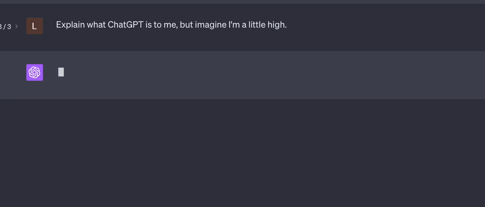
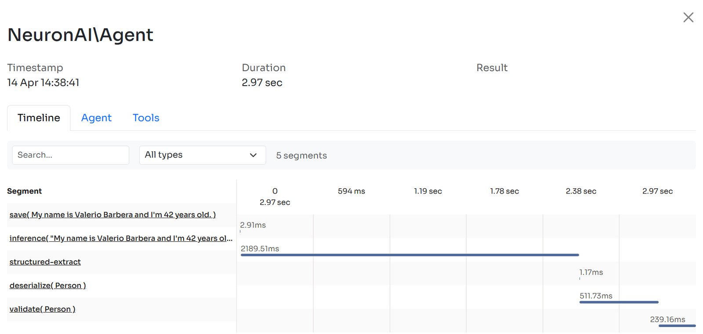

Finding a viable LangChain alternative for PHP has been a journey born of necessity and frustration. As a PHP developer for over fifteen years, I've witnessed our community adapt to countless technological shifts — from the LAMP stack to the rise of frameworks like Laravel and Symfony, from monolithic applications to microservices architecture. Yet nothing has felt quite as transformative — or as potentially exclusionary — as AI Agents development.

When I first began exploring the possibilities of integrating large language models into my applications, the excitement quickly disappeared. Cutting-edge tools were being built for Python, JavaScript, and Java, while PHP developers were left wondering if we'd ever catch up. LangChain emerged as the dominant framework for building AI agents, offering a comprehensive toolkit for creating sophisticated applications with LLMs. But it wasn't built for us (PHPers).

The options before me seemed totally unappealing. I could abandon PHP — the language that had been my professional foundation for years — and invest countless hours learning Python's ecosystem just to access these new capabilities. Or I could resign myself to basic API calls without the rich agent capabilities that were revolutionizing application development elsewhere. Neither choice felt acceptable for the millions of websites and applications built on PHP that deserve to evolve with this technology.

My frustration grew with each new AI project announcement, each new tutorial aimed at other language communities. It wasn't just about feeling left out — it was about watching a technological gap widen in real-time. While developers in other languages were creating sophisticated AI agents that could reason, use tools, and maintain memory, PHP developers were cobbling together basic integrations that barely scratched the surface of what was possible.

I experimented with various approaches — wrapping Python scripts in PHP, creating microservices in other languages to handle AI functionality, even attempting to port portions of LangChain's functionality directly. None of these solutions felt native or sustainable. They were compromises that introduced unnecessary complexity and technical debt.

What I needed — what our entire community needed — was a framework built from the ground up for PHP developers. Something that embraced PHP's strengths rather than treating the language as a limitation. Something that would give us the same capabilities as LangChain and other full featured frameworks, but with API patterns and paradigms that felt natural to PHP developers.

This realization was the genesis of Neuron AI. What began as a personal project to solve my own development challenges gradually evolved into something much more ambitious: creating the first professional-grade framework for building AI agents in PHP.

The journey wasn't easy. LLM technology is complex, and creating abstractions that are both powerful and intuitive requires countless iterations. There were moments of doubt when I wondered if the effort was worth it, if PHP developers would even care about these capabilities.

But with each component that fell into place — agents, memory systems, tool integrations, Structured Output — I became increasingly convinced that this work wasn't just necessary but transformative. PHP powers over 75% of websites with known server-side languages. The idea that this vast ecosystem would struggle in AI development seemed not just unfortunate but ultimately untenable.

Today, Neuron AI stands as a true LangChain alternative for PHP — not a pale imitation or a simplified wrapper, but a full-featured framework designed specifically for the PHP ecosystem. It brings all the core capabilities that have made LangChain so powerful — structured agent development, memory management, tool use, structured output, MCP connections — into a package that feels natural and intuitive for PHP developers.

[**https://docs.neuron-ai.dev**](https://docs.neuron-ai.dev)

The framework represents an invitation to PHP developers everywhere: you don't have to choose between the language you know and the AI capabilities you want. You can have both.

In the following sections, I'll walk through the core components of Neuron AI, demonstrate how it compares to LangChain, and show you how to build your first AI agent using this framework. Whether you're a seasoned PHP developer curious about AI or someone actively searching for a LangChain alternative in the PHP ecosystem, my hope is that you'll finish this article not just with new technical knowledge, but with a renewed sense of possibility about what you can build with the language you already know.

For those new to AI agent development in PHP, I’ve documented the foundational patterns and progressive implementation approaches in an educational resource that walks through the basic development lifecycle — [Start With AI Agents In PHP](https://www.amazon.it/dp/B0F1YX8KJB)

## Neuron AI vs. LangChain: A PHP Developers Advantage

When I first set out to create Neuron, what emerged wasn't just a PHP port of LangChain concepts, but a framework that leverages PHP's inherent strengths to deliver capabilities that feel natural and powerful in our ecosystem.

Neuron AI stands shoulder-to-shoulder with LangChain in core functionality while bringing distinct advantages through its PHP-native implementation. Like LangChain, it provides the essential building blocks for sophisticated AI agents: chat history management, memory systems, structured output handling, function calling, vector stores, and embeddings. But the way these components are implemented makes all the difference for PHP developers.

## Chat History & Memory

```php
class MyAgent extends Agent
{
    protected function provider(): AIProviderInterface
    {
        ...
    }
    
    protected function chatHistory()
    {
        return new InMemoryChatHistory(
            contextWindow: 50000
        );
    }
}
```

The framework's Chat History and Memory components showcase this philosophy perfectly. While the concepts mirror LangChain's approach, Neuron's implementation automatically handles context window management — a critical consideration when working with token-limited models. The system intelligently prunes conversation history when approaching token limits, ensuring your agents remain coherent across long interactions without manual intervention.

[**https://docs.neuron-ai.dev/chat-history-and-memory**](https://docs.neuron-ai.dev/chat-history-and-memory)

## Streaming



Streaming support represents another good point. Neuron implements streaming using generators in a way that feels natural within PHP applications.

[**https://docs.neuron-ai.dev/streaming**](https://docs.neuron-ai.dev/streaming)

## Structured Output

```php
class Person 
{
    #[SchemaProperty(description: 'The user name.', required: true)]
    public string $name;
    
    #[SchemaProperty(description: 'What the user love to eat.', required: false)]
    public string $preference;
}

// Talk to the agent requiring the structured output
$person = MyAgent::make()->structured(
    new UserMessage("I'm John and I like pizza!"),
    Person::class
);

echo $person->name ' like '.$person->preference;
// John like pizza
```

The ability to have LLMs return data in specific formats — is crucial for data extraction, or to integrate your AI Agent as part of a workflow that requires integration with downstream systems. Neuron AI provides robust parsers that can extract structured data from model outputs, transforming free-text responses into typed PHP objects. This capability becomes even more powerful when combined with PHP 8's type system, creating a bridge between the probabilistic world of LLMs and the type-safe world of modern PHP development.

[**https://docs.neuron-ai.dev/advanced/structured-output**](https://docs.neuron-ai.dev/advanced/structured-output)

## Tool & Function Calls

```php
class MyAgent extends Agent
{
    ...
    
    protected function tools(): array
    {
        return [
            Tool::make(
                'get_transcription',
                'Retrieve the transcription of a youtube video.',
            )->addProperty(
                new ToolProperty(
                    name: 'video_url',
                    type: 'string',
                    description: 'The URL of the YouTube video.',
                    required: true
                )
            )->setCallable(function (string $video_url) {
                // ... do something
            })
        ];
    }
}
```

Tool and function calling capabilities in Neuron AI allow your agents to interact with external systems and APIs. Whether retrieving data from databases, calling web services, or executing custom business logic, these features let you build agents that aren't limited to text generation but can take concrete actions in response to user inputs. The implementation elegantly leverages PHP's reflection capabilities, making it simple to expose your existing PHP methods as tools for your AI agents.

[**https://docs.neuron-ai.dev/tools-and-function-calls**](https://docs.neuron-ai.dev/tools-and-function-calls)

## Retrieval Augmented Generation (RAG)

```php
class MyChatBot extends RAG
{
    protected function provider(): AIProviderInterface
    {
        return new Anthropic(
            key: 'ANTHROPIC_API_KEY',
            model: 'ANTHROPIC_MODEL',
        );
    }
    
    protected function embeddings(): EmbeddingsProviderInterface
    {
        return new VoyageEmbeddingProvider(
            key: 'VOYAGE_API_KEY',
            model: 'VOYAGE_MODEL'
        );
    }
    
    protected function vectorStore(): VectorStoreInterface
    {
        return new PineconeVectoreStore(
            key: 'PINECONE_API_KEY',
            indexUrl: 'PINECONE_INDEX_URL'
        );
    }
}
```

For knowledge retrieval and semantic search, Neuron AI includes comprehensive support for vector stores and embeddings. These components enable agents to access relevant information from large document collections, effectively expanding their knowledge beyond what was included in their training data. The framework offers adapters for popular vector databases and embedding models, making it straightforward to implement retrieval-augmented generation (RAG) patterns in your PHP applications.

[**https://docs.neuron-ai.dev/rag**](https://docs.neuron-ai.dev/rag)

## Switch Between multiple AI providers with no refactoring

Perhaps most importantly for many production environments, Neuron AI provides compatibility with a wide range of LLM providers. From commercial APIs like OpenAI and Anthropic to open-source options running locally through Ollama, the framework gives you flexibility in choosing the right models for your specific needs and constraints. This provider-agnostic approach prevents vendor lock-in and allows you to adapt as the LLM landscape evolves.

[**https://docs.neuron-ai.dev/components/ai-provider**](https://docs.neuron-ai.dev/components/ai-provider)

## Observability: Neuron AI's Native Integration with Inspector.dev

One of the most significant challenges I encountered when building AI applications was observability—understanding what's happening inside my AI agents during execution. Traditional debugging approaches often fall short with LLM-powered systems, where the flow of information and decision-making process can be complex and opaque. This is where Neuron AI's native integration with Inspector.dev has been transformative for my development workflow. Inspector.dev, a real-time monitoring platform built specifically for PHP applications, plugs seamlessly into the Neuron framework to provide full visibility into AI agent operations. Every prompt sent to an LLM, every reasoning step, and every tool call is automatically captured and visualized in Inspector's intuitive timeline view.



The ability to see inside the "black box" of LLM interactions not only accelerates the development process but gives you the confidence to deploy sophisticated AI agents in mission-critical applications.

[**https://docs.neuron-ai.dev/advanced/observability**](https://docs.neuron-ai.dev/advanced/observability)

## The Object-Oriented Advantage

Interfaces and abstract classes provide clear contracts between components, ensuring that custom implementations will work correctly with the rest of the framework. This approach enables you to extend Neuron AI for specialized needs while maintaining compatibility with the ecosystem. PHP's strong typing capabilities, particularly in versions 8 and above, reinforce these contracts and help catch integration issues early in the development process.

The framework's careful use of namespaces organizes functionality in a way that prevents conflicts and makes the API intuitive to navigate. Rather than the flat module structure common in Python libraries, Neuron AI uses PHP's namespace system to create a hierarchical organization that scales well as the framework expands.

Error handling in Neuron AI takes advantage of PHP's exception system, providing clear, typed exceptions that help you quickly identify and address issues in your agent implementations.

## Implement Your First Agent: AI Agent summarizing YouTube video

Using PHP and the [Neuron AI framework](https://neuron-ai.dev) as the foundation, I built an AI agent in PHP that automatically summarizes YouTube videos, extracting the essential information and takeaways.

The agent processes video transcripts, identifies key points, and generates concise summaries that retain the core message of the original video.

Let’s explore three real-world contexts where YouTube video summarization can be incredibly helpful.

**Educational Context**

Students, teachers, and researchers often need to extract key information from lengthy educational content. The YouTube Agent could help:

- Students can quickly determine if a 2-hour lecture contains the specific topic they’re researching.
- Teachers can preview educational content before assigning it to students, ensuring relevance and quality.
- Researchers can efficiently process multiple conference presentations without watching them in full.

**Content Creation and Media Monitoring**

Creators and media professionals can use this Agent to:

- Journalists can quickly analyze trending video discussions without full viewing.
- Content creators can automate description generation for their contents.
- Social media managers can automate posts generation from YouTube videos ensuring more relevant content creation.

Just to give you some inspiration.

Here is the full article on how to create this agent:

[PHP AI Agent Summarizing YouTube Videos](/php-ai-agent-summarizing-youtube-videos/)

Here is the GitHub repository:

[**https://github.com/inspector-apm/youtube-ai-agent**](https://github.com/inspector-apm/youtube-ai-agent)
