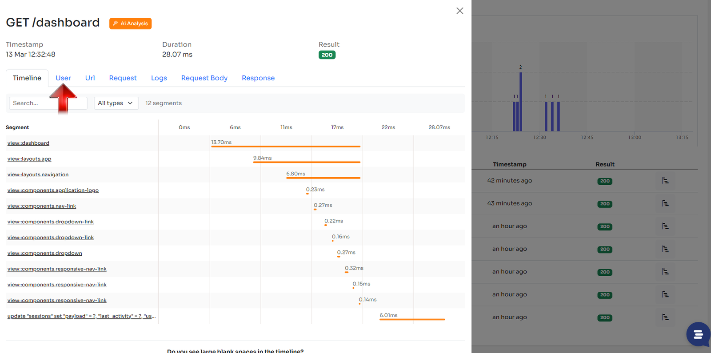
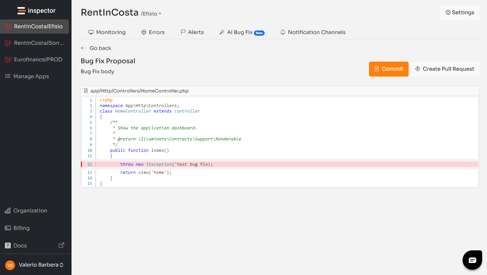

In this article I’ll show you how to upgrade your Inspector SDK configuration to work with Laravel 11, the latest version of the framework released just yesterday.

The Inspector SDK was updated to meet the requirements of the Symfony terminable interface and it’s now compatible with Laravel 11. The official documentation was updated as well: [https://docs.inspector.dev](https://docs.inspector.dev)

Laravel 11 brings a number of changes to the previous version. One of the most significant is the absence of the **App\\Http\\Kernel** class. The properties of this component have been moved into the new version of the **bootstrap/app.php** file that now is a bit more interactive and it’s the new place where you configure the middleware for your application.

For detailed information about the release of Laravel Reverb, the changes to model cast, and the new directory structure you can read the official announcement on [Laravel News](https://laravel-news.com/laravel-11).

Basically the middleware configuration is the only change you had to do to make Inspector work upgrading your Laravel installation to v11. Everything else continues to work as usual.

## Append middleware to Laravel 11 middleware groups

Until yesterday the center of middleware configuration was the **App\\Http\\Kernel** class.

```php
/**
 * The application's route middleware groups.
 *
 * @var  array
 */
protected $middlewareGroups = [
    'web' => [
        ...,
        \Inspector\Laravel\Middleware\WebRequestMonitoring::class,
    ],

    'api' => [
        ...,
        \Inspector\Laravel\Middleware\WebRequestMonitoring::class,
    ]
]
```

Now you should instruct Laravel to append the Inspector middleware to the web and api middleware groups in the **bootstrap/app.php** file:

```php
use \Inspector\Laravel\Middleware\WebRequestMonitoring;

return Application::configure(basePath: dirname(__DIR__))
    ->withRouting(
        // routes
    )
    ->withMiddleware(function (Middleware $middleware) {
        // Append the middleware
        $middleware->appendToGroup('web', WebRequestMonitoring::class)
            ->appendToGroup('api', WebRequestMonitoring::class);
    })
    ->withExceptions(function (Exceptions $exceptions) {
        //
    })->create();
```

This guarantees you to also catch the authenticated user that will automatically be attached to the current transaction.



## Assigning middleware to routes

In alternative you can assign the middleware to specific routes or groups. This type of usage is the same for current and previous versions of the framework.

```php
/*
 * Attach the "inspector" middleware in your routes
 */
Route::middleware(\Inspector\Laravel\Middleware\WebRequestMonitoring::class)
    ->group(function () {
        // Monitored routes here
    });
```

## Create a custom middleware

If you want to customize the behavior of the monitoring middleware you can create a custom middleware class that extend the original Inspector middleware:

```bash
php artisan make:middleware
```

In the new middleware class extend the Inspector middleware so you can override its methods and implement your customizations. This is the recommended way to implement custom logic to ignore requests. Read more in the [documentation](https://docs.inspector.dev/guides/laravel/http-requests-monitoring#ignore-http-requests).

Once you have the custom middleware you have to register it instead of the original Inspector middleware.

```php
use App\Http\Middleware\InspectorFilterMonitoringMiddleware;

return Application::configure(basePath: dirname(__DIR__))
    ->withRouting(
        // routes
    )
    ->withMiddleware(function (Middleware $middleware) {
        // Append the custom middleware
        $middleware->appendToGroup('web', InspectorFilterMonitoringMiddleware::class)
            ->appendToGroup('api', InspectorFilterMonitoringMiddleware::class);
    })
    ->withExceptions(function (Exceptions $exceptions) {
        //
    })->create();
```

## Autofix your Laravel application for free

Inspector is a Code Execution Monitoring tool specifically designed for software developers. You don’t need to install anything on the infrastructure, just install the [**Laravel package**](https://github.com/inspector-apm/inspector-laravel) and you are ready to go.

If you are looking for effective automation, and the ability to automatically receive code change proposals to fix application errors try Inspector for free. [**Register your account**](https://app.inspector.dev/register).

Or learn more on the website: [**https://inspector.dev**](/)


