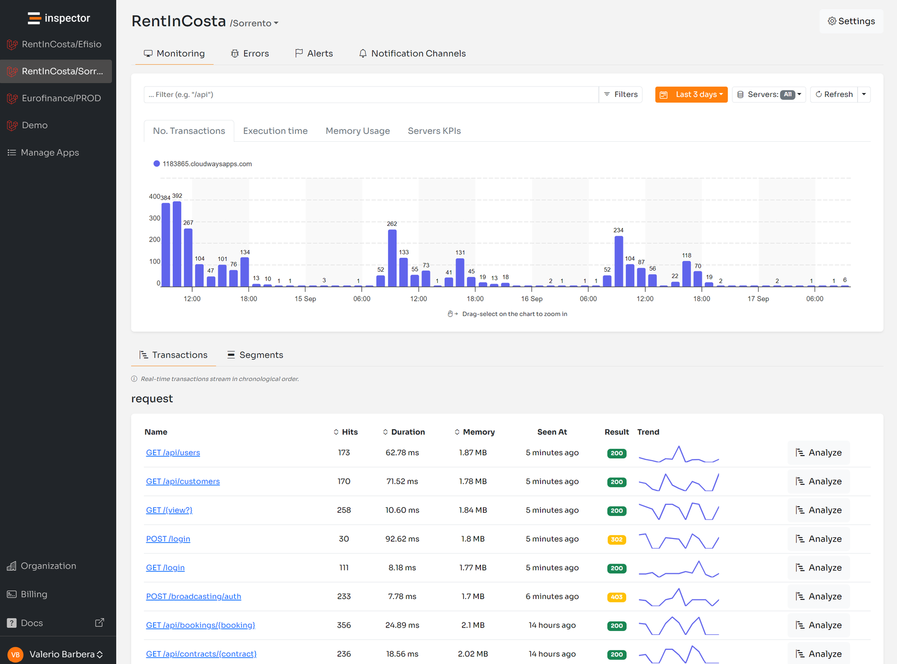

Recently the support for wildcard was introduced in the [**Symfony**](/symfony/) library to help developers turn-off monitoring in some parts of their applications using URL path.

```apacheconf
/api/users*
```

It was already supported in the [**Laravel**](/laravel/) package.

I received a lot of feedback from our users to make it possible also for commands. And it’s what this library update is about.

For more technical articles you can follow me on [**Linkedin**](https://www.linkedin.com/in/valeriobarbera/) or [**X**](https://x.com/Barbalerio).

## Laravel/Symfony console command monitoring

Typically the console commands in the Laravel and Symfony frameworks are organized by namespace like:

```bash
make:migration
make:middleware
make:model
```

Before this release you have to manually add all the commands you want to exclude from your monitoring metrics in the inspector configuration file.

```php
'ignore_commands' => [
    'make:migration',
    'make:middleware',
    'make:model',
],
```

## Ignore Console Commands With Wildcard

Now instead of forcing you to list all commands you want to ignore one by one we introduced the support for the wildcard character “**\***” to make this configuration a lot easier and the inspector configuration file shorter.

You can change the configuration above with a single line in the inspector configuration file:

```php
'ignore_commands' => [
    'make*',
],
```

In the same way you did URLs:

```php
'ignore_urls' => [
    'api/users*',
],
```

For more technical articles you can follow me on [**Linkedin**](https://www.linkedin.com/in/valeriobarbera/) or [**X**](https://x.com/Barbalerio).

## Monitor your Symfony application for free

Inspector is a Code Execution Monitoring tool specifically designed for software developers. You don’t need to install anything on the infrastructure, just install the [**Symfony package**](https://github.com/inspector-apm/inspector-symfony) and you are ready to go.

If you are looking for HTTP monitoring, database query insights, and the ability to forward alerts and notifications into your preferred messaging environment try Inspector for free. [**Register your account**](https://app.inspector.dev/register).

Or learn more on the website: [**https://inspector.dev**](/)

[](/)
