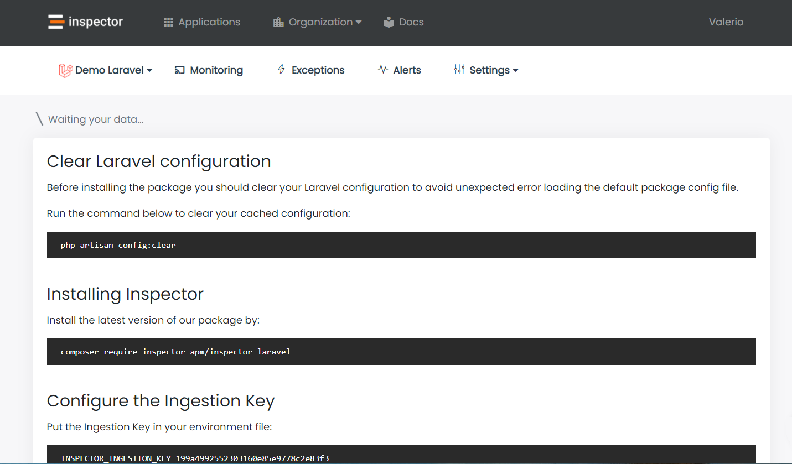
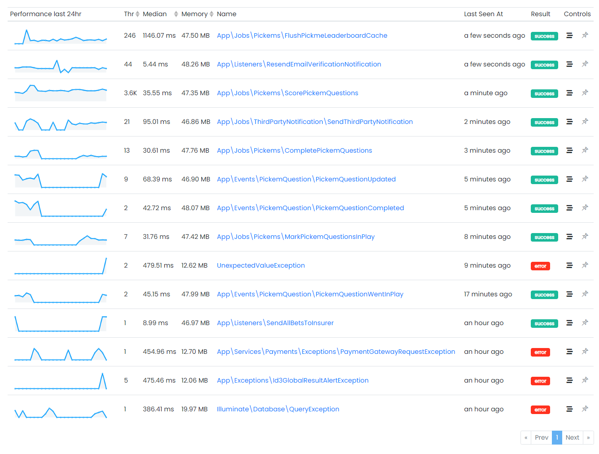
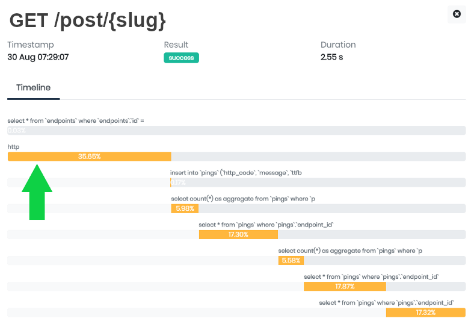
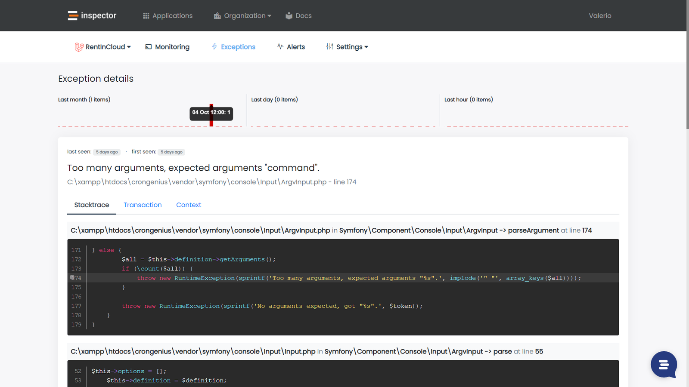

I use Lavavel to build applications of all kinds, like CRM, APIs for mobile apps, etc, and I enjoyed all the powerful components of the framework. Laravel background jobs is the most powerful in my opinion because open the doors for new architectural concepts that not also improve your application reliability and performance, but can be an inspiration to innovate your approach in software products development.

But:

> With great powers comes great responsibilities.
>
> — Uncle Ben

Laravel provides two ways to execute background processes:

- [Laravel queues/jobs system](/what-worked-for-me-using-laravel-queues-from-the-basics-to-horizon/)
- [Laravel cron tasks scheduling](/laravel-cron-scheduling-and-its-secrets/)

Developers have to take care of this part of the application because these scripts are executed in isolation, away from the eyes of the users, but also from yours.

In this article I'll show you how to turn on real-time monitoring in the dark side of your application: "Queued Jobs and Artisan commands".

## Laravel background jobs: How it works

Laravel provides great architecture for queued Jobs and scheduled cron tasks. I use them a lot. They allow us to execute some piece of code asynchronously in the background out of a classic HTTP request cycle.

Often they are a cause of concern for developers because their execution is not related to direct user interaction. **They can go wrong for days, and there would be no way of knowing it. Unless we manually check their results inside logs.**

If something goes wrong during an HTTP request, it will appear in red bubbles or messages that inform the user immediately of the problem. It's pretty easy to discover relevant errors before releasing the software in production by automated tests. And by using the application yourself.

**If a queued Jobs or a scheduled Artisan command fails, it will do it silently, without anyone noticing.**

Inspector is a composer package to add real-time monitoring in Laravel applications, it's very easy to install and use. It takes just two minutes to get started.

Let me show you how it works.

### Installing Inspector

Run the composer command below in your terminal:

```bash
composer require inspector-apm/inspector-laravel
```

### Configure the API key

Get a new API key by signing up for Inspector ([https://app.inspector.dev/register](https://app.inspector.dev/register)) and creating a new application. It only takes a few seconds.

Select and copy the API key:



Put the API key in your environment file:

```bash
INSPECTOR_API_KEY=xxxxxxxxxxxxxxxxxx
```

## Laravel background processes

By default Inspector will monitor all background tasks:

- Queued Jobs
- Scheduled Artisan commands
- Unhandled Exceptions

You can also monitor your application when it executes due to an incoming HTTP request. You can read more about HTTP monitoring in the official documentation: [**https://docs.inspector.dev/platforms/laravel/http-requests-monitoring**](https://docs.inspector.dev/platforms/laravel/http-requests-monitoring)

Instantly you will see transaction streams in your project’s dashboard:



and for each transaction you can monitor what your application is executing in real-time:

## Laravel custom analytics

Thanks to Inspector you can put everything you want in the transaction's timeline. It will helps you to get a real-time feedback about the execution of a code block inside your Job or in an Artisan command.

Suppose to run an external http request in your code that, by default, is not present in the timeline.

```php
namespace App\Jobs;


use GuzzleHttp\Client;
use Illuminate\Contracts\Queue\ShouldQueue;


class CallExternalSerivce implements ShouldQueue
{
    /**
     * @var Client
     */
    protected $guzzleClient;

    /**
     * Create a new job instance.
     */
    public function __construct()
    {
        $this->guzzleClient = new Client();
    }

    /**
     * Execute the job.
     */
    public function handle()
    {
        $this->guzzleClient->get('https://api.example.com');
    }
}
```

Using the Inspector helper function you can monitor this external call:

```php
namespace App\Jobs;


use GuzzleHttp\Client;
use Illuminate\Contracts\Queue\ShouldQueue;


class CallExternalSerivce implements ShouldQueue
{
    /**
     * @var Client
     */
    protected $guzzleClient;

    /**
     * Create a new job instance.
     */
    public function __construct()
    {
        $this->guzzleClient = new Client();
    }

    /**
     * Execute the job.
     */
    public function handle()
    {
        inspector()->addSegment(function () {
            $this->guzzleClient->get('https://api.example.com');
        }, 'http');
    }
}
```

This will produce a new segment in the timeline and now you can trace its impact:



### Exceptions Alerting

**By default, every unhandled exception fired in your Laravel app will be reported automatically to be sure you’re alerted for unpredictable errors in real time.**

I wish that every change I make to my code could be perfect. But the reality is that this is not always the case. Some errors appear immediately after an update, while others pop up unpredictably.

Yet, Inspector automates the detection of unknown issues. This is especially the case in background tasks where it's even more tricky to investigate. So, I no longer need to manually check the status of my apps continuously or wait reports directly from users.

Inspector allows you to report an exception manually if you want be aware of it:

```php
try {

    inspector()->addSegment(function () {
        $this->guzzleClient->get('https://api.example.com');
    }, 'http');

} catch (GuzzleException $exception) {
    inspector()->reportException($exception);
}
```

If something goes wrong in your code you will be alerted in real-time in your inbox, and the exception will be monitored for all later occurrences:



When background Jobs or scheduled commands are involved, get an accurate picture of what's going on inside the application can take hours or, based on my experience, even days. So Inspector makes a massive difference in your efficiency and productivity.
