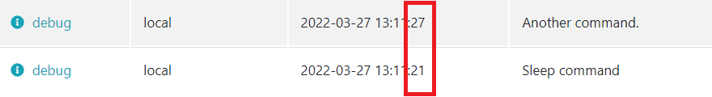
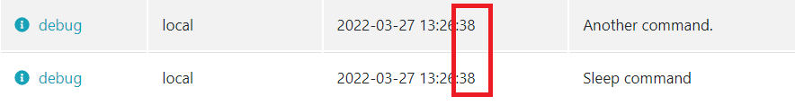

Laravel cron scheduling is one of the most useful features of the framework.The [official documentation](https://laravel.com/docs/master/scheduling) clearly explains what it is for:

> In the past, you may have written a cron configuration entry for each task you needed to schedule on your server. However, this can quickly become a pain because your task schedule is no longer in source control and you must SSH into your server to view your existing cron entries or add additional entries.
>
> Laravel's command scheduler offers a fresh approach to managing scheduled tasks on your server. The scheduler allows you to fluently and expressively define your command schedule within your Laravel application itself. When using the scheduler, only a single cron entry is needed on your server.

Some common use cases for scheduled tasks:

- Daily/Weekly/Monthly summary reports
- Garbage collection
- Import / Export processes
- Notifying customers of upcoming expirations (account, credit cards, etc)

I myself have worked a lot with this component of the framework because there are some parts of the Inspector backend system that depend on it.

Experimenting with the first tasks can give you a lot of happiness, but when the number of tasks increase, or their internal effort becomes heavy there are some non-intuitive behaviors you need to know to avoid big headaches later and to be ready for a sustainable application growth.

## How Laravel scheduling works

Laravel tasks scheduling is designed like a proxy for your cron scheduling list. You only need one line on the cron file in your server:

```bash
* * * * * cd /path-to-your-project && php artisan schedule:run >> /dev/null 2>&1
```

It instructs the cron scheduler to run this artisan command every minute.

Without going too deep, analyzing the implementation of the **\\Illuminate\\Console\\Scheduling\\ScheduleRunCommand** class you can see that it iterates events defined in the **App\\Console\\Kernel** class that are ready to be executed in a foreach cycle, and runs them with runEvent method.

```php
foreach ($this->schedule->dueEvents($this->laravel) as $event) {
	
	//...
	
	$this->runEvent($event);
	
	//...
}
```

It is in charge of executing all the commands defined in the App\\Console\\Kernel class based on the frequency you have configured for each of them.

## How to schedule a task

Immagine you need to check your blog posts every ten minutes to send an alert if they are unreachable. You can schedule this command as shown below:

```php
namespace App\Console;

use App\Console\Commands\PostsCehckCommand;
use Illuminate\Console\Scheduling\Schedule;
use Illuminate\Foundation\Console\Kernel as ConsoleKernel;

class Kernel extends ConsoleKernel
{
    /**
     * Define the application's command schedule.
     *
     * @param  \Illuminate\Console\Scheduling\Schedule  $schedule
     * @return void
     */
    protected function schedule(Schedule $schedule)
    {
		
        $schedule->command(PostsCheckCommand::class)->everyTenMinutes();
		
    }
}
```

Laravel scheduler provides a fluent and expressive APIs to help you define the way a command must be run.

You need to add a new line in the scheduler to add new cron jobs.

## Parallel execution

**ScheduleRunCommand** execute tasks sequentially based on the order they are listed in the schedule method.

The command uses a foreach cycle to iterate events, so if you have long-running tasks, or the list of tasks is lengthy, this may cause subsequent tasks to start much later than anticipated.

To simulate this scenario I created two commands:

- SleepCommand (that contains a 5 seconds sleep)
- Another command (that simply write a new log line)

Then add the appropriate line to the scheduler:

```php
/**
 * Define the application's command schedule.
 *
 * @param  \Illuminate\Console\Scheduling\Schedule  $schedule
 * @return void
 */
protected function schedule(Schedule $schedule)
{
	$schedule->command(SleepCommand::class)->everyMinute();
	$schedule->command(AnotherCommand::class)->everyMinute();
}
```

Type the command below in your terminal to run the test:

```bash
php artisan schedule:run
```

Logs will report the two lines with a 5 seconds interval:



To prevent tasks from stepping on each other’s toes you would like to run tasks in the background so that they may all run simultaneously, you may use the runInBackground method:

```php
/**
 * Define the application's command schedule.
 *
 * @param  \Illuminate\Console\Scheduling\Schedule  $schedule
 * @return void
 */
protected function schedule(Schedule $schedule)
{
	$schedule->command(SleepCommand::class)->everyMinute()->runInBackground();
	$schedule->command(AnotherCommand::class)->everyMinute();
}
```

Logs confirm that the sleep hasn’t any effect on the time the second command runs.



I personally use the runInBackground option in every task by default.

## Don’t worry about exceptions

You may worry that an exception in one command will stop the entire cycle, since the commands are executed in sequential order.

It is not so fortunately.

The **SchduleRunCommand** simply reports exceptions via the Laravel exception handler without breaking the cycle. So the next commands in the list can be executed as expected.

```php
/**
 * Run the given event.
 *
 * @param  \Illuminate\Console\Scheduling\Event  $event
 * @return void
 */
protected function runEvent($event)
{
    $this->dispatcher->dispatch(new ScheduledTaskStarting($event));
	
	try {
		$event->run($this->laravel);

		$this->dispatcher->dispatch(new ScheduledTaskFinished($event);

	} catch (Throwable $e) {
		$this->dispatcher->dispatch(new ScheduledTaskFailed($event, $e));

		$this->handler->report($e);
	}
}
```

## Visibility

Scheduled tasks are like a hidden part of your application, because they run away from the users' eyes.

Their execution is not related to the user interaction like the code you write in the controllers.

Their presence pushes you to continuously check the logs (even on Saturday and Sunday) to be sure that no errors appear.

If something goes wrong during an HTTP request it will causes red bubbles or messages that inform the user immediately of the problem. It’s quite easy to discover relevant errors before releasing the software in production using the application yourself.

If a scheduled command fails he will do it silently, without anyone noticing.

Inspector is designed to remove these concerns from your daily effort. Monitoring 24/7 what happens inside your artisan commands with a unique level of visibility.
