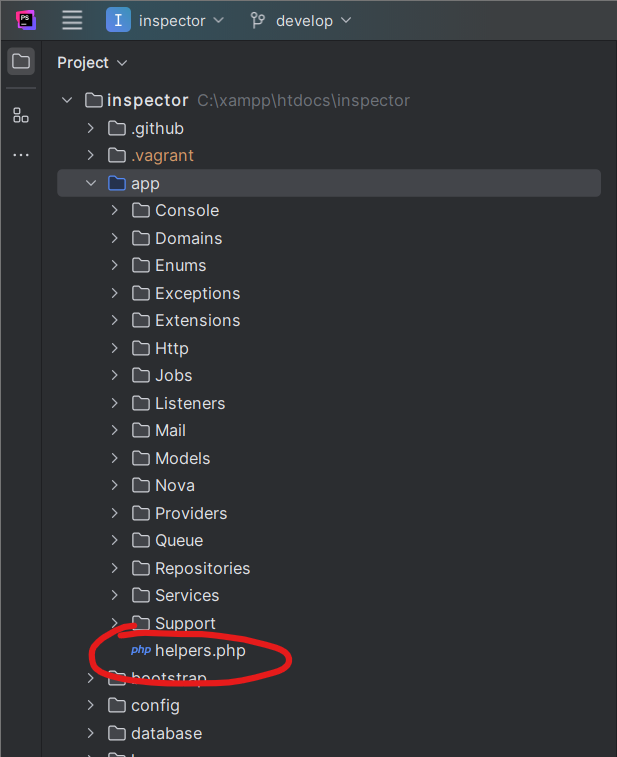

Helper functions are quite popular among Laravel developers. They provide access to some clever algorithms ready to be used in your code using a single statement.

Probably the most known helper function is “url()” that allows you to generate internal application URLs.

Another great helper is the “retry()” function for example: [https://laravel.com/docs/11.x/helpers#method-retry](https://laravel.com/docs/11.x/helpers#method-retry)

Easy way to retry a statement a certain number of times if it fires an exception. It’s usually used on external API calls, and in fact it was recently integrated as a method in the Laravel HTTP client.

```php
$response = Http::retry(3, 100)->post(/* ... */);
```

More about HTTP client on the dedicated article: [https://inspector.dev/laravel-http-client-overview-and-monitoring/](/laravel-http-client-overview-and-monitoring/)

## Laravel helper functions use case

Sometimes we would like to automate tasks related to our business logic and encapsulating it into an helper function could be very convenient. I wrote about the implementation of **[array_map for associative arrays](/php-array_map-for-associative-array-fast-tips/)** that is a perfect fit for this use case.

You can refer to the article to know the purpose of this function, in this context I want to make it a custom helper function to be used inside your Laravel application.

## How to register new Laravel helper functions

First create a new file **helper.php** in the **app/** directory of your Laravel project.



Paste the code below to declare the **array_map_assoc** function into the file:

```php
if (!function_exists('array_map_assoc')) {
    /**
     * Apply a mapping callback receiving key and value as arguments.
     * The standard array_map doesn't pass the key to the callback. But in the case of associative arrays,
     * it could be really helpful.
     *
     * array_map_assoc(function ($key, $value) {
     *  ...
     * }, $items)
     *
     * @param callable $callback
     * @param array $array
     * @return array
     */
    function array_map_assoc(callable $callback, array $array): array
    {
        // map original array keys, and call $callable with $key and $value.
        return array_map(function($key) use ($callback, $array){
            return $callback($key, $array[$key]);
        }, array_keys($array));
    }
}
```

As you can see the function declaration is wrapped by the if to avoid registering functions with the same name.

## Include the helper file via Composer's autoload

Laravel doesn't automatically load custom helper files, so you need to manually instruct composer to include the file during the autoload generation.

In the **composer.json** file of your Laravel project find the “autoload” section, and add the “files” keyword:

```php
"autoload": {
    "psr-4": {
        "App\\": "app/",
        "Database\\Factories\\": "database/factories/",
        "Database\\Seeders\\": "database/seeders/"
    },
    "files": [
        "app/helpers.php"
    ]
},
```

After adding the file, run **composer dump-autoload** in your terminal to refresh Composer’s autoload files.

## Using Your Laravel Helper Function

Once the helper file is loaded, you can use your custom functions anywhere in your Laravel application just like any other PHP function.

```php
$histogram = array_map_assoc(function ($key, $value) {
    return [
        'label' => $key,
        'value' => $value['doc_count']
    ];
}, $data);
```

Hope it’s helpful to stay organized with your codebase.

For more technical articles you can follow me on [**Linkedin**](https://www.linkedin.com/in/valeriobarbera/) or **[X](https://x.com/Barbalerio)**. I post about building my SaaS business.
