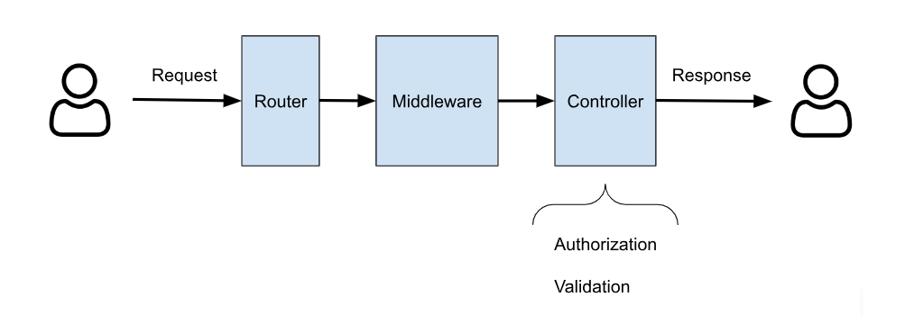

In this article I will talk about Laravel Form Request to send data from your application frontend to the backend. In web applications, data is usually sent via HTML forms: the data entered by the user into the browser is sent to the server and stored in the database eventually.

Laravel makes it extremely simple to connect the fields of an HTML form with a specific database table, following some conventions related to its implementation of the MVC model (Model/View/Controller).

Laravel Form Request allows you to easily implement the validation step on incoming data, and the authorization logic for the request. In addition to the **validate** method that can be used to specify all [available validation rules](https://laravel.com/docs/master/validation#available-validation-rules) (presence of a field, length, regular expressions, etc.)

If you want to learn how to create your custom validation rules in Laravel, you can read this tutorial:

[Laravel custom validation rules](/laravel-validation-and-custom-rules-in-inspector/)

For more technical articles you can follow me on [**Linkedin**](https://www.linkedin.com/in/valeriobarbera/) or **[X](https://x.com/Barbalerio)**.

## Laravel Form Request Lifecycle



The HTTP Request comes into the system through the Router to find the controller associated with the requested endpoint. Before passing the request into the controller the router runs the middleware chain for that specific endpoint, and then the request is injected into the controller’s method.

```php
class BookController extends Controller 
{
    public function store(Request $request)
    {
        return Book::create($request->all());
    }
}
```

Typically authorization and data validation are done in the controller. This is typically the case because the Laravel base controller every custom controller class extends provides a perfect integration with the Laravel authorization system.

And the data validation step can be done calling the validate method on the request instance:

```php
class BookController extends Controller 
{
    public function store(Request $request)
    {
        // Authorize the user action
        $this->authorize('create', Book::class);
	
        // Validate incoming data
        $request->validate([
            'title' => ['required', 'max:200'],
            'author_id' => ['required', 'exists:users,id'],
        ]);
		
        // Return the response
        return Book::create($request->all());
    }
}
```

For simple tasks similar to the example above it’s totally fine to implement them into the controller. But sometimes validation, authorization, or both, can be tricky and very different from one method to another (store, update, or other actions).

You could need to customize error messages or implement intermediate methods that could make the Controller a mess.

In this case you can make your life easier by implementing a dedicated object. A Form Request precisely.

## What is a Laravel Form Request

basically a Laravel Form Request is an extension of the basic http request class *Illuminate/Http/Request* that encapsulates their own validation and authorization logic.

```php
<?php

namespace App\Http\Requests;

use Illuminate\Foundation\Http\FormRequest;

class StoreBookRequest extends FormRequest
{
    /**
     * Determine if the user is authorized to make this request.
     */
    public function authorize(): bool
    {
        return true;
    }

    /**
     * Get the validation rules that apply to the request.
     *
     * @return array<string, \Illuminate\Contracts\Validation\ValidationRule|array<mixed>|string>
     */
    public function rules(): array
    {
        return [
            //
        ];
    }
}
```

You can create a Form Request with the following command:

```bash
php artisan make:request StoreBookRequest
```

## Authorization

In the authorize method you can get the logged in user to verify its ability to perform this action. The standard user model in Laravel already has the **can**() method available to verify permission based on your Policy classes:

```php
class StoreBookRequest extends FormRequest
{
    /**
     * Determine if the user is authorized to make this request.
     */
    public function authorize(): bool
    {
        return $this->user()->can('create', Book::class);
    }

    /**
     * Get the validation rules that apply to the request.
     *
     * @return array<string, \Illuminate\Contracts\Validation\ValidationRule|array<mixed>|string>
     */
    public function rules(): array
    {
        return [
            //
        ];
    }
}
```

Or leverage the [Route-Model binding](https://laravel.com/docs/master/routing#route-model-binding) to get access also to the target object:

```php
// Update book route
Route::put('books/{book}');

// Access the given Book object
public function authorize(): bool
{
    return $this->user()->can('update', $this->book);
}
```

## Validation

More features are available for data validation in the Form Request class. You can basically start encapsulating the standard validation logic:

```php
class StoreBookRequest extends FormRequest
{
    /**
     * Determine if the user is authorized to make this request.
     */
    public function authorize(): bool
    {
        return true;
    }

    /**
     * Get the validation rules that apply to the request.
     *
     * @return array<string, \Illuminate\Contracts\Validation\ValidationRule|array<mixed>|string>
     */
    public function rules(): array
    {
        return [
            'title' => ['required', 'max:200'],
            'author_id' => ['required', 'exists:users,id'],
        ];
    }
}
```

Now that you are in a Form Request class you can perform additional validation steps using hooks, like *after*:

```php
use App\Validation\ValidateUserStatus;

class StoreBookRequest extends FormRequest
{
    /**
     * Determine if the user is authorized to make this request.
     */
    public function authorize(): bool
    {
        return true;
    }

    /**
     * Get the validation rules that apply to the request.
     *
     * @return array<string, \Illuminate\Contracts\Validation\ValidationRule|array<mixed>|string>
     */
    public function rules(): array
    {
        return [
            'title' => ['required', 'max:200'],
            'author_id' => ['required', 'exists:users,id'],
        ];
    }
	
    /**
     * Get the "after" validation callables for the request.
     */
    public function after(): array
    {
        return [
            new ValidateUserStatus,
	
            function (Validator $validator) {
                // Custom validator
            },
        ];
    }
}
```

## Customizing Laravel validation messages

If you need to customize validation error messages you could do it in the traditional way inside the controller passing the custom messages as second argument of the request's validate method:

```php
public function store(Request $request)
{
    $request->validate(
        // Rules
        ['title' => ['required', 'max:200']],

        // Custom validation messages
        ['title.required' => 'Title field is required']
    );
}
```

Clearly if the number of fields under validation increase, adding also custom messages can put more pressure on the code organization inside the Controller. Form request can encapsulate custom message too with ease:

```php
use App\Validation\ValidateUserStatus;

class StoreBookRequest extends FormRequest
{
    /**
     * Determine if the user is authorized to make this request.
     */
    public function authorize(): bool
    {
        return true;
    }

    /**
     * Get the validation rules that apply to the request.
     *
     * @return array<string, \Illuminate\Contracts\Validation\ValidationRule|array<mixed>|string>
     */
    public function rules(): array
    {
        return [
            'title' => ['required', 'max:200'],
            'author_id' => ['required', 'exists:users,id'],
        ];
    }
	
    /**
     * Get the "after" validation callables for the request.
     */
    public function after(): array
    {
        return [
            new ValidateUserStatus,
			
            function (Validator $validator) {
                // Custom validator
            },
        ];
    }

    /**
     * Get the validation rules that apply to the request.
     *
     * @return array<string, \Illuminate\Contracts\Validation\ValidationRule|array<mixed>|string>
     */
    public function messages(): array
    {
        return [
            'title.required' => ['Title field is required.'],
            'author_id.required' => ['You need to associate an author to the book.'],
        ];
    }
}
```

As shown by the snippets above using From Request you can decouple the controller from authorization and validation logic for specific actions, making your life much easier reading and navigating your application code.

For more technical articles you can follow me on [**Linkedin**](https://www.linkedin.com/in/valeriobarbera/) or **[X](https://x.com/Barbalerio)**.
