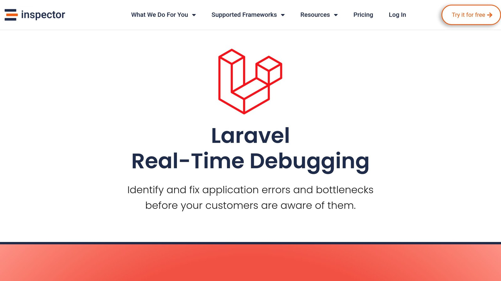
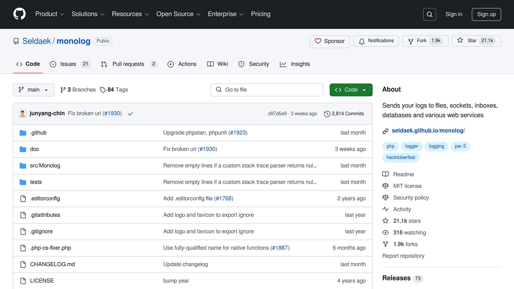

[Laravel](https://laravel.com/)'s logging system helps you track application events and errors efficiently. It uses **channels** to define where logs are sent (e.g., files, [Slack](https://slack.com/help/articles/115004071768-What-is-Slack-)) and **stacks** to combine multiple channels for broader logging coverage. Here's a quick overview:

- **Channels**: Log specific events (e.g., errors, security) to destinations like files or external tools.
- **Stacks**: Combine multiple channels to log messages in multiple places at once.
- **Drivers**: Common options include `single` (one file), `daily` (rotated logs), and `Slack` (team alerts).
- **Log Levels**: Control the severity of logs recorded, from `debug` to `emergency`.

## Quick Comparison

| Feature | Purpose | Example Use Case |
| --- | --- | --- |
| Channels | Define log destinations | Send errors to Slack, save logs locally |
| Stacks | Combine multiple channels | Log to daily files and external tools |
| Daily Files | Rotate logs automatically | Manage storage and keep logs organized |
| External Tools | Integrate monitoring services | Real-time alerts and performance tracking |

This system ensures better log organization, real-time error tracking, and flexibility for production environments. Read on to learn how to configure and use channels, stacks, and custom handlers effectively.

## Understanding Log Channels and Stacks

### What Are Log Channels?

Log channels let you control where and how your application logs messages. Each channel works independently, with its own settings, like the logging driver (e.g., single, daily) and the minimum log level required to record messages.

Here are some of the most commonly used channel drivers in Laravel:

| Driver Type | Purpose | Common Use Case |
| --- | --- | --- |
| Single | Logs to a single file | Ideal for development |
| Daily | Creates a new log file each day | Useful for production monitoring |
| Slack | Sends logs to Slack | Great for team alerts |
| Syslog | Integrates with system logs | Best for server monitoring |

You can configure these channels in the `config/logging.php` file. For instance, a simple setup for a single channel might look like this:

```php
'single' => [
    'driver' => 'single',
    'path' => storage_path('logs/laravel.log'),
    'level' => 'debug',
],
```

The `level` setting defines the minimum severity of messages to log (e.g., 'debug', 'error'). For example, setting it to 'warning' ensures only warnings and more severe messages are logged, helping you focus on critical issues [<sup>\[1\]</sup>](https://betterstack.com/community/guides/logging/how-to-start-logging-with-laravel/).

### What Are Log Stacks?

Log stacks let you combine multiple channels, so a single log message can be recorded in several places at once [<sup>\[3\]</sup>](https://stackify.com/laravel-logging-tutorial/).

Here’s an example of a stack configuration:

```php
'stack' => [
    'driver' => 'stack',
    'channels' => ['daily', 'syslog'],
    'ignore_exceptions' => false,
],
```

This setup logs messages to daily files for detailed records while also sending them to system logs for server-level monitoring.

With stacks, you can customize how and where logs are sent. For example, you might:

- Send critical errors to Slack for immediate attention
- Log all debug data to files for in-depth analysis
- Forward security logs to a dedicated monitoring tool

Each channel in the stack processes messages based on its own configuration [<sup>\[1\]</sup>](https://betterstack.com/community/guides/logging/how-to-start-logging-with-laravel/)[<sup>\[3\]</sup>](https://stackify.com/laravel-logging-tutorial/).

If you're managing a high-traffic production app, a stack might include:

- Daily rotating files for detailed logs
- Integration with external monitoring tools
- Real-time error alerts
- System log connections for server issues

This setup ensures logs are well-organized and provide a complete picture of your application's performance [<sup>\[2\]</sup>](https://www.freecodecamp.org/news/laravel-logging/).

## Configuring Log Channels and Stacks

### Setting Up Log Channels

You can configure log channels in the `config/logging.php` file. Each channel is defined with a specific driver and settings tailored to your needs.

```php
'channels' => [
    'daily' => [
        'driver' => 'daily',
        'path' => storage_path('logs/laravel.log'),
        'level' => 'debug',
        'days' => 14,
    ],
    'slack' => [
        'driver' => 'slack',
        'url' => env('LOG_SLACK_WEBHOOK_URL'),
        'username' => 'Error Bot',
        'emoji' => '💥',
        'level' => 'error',
    ],
]
```

The **log level** determines which messages are recorded. Here's a quick reference:

| Log Level | Description |
| --- | --- |
| Emergency | Critical system failure |
| Critical | Major component failure |
| Error | Runtime issue |
| Warning | Non-critical issues |
| Notice | Significant events |
| Info | General information |
| Debug | Detailed diagnostics |

After defining your channels, you can group them into stacks for more flexibility in logging.

### Creating and Managing Log Stacks

Log stacks allow you to send messages to multiple channels simultaneously. This is especially useful in production environments. Here’s an example of a stack configuration:

```php
'production_stack' => [
    'driver' => 'stack',
    'channels' => ['daily', 'slack', 'syslog'],
    'ignore_exceptions' => false,
],
```

Here’s what the main settings do:

| Setting | Description |
| --- | --- |
| channels | Specifies the channels to use |
| permission | Sets log file permissions |

For better [**monitoring and debugging**](/monitoring-solutions-for-developers-why-monitoring-could-be-a-crap/), tools like Inspector can analyze logs in real time.

With these configurations, you can fine-tune your logging setup to suit your application's needs.

## Writing and Managing Log Messages

### Using the Log Facade

The Log facade makes it easy to send messages to your configured logging channels:

```php
// Log a message using the default channel
Log::info('User registration successful');

// Log an error to a specific channel
Log::channel('slack')->error('Payment processing failed');

// Log critical issues to multiple channels
Log::stack(['daily', 'slack'])->critical('Database connection lost');
```

| Log Level | Purpose | Example Message |
| --- | --- | --- |
| debug | Development details | "Query executed in 1.2s" |
| info | General events | "New user registered" |
| warning | Potential issues | "API rate limit at 90%" |
| error | Runtime failures | "Payment gateway timeout" |
| critical | Serious system issues | "Database connection failed" |
| emergency | Complete outages | "Application is offline" |

While these basic log levels are useful, a more structured approach can make monitoring and debugging faster and more effective.

### Structured Logging for Better Insights

Structured logging makes your log data easier to search and analyze. By using key-value pairs, you can add more context to your logs:

```php
Log::info('Order processed', [
    'order_id' => $order->id,
    'amount' => $order->total,
    'processing_time' => $processingTime
]);
```

This approach allows you to [filter and search](https://docs.inspector.dev/concepts/filtering-syntax) through logs efficiently. Combined with Laravel's channel and stack configurations, structured logging ensures your logs are both detailed and well-organized.

### Including Contextual Information

Adding contextual data to logs provides better clarity and helps during debugging:

```php
Log::error('Transaction failed', [
    'user_id' => auth()->id(),
    'request_data' => $request->all(),
    'error_code' => $exception->getCode(),
    'stack_trace' => $exception->getTraceAsString()
]);
```

> "Using structured logging with contextual information has helped us reduce debugging time by 60% and improve our incident response significantly", reports Inspector's documentation on real-time log monitoring [Inspector].

## Configuring and Viewing Logs in [Laravel](https://laravel.com/)

[Watch the video on YouTube](https://www.youtube.com/watch?v=MGASWCQ6TJ0)

## Advanced Logging Practices and Tools

Laravel's built-in logging channels and stacks work for most scenarios, but sometimes you need more tailored solutions. Custom log handlers let you handle specific logging requirements with greater flexibility.

### Custom Log Handlers

To create a custom log handler, you need to implement the `HandlerInterface` and define how logs should be processed. Here's a simple example:

```php
use Monolog\Handler\HandlerInterface;
use Monolog\LogRecord;

class CustomSlackHandler implements HandlerInterface
{
    public function isHandling(LogRecord $record): bool
    {
        return $record->level->value >= Logger::ERROR;
    }

    public function handle(LogRecord $record): bool
    {
        // Format and send critical errors to Slack
        return false; // Allow the log message to continue processing
    }
}
```

Once your handler is ready, register it in `config/logging.php`:

```php
'channels' => [
    'custom-slack' => [
        'driver' => 'monolog',
        'handler' => CustomSlackHandler::class,
    ],
]
```

This setup enables Laravel to use your custom handler for logging specific events or errors.

### Using [Inspector](/laravel/) for Enhanced Log Monitoring



For high-traffic applications, standard logging might not provide enough clarity or immediate feedback. Inspector adds real-time monitoring and debugging tools to Laravel, offering deeper insights into your application's performance.

Inspector includes:

- **HTTP traffic tracking** to pinpoint slow endpoints
- **Background task visualization** for diagnosing delayed jobs
- **Real-time error alerts** to minimize downtime
- **SQL query analysis** to improve database efficiency

Here's how you can [**integrate Inspector**](https://docs.inspector.dev/guides/laravel/installation) into your Laravel app:

```php
use Inspector\Laravel\Facades\Inspector;

class OrderController extends Controller
{
    public function process(Order $order)
    {
        try {
            // Your order processing logic
        } catch (\Exception $e) {
            Inspector::reportException($e);
            throw $e;
        }
    }
}
```

Inspector also supports data masking, ensuring sensitive information is protected while still allowing robust monitoring and analysis.

## Conclusion and Key Takeaways

### Recap of Channels and Stacks

Laravel's logging system offers a structured way to manage logs using **channels** and **stacks**. Channels direct logs to specific destinations, while stacks allow you to log to multiple channels at the same time. Together, they provide a way to create customized and scalable logging setups.

Here’s what Laravel’s logging system helps you do:

- **Organize logs** by severity and purpose
- **Route critical errors** so they’re addressed immediately
- **Separate logs** for different parts of your application
- **Scale logging** as your application grows

By understanding how channels and stacks work, you can create a logging system that’s tailored to your needs and improves both performance and clarity.

### Final Tips for Optimizing Laravel Logging

Want to make the most of Laravel's logging features? Here are a few practical tips:

**Log Level Management**

- Set specific log levels for each channel to focus on what matters most.
- Use stacks to combine channels for a more complete view of your logs.
- Rotate logs daily to manage storage and keep things organized.

For example, combining daily log files with Slack notifications in a stack lets you handle urgent issues right away while keeping a detailed record.

**Monitor Log Performance**

Tools like Inspector can help you track logging in real-time, making it easier to spot issues without slowing down your application.

Here’s a quick guide to better log management:

| Log Aspect | Best Practice | Impact |
| --- | --- | --- |
| **Channel Selection** | Assign specific channels for different log types | Keeps logs organized and speeds up debugging |
| **Stack Configuration** | Group channels by severity levels | Improves monitoring and quickens issue response |
| **Log Rotation** | Use daily rotation with the right retention policy | Saves storage space and simplifies log upkeep |

## FAQs

### How does logging work in Laravel?

Laravel uses a logging system built on Monolog to track application events and store log messages. These logs can be sent to various destinations, such as files, Slack, or custom handlers. You can manage the logging setup through the `config/logging.php` file, where channels and stacks are defined. Channels determine where logs are sent, while stacks allow you to combine multiple channels for better log organization.

### What is [Monolog](https://github.com/Seldaek/monolog) in Laravel?



Monolog is the library behind Laravel's logging system. It offers a flexible way to handle logs by supporting multiple handlers and formatters. This flexibility allows developers to tailor logging to suit different needs and environments.

### How to maintain log in Laravel?

Maintaining logs in Laravel requires thoughtful configuration and regular management. Here are some tips:

- **Set up log rotation**: Use daily log channels to keep log files from becoming too large.
- **Adjust log levels**: Choose log levels that align with your environment, such as `debug` for development and `error` for production.
- **Manage log storage**: Implement log cleanup policies to free up disk space.

For real-time log monitoring, tools like Inspector can help you track application logs and quickly address issues.

For more detailed logging setups and tools, revisit earlier sections on custom handlers and monitoring options.

## Related Blog Posts

- [5 Ways to Optimize Symfony Application Performance](/5-ways-to-optimize-symfony-application-performance/)
- [Real-Time Error Tracking vs. Log Analysis: A Comparison](/real-time-error-tracking-vs-log-analysis-a-comparison/)
- [Error Pattern Recognition in PHP Applications](/error-pattern-recognition-in-php-applications/)
- [Common JOIN Query Indexing Mistakes to Avoid](/common-join-query-indexing-mistakes-to-avoid/)
