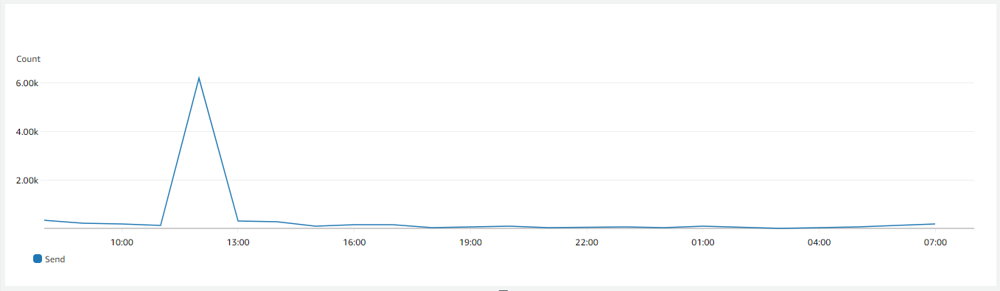
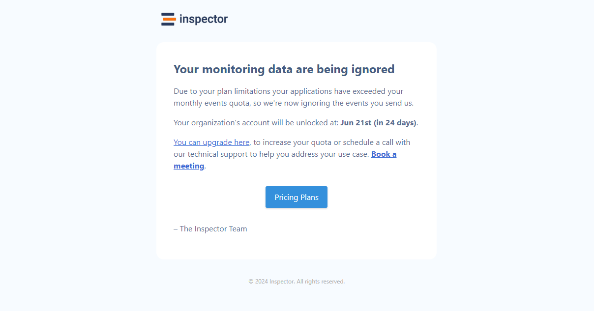

Sending emails in Laravel requires the collaboration between three components: Laravel mailer, Laravel mailable classes, and the Mail facade. Each of the three deals with a different aspect of the lifecycle of sending an email.

Mailers are the drivers to connect email sending services (like AWS SES, Sendgrid, Mailgun, etc.) that the application can use to forward emails to the recipients.

Laravel Mailable are special classes that represent a template of email to send. It contains all the typical information of an email message like the content, the “to” field, attachments, etc.

Finally, the Mail facade is the access point to request the actual sending of a mailable through a mailer driver.

I had the opportunity to explore this system in detail and now at peak Inspector sends more than 6000 emails per hour.



I hope my experience could be helpful for you to better understand this component of the framework since Laravel Mailable is one of the key components of any modern application.

For more technical articles you can follow me on [**Linkedin**](https://www.linkedin.com/in/valeriobarbera/) or **[X](https://x.com/Barbalerio)**.

## Laravel Mailers Configurations

The configuration of mailer drivers in Laravel is in the **config/mail.php** file. It is possible to define several mailers, each characterized by a name and a transport driver.

```php
'mailgun' => [
    'transport' => 'mailgun',
    // 'client' => [
    //     'timeout' => 5,
    // ],
],
```

In this way, Laravel allows you to not only configure the available mail servers, but to use different servers or emailing services to send different types of email messages. This possibility is very important for applications that have to send both transactional emails, and bulk emails. Transactional emails are those that are sent in response to a specific user action and which need to be delivered as soon as possible, such as those with codes to change passwords or confirmation of an order. Bulk emails instead are related to newsletters and other marketing messages, which may travel on slower channels.

You can configure the default mailer and failover mailers, in case any of the others fires exceptions.

```php
'mailers' => [
    'failover' => [
        'transport' => 'failover',
        'mailers' => [
            'postmark',
            'mailgun',
            'sendmail',
        ],
    ],
 
    // ...
],
```

Laravel will try to use them in case the primary email service is down.

## Create A Mailable Class

A mailable is a PHP class that represents an email sent by your application. You can create a new mailable class using the Artisan make command.

```bash
php artisan make:mail OrderConfirmation
```

The configuration of a mailable occurs through three main methods *envelope*, *content* and *attachments*, which respectively deal with defining the headers, the body of the message and any attachments.

```php
use Illuminate\Bus\Queueable;
use Illuminate\Mail\Mailables\Address;
use Illuminate\Mail\Mailables\Attachment;
use Illuminate\Mail\Mailables\Content;
use Illuminate\Mail\Mailables\Envelope;
use Illuminate\Mail\Mailable;
use Illuminate\Queue\SerializesModels;

class OrderConfirmation extends Mailable
{
    use Queueable;
    use SerializesModels;

    public function __construct(public Order $order) {}

    /**
     * Configure the email message
     */
    public function envelope()
    {
        return new Envelope(
            from: new Address('noreply@example.com', 'E-commerce'),
            subject: 'Order Confirmation',
        );
    }

    /**
     * Generate the body
     */
    public function content()
    {
        return new Content(
            markdown: 'emails.orders.confirm',
        );
    }

    /**
     * Configure the email attachements
     */
    public function attachments()
    {
        $code = $this->order->code;

        return [
            Attachment::fromPath("/path/to/order-{$code}.pdf"),
        ];
    }
}
```

The rendering of the email content is, obviously, entrusted to the appropriate Blade template. Inside the Blade view it is possible to retrieve the data to be used for rendering the email using the public properties defined in the mailable class ($order in the example above).

```php
Code: {{ $order->code }}
Address: {{ $order->address }}
...
```

## Sending Laravel Mailable

The actual sending of an email occurs via the Mail facade and its “to” and “send” methods.

```php
class OrderController extends Controller
{
    public function ship(Order $order)
    {
        // do stuff with the order

        // Send the confirmation email
        Mail::to($order->user)->send(new OrderConfirmation($order));
    }
}
```

The email recipient can be passed as an email address string or via a User object or collection of objects that have the name and email properties.

The actual email to be sent is represented by the mailable object, that receives the necessary properties to render the Blade template associated with the content.

The Mail facade offers various chainable methods that allow you to define in more detail the sending configuration, both as regards the recipients (with the *cc* and *bcc* methods) and the times and methods of sending (queue or later).

If you want learn how to create your own facades you can read the article below:

[How to extend Laravel implementing custom Facade – Tutorial](/how-to-extend-laravel-with-driver-based-services/)

## Queue a Laravel Mailable

Since sending an email requires the use of external services (the Mailer drivers) it may be a slow operation with a negative impact on the user experience.

Laravel allows you to queue email messages for background sending. If you are interested in tutorial on how to use the Laravel queue system at scale you can read the article below:

[Laravel Queues and Jobs - from the basics to Horizon](/what-worked-for-me-using-laravel-queues-from-the-basics-to-horizon/)

To defer the sending of an email in the background you have two options: the ShouldQueue interface, or the queue method of the Mail facade.

As shown in a previous snippet, the mailable class is generated with some traits attached by default like *Queueable*.

It allows to programmatically use the queue methods on the Mail facade without touching your implementation:

```php
Mail::to($user)->queue(new OrderConfirmation($order));
```

In alternative you can declare the implementation of the ShouldQueue interface in the Mailable class:

```php
use Illuminate\Contracts\Queue\ShouldQueue;

class OrderConfirmation extends Mailable implements ShouldQueue
{
    ...
}
```

If you use this interface the sending of the email is always queued also if you call the standard *send* method on the Mail facade.

```php
// If the mailable class implements ShouldQueue these methods has the same behaviour.
Mail::to($user)->send(new OrderConfirmation($order));
Mail::to($user)->queue(new OrderConfirmation($order));
```

## Rendering the Laravel Mailable Template in the Browser

When you implement a view related to an email message it’s really helpful to have visual feedback of what the final result the Blade view will render.You can do it using the **routes/mailable.php** file in your Laravel projects.

```php
/*
 * Render email in the browser.
 *
 * Visit https://homestead.test/mailable
 */
Route::get('/', function () {
    return new \App\Domains\Organization\Mails\IngestionLimitMail(
        \App\Domains\Organization\Models\Organization::firstOrFail()
    );
});
```

You can return a valid Mailable instance from the route and Laravel will render the view in the browser. It’s like developing a normal web page.



Finally remember to limit the availability of this route in the *RouteServiceProvider*:

```php
class RouteServiceProvider extends ServiceProvider
{
    /**
     * Define your route model bindings, pattern filters, etc.
     *
     * @return void
     */
    public function boot()
    {
        if (app()->environment('local')) {
            $this->mapMailableRoutes();
        }
    }
	
    /**
     * Render mailables in the browser.
     *
     * @return void
     */
    protected function mapMailableRoutes()
    {
        Route::prefix('mailable')
            ->group(base_path('routes/mailable.php'));
    }
}
```

For more technical articles you can follow me on [**Linkedin**](https://www.linkedin.com/in/valeriobarbera/) or **[X](https://x.com/Barbalerio)**.
