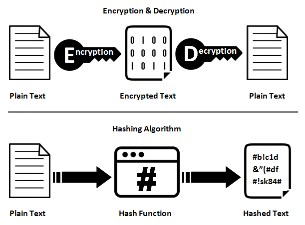

Recently we went deep into the Laravel authentication system for some improvements and to add Multi-Factor authentication. I discovered some interesting details on how Laravel password hashing works.

This article can help you understand how secure your application is from this point of view or if it is necessary to make some changes in your PHP app to increase security.

Spoiler: Despite the title of the article, Laravel doesn’t use a salt to hash your user’s password, PHP does.

You can follow me on [**Linkedin**](https://www.linkedin.com/in/valeriobarbera/) or **[X](https://x.com/Barbalerio)**. I post about building my SaaS product.

## Hashing is different from Encryption

To avoid any misunderstanding, let me clarify that Hashing and Encryption are two very different things. Hashing is one way. Starting from a hash you cannot get back to the original string. Encryption instead is two ways. You can encrypt and decrypt strings.In fact these two features are provided through two different Laravel Facades: [Illuminate\\Support\\Facades\\Hash](https://api.laravel.com/docs/12.x/Illuminate/Support/Facades/Hash.html) (for hashing), [Illuminate\\Support\\Facades\\Crypt](https://api.laravel.com/docs/12.x/Illuminate/Support/Facades/Crypt.html) (for encryption).



In the case of passwords, we want to store the hash so even in case of a data breach there is no way to get back the original password so the user credentials still protected.

## How does Laravel make the password hash?

Obviously with the make method on the Hash service:

```php
\Illuminate\Support\Facades\Hash::make(‘password’);

// Output
$2y$10$PeZ29z5axgJUZiy01tMBMuQuego6WLCDUV34LJbVowg4AKcZFl4mC
```

If you run this instruction multiple times you will get a different result each time:

```bash
$2y$10$PeZ29z5axgJUZiy01tMBMuQuego6WLCDUV34LJbVowg4AKcZFl4mC
$2y$10$cYoHztp3QwzRvdTmzEE5xeXfXjbc6Ix3C9LhBungA/DIHcBLtgAE2
$2y$10$Mz30EAiaHtZZ1J5m6yrVbuHJcZr4r4iV.RYGX8I.pZ9tT2wThGPKW
```

So, How the hell does Laravel compare two passwords to check if they are the same? It’s the check we need to do when a user is logging in.

The counter part of the *make()* method is *check()*:

```php
use Illuminate\Support\Facades\Hash;

// Stored hashed password retrieved from the database
$storedHash = '$2y$10$Oi4mNb5kKDWtVzbs6fLCie.Uy1eG1n0BnDO1QazrF8b1/LJZVWJSO';

// User-provided password during login attempt
$userInputPassword = 'password';

// Verify if the user-provided password matches the stored hash
if (Hash::check($userInputPassword, $storedHash)) {
    echo "Password verified!";
} else {
    echo "Invalid password!";
}
```

## Laravel Password Hashing is a wrapper of PHP password functions

The Laravel password hashing component is an abstraction to use two native PHP functions with a predefined setup: **password_hash**, and **password_verify**. Both are a native wrappers of the low level [**crypt**](https://www.php.net/manual/en/function.crypt.php) function.

This are the internal implementation of the two methods in the Laravel BcryptHasher:

```php
Hash::make($password);

public function make($value, array $options = [])
{
    $hash = password_hash($value, PASSWORD_BCRYPT, [
        'cost' => $this->cost($options),
    ]);

    if ($hash === false) {
        throw new RuntimeException('Bcrypt hashing not supported.');
    }

    return $hash;
}
```

```php
Hash::check($password, $storedHash);

public function check($value, $hashedValue, array $options = [])
{
    if (is_null($hashedValue) || strlen($hashedValue) === 0) {
        return false;
    }

    return password_verify($value, $hashedValue);
}
```

As mentioned in the PHP documentation:

> password_hash() uses a strong hash, generates a strong salt, and applies proper rounds automatically. password_hash() is a simple crypt() wrapper and compatible with existing password hashes. Use of password_hash() is encouraged.
>
> — PHP documentation

In the examples above I reported some results of the **Hash::make()** that are the result of the *password_hash()* function eventually. You can notice the same pattern at the beginning of the string. It’s a composition of the algorithm, cost and salt as part of the returned hash. Therefore, all information that's needed to verify the hash is included in it. This allows the *password_verify()* function to verify the hash without needing separate storage for the salt or algorithm information.

Internally, the *password_verify()* function works by performing the following steps:

**Extracting Parameters**: It extracts the parameters stored within the hash string itself. These parameters include the hashing algorithm, the cost, and the salt.

**Hashing the Input Password**: Using the extracted parameters, *password_verify()* rehashes the user-provided password using the same algorithm, salt, and cost factor that were used to generate the stored hash.

**Comparison**: After rehashing the input password, it compares the resulting hash with the stored hash. If the two hashes match, the input password is correct.

Here is an example of how the *password_verify()* function can be implemented in plain PHP so you can understand the process:

```php
function password_verify($userInputPassword, $storedHash) {
    // Extract parameters from the stored hash
    $params = explode('$', $storedHash);
    $algorithm = $params[1];
    $cost = (int)$params[2];
    $salt = $params[3];

    // Rehash the user input password using the extracted parameters
    $rehashedPassword = crypt($userInputPassword, '$' . $algorithm . '$' . $cost . '$' . $salt);

    // Compare the rehashed password with the stored hash
    if ($rehashedPassword === $storedHash) {
        return true;
    } else {
        return false;
    }
}
```

## Security considerations

*password_hash()* already generates a strong hash with a salt. From the Laravel configuration you can eventually change the cost factor through the bcrypt.rounds parameter in the config/hashing.php file.

```php
/*
|--------------------------------------------------------------------------
| Bcrypt Options
|--------------------------------------------------------------------------
|
| Here you may specify the configuration options that should be used when
| passwords are hashed using the Bcrypt algorithm. This will allow you
| to control the amount of time it takes to hash the given password.
|
*/

'bcrypt' => [
	'rounds' => env('BCRYPT_ROUNDS', 10),
],
```

Increasing the cost factor (number of rounds) in the Bcrypt algorithm generally improves the security of passwords by making password hashing more computationally intensive and resistant to brute-force attacks.

For example the default value of the rounds parameter is 10, I use 12 in my application to strengthen my passwords a bit.
