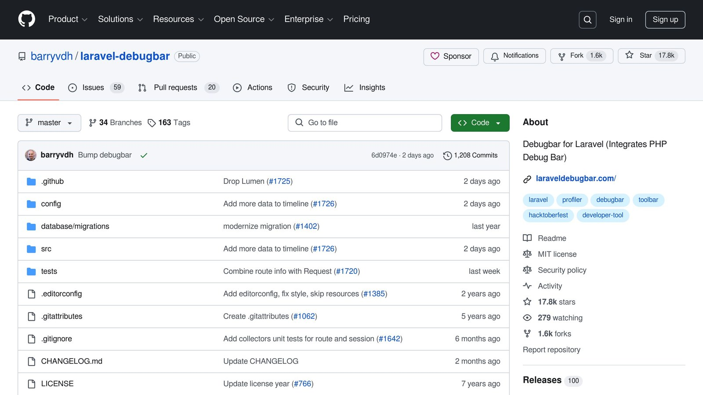
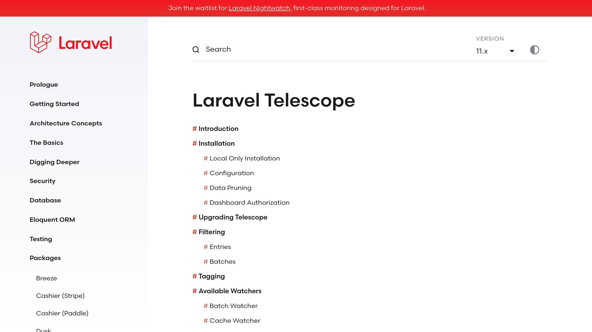
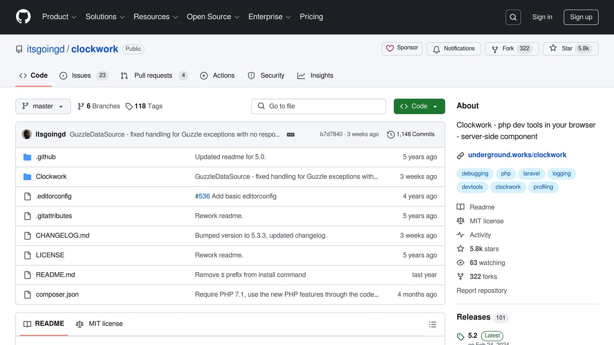
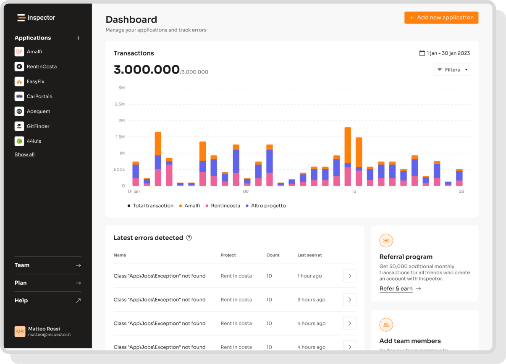

Query profiling helps you identify and fix database bottlenecks, improving response times and reducing server load. Common issues include N+1 queries, poor eager loading, and inefficient query structures. Tools like [**Laravel Debugbar**](https://github.com/barryvdh/laravel-debugbar), **Telescope**, and [**Clockwork**](https://github.com/itsgoingd/clockwork) can simplify this process.

## Key Takeaways:

- **Tools**: Use Debugbar for local debugging, Telescope for staging, and Inspector for production monitoring.
- **Optimization Techniques**: Fix N+1 queries with `with()`, use indexes, and choose between Eloquent ORM or raw SQL depending on complexity.
- **Advanced Debugging**: Leverage custom query logging and performance testing to pinpoint inefficiencies.

## Quick Comparison of Profiling Tools:

| Tool | Best For | Key Features |
| --- | --- | --- |
| [Laravel](https://laravel.com/) Debugbar | Local development | Query times, memory usage, stack traces |
| [Laravel Telescope](https://laravel.com/docs/11.x/telescope) | Staging/debugging | Real-time query tracking, dashboard insights |
| Clockwork | Query analysis | Timeline view, query grouping, performance data |
| [Inspector.dev](/laravel/) | Production monitoring | Automated insights, slow query detection |

## Laravel Query Profiling Tools

Laravel developers have access to several tools designed to monitor and optimize database performance. These tools help identify bottlenecks and debug database interactions effectively.

### [Laravel Debugbar](https://github.com/barryvdh/laravel-debugbar) Setup and Usage



Laravel Debugbar is a handy tool that provides insights into query execution times, memory usage, and stack traces directly in your browser. To install it in your development environment, use:

```bash
composer require barryvdh/laravel-debugbar --dev
```

**Note**: This tool should only be used in a development environment, as enabling it in production can negatively affect application performance.

### [Laravel Telescope](https://laravel.com/docs/11.x/telescope) Features



Laravel Telescope offers a robust set of debugging tools, including detailed query monitoring. You can set it up with the following commands:

```bash
composer require laravel/telescope
php artisan telescope:install
php artisan migrate
```

Telescope provides a real-time dashboard at `/telescope`, where you can monitor database activity. It tracks query execution times, bindings, parameters, migrations, and more.

### [Clockwork](https://github.com/itsgoingd/clockwork) for Query Analysis



Clockwork integrates with a Chrome extension to simplify query analysis. Here's what it offers:

| Feature | Description |
| --- | --- |
| Timeline View | Displays query execution visually |
| Query Grouping | Highlights repeated queries |
| Stack Trace Analysis | Shows where queries originate in the code |
| Performance Metrics | Provides detailed timing data |

### Inspector for Real-time Monitoring

Inspector is ideal for production environments, focusing on detecting slow queries and offering automated insights. Install the official [Laravel package\](/laravel/) to automatically connect your application to the monitoring dashboard.

It helps visualize background tasks, identify slow SQL queries, and provides performance metrics without adding overhead to development tools.

For best results, use these tools strategically: Laravel Debugbar for local development and staging, and Inspector for production monitoring. While these tools can pinpoint issues, resolving performance problems requires thoughtful optimization techniques.



## Laravel Query Optimization Methods

Once you've identified query inefficiencies using tools like Debugbar or Telescope, these techniques can help improve performance.

### Fixing N+1 Queries with Eager Loading

Eager loading is an effective way to handle the N+1 query issue. By using the `with()` method, you can drastically reduce the number of queries your application runs:

```php
// Inefficient approach - generates N+1 queries
$users = User::all();
foreach ($users as $user) {
    $user->posts; // Generates a new query for each user
}

// Optimized approach - single query
$users = User::with('posts')->get();
```

In this example, the query count drops from hundreds to just two: one for fetching users and another for retrieving all related posts.

### Making Better Use of Eloquent ORM

You can further optimize Eloquent queries by applying these techniques:

| Technique | Implementation | Impact |
| --- | --- | --- |
| Select Specific Columns | `User::select(['id', 'name'])` | Reduces the amount of data sent |
| Query Scopes & Record Checks | `User::active()->exists()` | Speeds up queries and improves reusability |
| Database Indexing | `$table->index('email')` | Speeds up searches by structuring data efficiently |

### Choosing Between SQL and Query Builder

For standard operations, Query Builder offers clean syntax and is easier to maintain:

- Basic CRUD operations
- Simple joins and filtering
- Aggregations like sums or counts

However, for more complex operations, raw SQL can provide greater control and efficiency:

```php
DB::select(DB::raw('SELECT * FROM users WHERE created_at > NOW() - INTERVAL 7 DAY'));
```

When working with database-specific features, like MySQL's full-text search, raw SQL might be the better choice for maximizing performance.

These methods tackle common query inefficiencies, but for deeper performance issues, advanced debugging tools can provide additional insights.

## Advanced Laravel Query Debugging

Debugging database performance in Laravel goes beyond tools like Telescope. Custom query logging and performance testing can give you a closer look at how your application interacts with the database.

### Custom Query Logging Setup

Custom query logging helps you capture detailed information about database interactions. With methods like `DB::enableQueryLog()` and `DB::listen()`, you can track SQL statements, bindings, and execution times:

```php
// Enable query logging for specific code blocks
DB::enableQueryLog();

// Log queries with details like execution time and bindings
DB::listen(function ($query) {
    $sql = $query->sql;
    $bindings = $query->bindings;
    $time = $query->time;

    Log::channel('queries')->info('Query Details', [
        'sql' => $sql,
        'bindings' => $bindings,
        'time' => $time,
    ]);
});
```

In production environments, limit logging to critical sections to avoid slowing down your application. You can configure this in `config/logging.php`.

### Query Performance Testing

Keep an eye on key performance metrics such as **execution time** (aim for under 100ms), **memory usage** (less than 10MB per query), and the amount of data being processed. Tailor these benchmarks to fit your application's needs.

Laravel's `explain()` command is a great tool for analyzing how queries are executed:

```php
DB::table('users')
    ->where('active', 1)
    ->explain();
```

To improve performance, focus on these areas:

- **Query Execution Plans**: Understand how your database processes queries and identify bottlenecks.
- **Index Usage**: Confirm that indexes are being used effectively to speed up lookups.
- **Memory Consumption**: Track how much RAM is used during query execution to avoid unnecessary overhead.

These techniques will help you identify and resolve database performance issues efficiently.

## Conclusion

Laravel Query profiling and optimization play a crucial role in keeping Laravel applications running smoothly. By using the right tools and techniques, developers can effectively monitor and debug queries to improve overall performance.

### Key Takeaways

Improving Laravel queries involves leveraging both built-in and third-party tools. Here's a quick look at some essential profiling tools:

| Tool | Purpose |
| --- | --- |
| Laravel Telescope | Debugging during development |
| Inspector.dev | Monitoring in production |
| Laravel Debugbar | Local environment debugging |
| Clockwork | In-depth performance analysis |

Telescope is perfect for debugging during development, while Inspector.dev shines in production environments. Together with Laravel's built-in features, these tools create a well-rounded approach to query optimization.

Some effective strategies to maintain performance include:

- Using tools like Inspector.dev to catch slow queries early
- Writing efficient ORM patterns
- Selecting query methods that match the complexity of your needs
- Setting up focused logging for critical parts of your application

## FAQs

### How to solve N+1 problem in Laravel?

The N+1 problem occurs when your application executes one query to retrieve a set of records and then additional queries for related data. To fix this, you can use Laravel's `with()` method for eager loading. Here's an example:

Instead of this:

```php
$users = User::all();
foreach ($users as $user) {
    $user->posts; // Runs a query for each user
}
```

Use eager loading like this:

```php
$users = User::with('posts')->get();
```

This approach loads all related data in a single query, reducing database load. To identify N+1 issues, you can use tools like **Laravel Debugbar**, which highlights all executed queries under the "Queries" tab. After resolving N+1 queries, you should also look for other performance issues, like slow queries.

### How to detect slow queries in Laravel?

Laravel includes several tools to spot slow queries:

| Tool | Features |
| --- | --- |
| [Laravel Pulse](https://laravel.com/docs/11.x/pulse) | Tracks real-time queries |
| Telescope | Debugging during development |
| Inspector.dev | Monitors production queries |

For instance, **Laravel Pulse** flags queries taking longer than 1,000ms by default. You can adjust this threshold using the `PULSE_SLOW_QUERIES_THRESHOLD` variable.

### What is query optimization in Laravel?

Query optimization refers to methods that improve database performance, such as eager loading, indexing, and minimizing data retrieval. Here are a few examples:

```php
// Fetch only required columns
User::select('id', 'name', 'email')->get();

// Use exists() for faster checks
if (Post::where('user_id', $userId)->exists()) { 
    // Code here
}
```

Tools like **Telescope** and **Inspector** can track query performance, helping you ensure that these optimizations work effectively in practice.

## Related Blog Posts

- [How to Monitor SQL Performance in Spring Boot](/how-to-monitor-sql-performance-in-spring-boot/)
- [5 Ways to Optimize Symfony Application Performance](/5-ways-to-optimize-symfony-application-performance/)
- [Laravel Logging: Setup and Use](/log-channels-in-laravel-setup-and-use/)
- [Common JOIN Query Indexing Mistakes to Avoid](/common-join-query-indexing-mistakes-to-avoid/)
