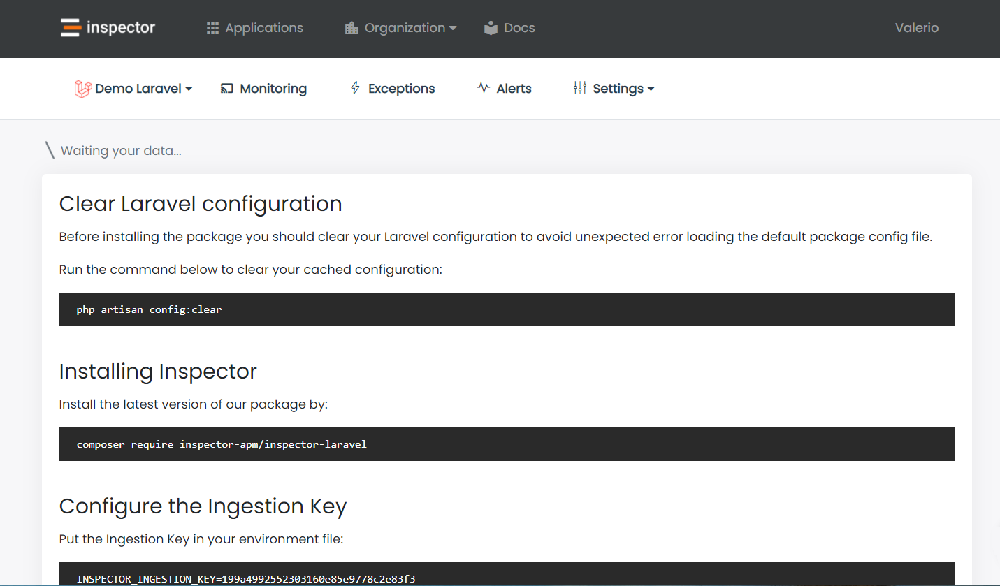
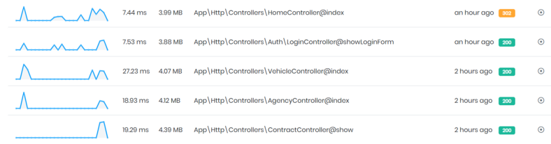

As product owner I learned on my skin how an application issue can be so hard to fix. They can cause negative impacts on the user experience, or block new potential customers during their on-boarding path.

To help you get faster in identifying which part of the application is in trouble, **we have designed an easy to use tool to directly monitor your application controllers and methods.**

Many of us continue to discover bugs and errors in the applications thanks to direct reports by users.

It’s too dangerous today.

When a user reports a problem it’s just too late. For a user that report a problem there are many others that simply stop using our application silently, moving to another product that fits their needs better.

Emerging software houses needs to hide bugs and bottlenecks from users eyes as much as possible to provide a better customer experience than the competitors.

A **real-time monitoring tool** help developers to address this problem, but many tools out there need a lot of resources and time to be installed and configured, making the life of developers more complicated.

Inspector is a composer package to add real-time monitoring in your [Laravel](/laravel/) application, it’s very easy to install and use, and it takes less than one minute to get started.

## Install the composer package to monitor Laravel

Install our package by running the command below in your terminal:

```bash
composer require inspector-apm/inspector-laravel
```

## Configure the API key

Get a fresh API key by signing up for Inspector ([https://app.inspector.dev/register](https://app.inspector.dev/register)) and creating a new application, it takes just a few seconds.

You’ll see installation instructions directly in the app screen:



*How to install the Inspector composer package in Laravel applications.*

Put the API key into your environment file:

```bash
INSPECTOR_API_KEY=13c37c434XXXXXXXXXXXX
```

## Http Requests Monitoring

To activate inspection when your application is executed by an incoming http request you can use the **WebRequestMonitoring** middleware.

Thanks to the middleware you are free to decide on which routes you want activate execution tracing, based on your routes configuration or on your personal monitoring preferences.

**WebRequestMonitoring** middleware works like any other Laravel middleware you are familiar to.

Basically you can attach the middleware in the `App\Http\Kernel` class in one or more of your predefined middleware groups:

```php
/**
 * The application’s route middleware groups.
 *
 * @var array
 */
protected $middlewareGroups = [
   'web' => [
      …,
      \Inspector\Laravel\Middleware\WebRequestMonitoring::class,
   ],   'api' => [
      …,
      \Inspector\Laravel\Middleware\WebRequestMonitoring::class,
   ]
]
```

## Identify Controller/Method execution

If you prefer to have a clear visibility of what controller and method are executed based on any HTTP request, you can use the code snippet below inside the **boot** method of one of your ServiceProvider.

Maybe the best place could be the **EventsServiceProvider**.

```php
use Illuminate\Routing\Events\RouteMatched;

/**
 * Register any events for your application.
 *
 * @return void
 */
public function boot() 
{
   parent::boot();  /*
   * Changes the way inspector reports transactions in your dashboard.
   */
   Event::listen(RouteMatched::class, function(RouteMatched $event) {
      $name = $event->route->getActionName();
 
      if(inspector()->isRecording()) {
         inspector()->currentTransaction()->name = $name;
      } else {
          inspector()->startTransaction($name);
      }
   });
}
```

This will change the way Inspector reports transactions in your dashboard from ***GET /path/{id}*** to ***YourController@yourMethod*** .


