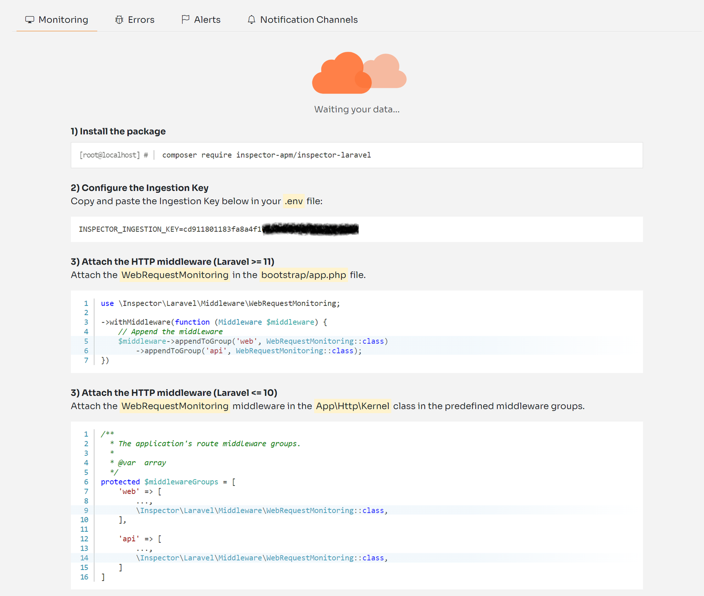
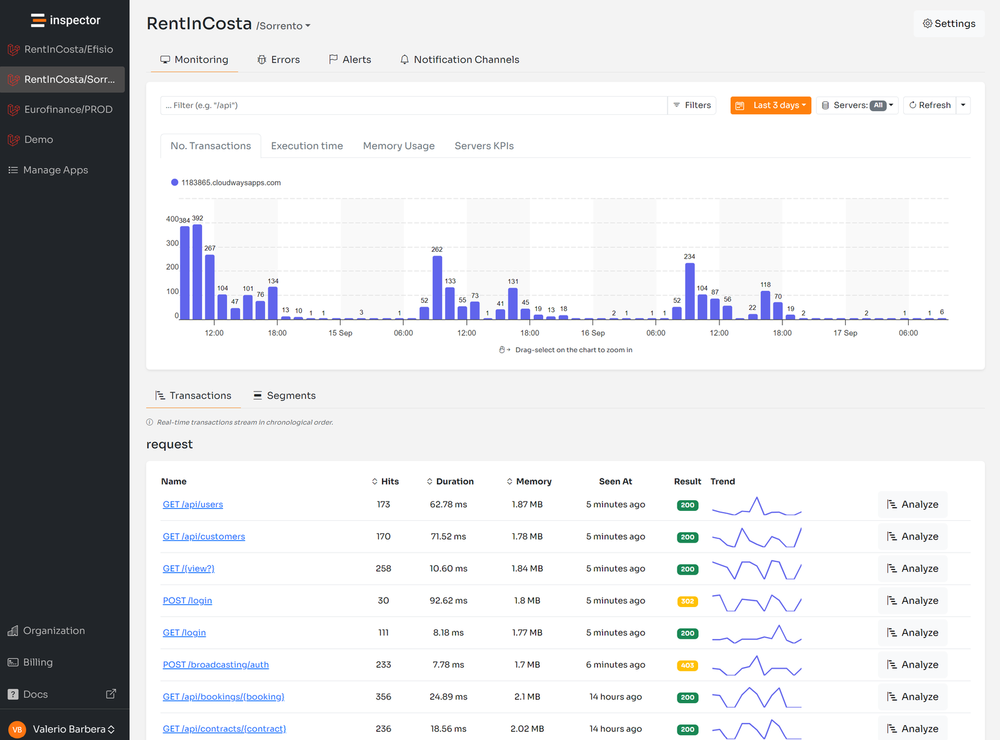
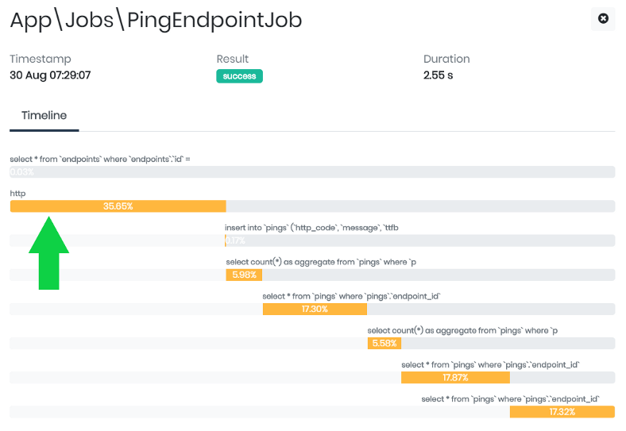
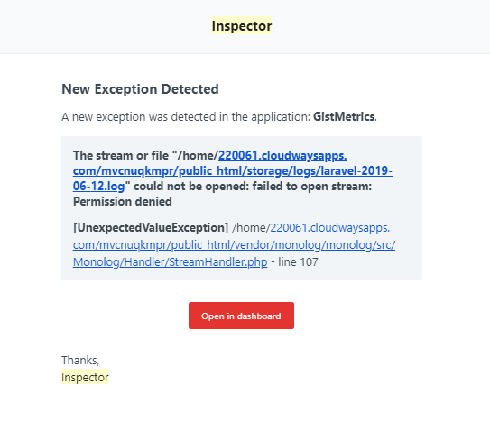
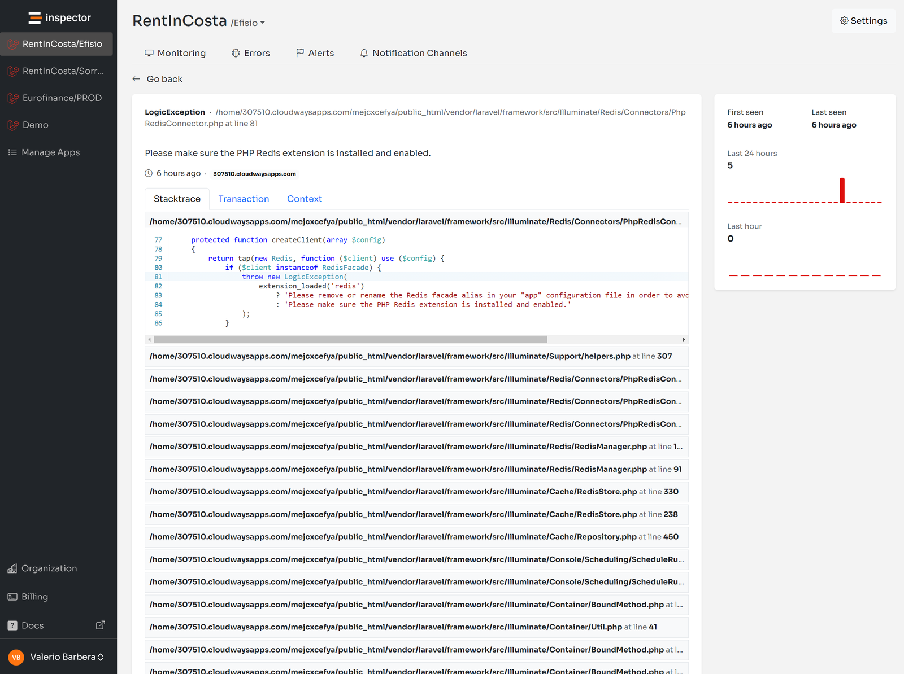

During development cycles, new code changes are published almost every week, if not every day. Unfortunately, it's impossible to anticipate all the problems that could happen after each release. Furthermore, users don't spend their time reporting bugs. That's why a Monitoring package could bring so much costs and time savings in your daily work.

Is not only about retaining users that report errors to you, but also take care of dozens of other users who just stop using your application silently if it doesn't work as expected. And it could take years before you can meet these customers again.

Small teams or single makers has a lot of constraints to improve their tech stack and work habits. Economic constraints, skills gap, limited time, etc. And the most popular monitoring platforms are so complicated, require a lot of additional skills to deal with cloud infrastructures, or are out of budget.

Inspector package fills this gap.

First I designed Inspector to work with a simple package. You don't need to touch anything at the infrastructure level (*VMs, kubernetes, etc.*). Just install **[the library](https://github.com/inspector-apm/inspector-laravel)**, configure the project key in the environment file, and you will see everything your application is doing in real-time.

Follow the quick step-by-step guide below to give it a try. Feel free to send me your feedback in the comments, there's anything more important for me to improve Inspector.

## Laravel Code Execution Monitoring: how it works

Inspector is a composer package to add real-time code execution monitoring to your Laravel application. It allows you to work on continuous code changes while catching bugs and bottlenecks in real-time. Before users do.

It takes less than one minute to get started. Let's see how it works.

### Install the composer package

Run the composer command below in your terminal to install the latest version:

```bash
composer require inspector-apm/inspector-laravel
```

### Configure the Ingestion Key

Get a new Ingestion key by signing up for Inspector ([https://app.inspector.dev/register](https://app.inspector.dev/register)) and creating a new project, it only takes a few seconds.

You'll see installation instructions directly in the app screen:



Put the API key into your environment file:

```bash
INSPECTOR_INGESTION_KEY=xxxxxxxxxxxxxxx
```

### Test everything is working

Execute the test command to check if your app sends data to Inspector correctly:

```bash
php artisan inspector:test
```

Go to [**https://app.inspector.dev**](https://app.inspector.dev) to explore the demo data.

By default Inspector monitors:

- Database interactions
- Queued Jobs execution
- Artisan commands
- Email sent
- Unhandled Exceptions

But, we turned on the light in the 50% of our app executed in the background. The next step is to monitor all execution cycles generated by user interactions.

## Monitoring Incoming HTTP Requests

To activate HTTP requests monitoring, you can use the WebRequestMonitoring middleware as an independent component. You are then free to decide which routes need to be monitored. Base it on your routes configuration or your monitoring preferences.

### Laravel >= 11

You should append the Inspector middleware in the *bootstrap/app.php* file for web and api middleware groups, so in two lines of code you'll intercept all incoming http requests:

```php
use \Inspector\Laravel\Middleware\WebRequestMonitoring;

return Application::configure(basePath: dirname(__DIR__))
    ->withRouting(
        // routes
    )
    ->withMiddleware(function (Middleware $middleware) {
        // Append the middleware
        $middleware->appendToGroup('web', WebRequestMonitoring::class)
            ->appendToGroup('api', WebRequestMonitoring::class);
    })
    ->withExceptions(function (Exceptions $exceptions) {
        //
    })->create();
```

### Laravel <= 10

Attach the middleware in the *App\\Http\\Kernel* class:

```php
/**
 * The application's route middleware groups.
 *
 * @var array
 */
protected $middlewareGroups = [
    'web' => [
       …,
       \Inspector\Laravel\Middleware\WebRequestMonitoring::class,
    ],    'api' => [
       …,
       \Inspector\Laravel\Middleware\WebRequestMonitoring::class,
    ]
]
```

## Deploy your code and navigate the execution flow

The next step is to deploy your code to the production environment. Next, check out how Inspector creates a visual representation of what happens inside your code.

You will see transaction streams in your dashboard. And for each transaction, you can monitor what your application executes in real-time:



## Enrich the Inspector timeline

Inspector monitors database queries, background jobs, and artisan commands by default. Still, there might be many critical statements in your code that need monitoring for performance and errors:

- Http calls to external services
- Function that deals with files (pdf, excel, images)

****Thanks to Inspector, you can add custom segments in your timeline** besides **those detected by default. This allows you to measure the impact that a hidden code block has on a transaction's performance.****

Let me show you a real life example.

Suppose you have a queued job that executes some database queries and an HTTP request to an external service in the background.

Inspector detects job and database queries by default. Still, it **could be interesting to monitor and measure the execution of the HTTP request to the external service. Then activate alerts if something goes wrong.**

Use the **inspector()** helper function:

```php
class TagUserAsActive extends Job
{
    /** 
     * @var User $user 
     */
    protected $user;

    // Monitring an external HTTP requests
    public function handle()
    {
        inspector()->addSegment(function () {            
            $this->guzzle->post('/mail-marketing/add_tag', [
                'email' => $this->user->email,
                'tag' => 'active',
            ]);        
        }, 'http');
    }
}
```

You will be able to identify the impact of the new segment in the transaction timeline:



## Laravel Errors & Exceptions Alerting

****By default, every exception fired in your Laravel app is reported. This ensures you're alerted to unpredictable errors in real-time.****

I wish that every change I make to my code could be perfect. But the reality is that this is not always the case. Some errors appear immediately after an update, while others pop up unexpectedly. It's an unfortunate fact of life for developers. And it often also depends on problems caused by the connection between our application and other services.

Yet, Inspector makes the job easier. It automates the detection of unknown issues, so you no longer need to manually check the status of your apps. You no longer wait for reports from users. If something goes wrong, you'll receive a notification in real-time. And after each release, you can stay informed about the impact of the latest code refactor.

If your code fires an exception, but you don't want to block the execution, manually report the error to Inspector for personal monitoring.

```php
try {   

    // Your dangerous code here...

} catch (GuzzleException $exception) {
   inspector()->reportException($exception)
}
```

Furthermore, if the HTTP request fails, you are alerted in real-time via your inbox to examine the error.



You even get access to detailed information gathered by Inspector in real time:



When a customer reports that something isn't working, it forces you to drop whatever you are doing. Then start trying to reproduce the scenario, and recapture and reanalyze the logs in your toolset.

Getting an accurate picture of what's happening can take hours or even days. Inspector can make a massive difference in efficiency, productivity, and customer happiness.
