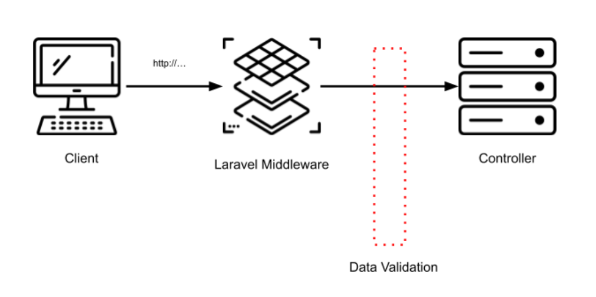

**Data validation** is one of the fundamental features in your Laravel application. And it is something developers manipulate almost every day. The value a software provides to users is often a function of the quality of data it collects and provides.

Laravel ships with many [predefined validation rules](https://laravel.com/docs/master/validation#available-validation-rules) you can immediately use in your controllers. But working on the Inspector backend we have identified some aspects of validating incoming data that impact the security and reliability of our application.

In this article I'll show you how to implement custom data validation class in Laravel to extend the validation layer of your backend with new functionalities provided by external services, like email or password validators.

I'll start with some context to clarify the validation layer’s role in a back-end service. Then I'll show you our implementations. If you have recently started using Laravel you can read a quick overview of the framework in this artile: [What is Laravel framework, and why is it so popular?](/what-is-laravel-framework/)

## Laravel Validation layer

Data integrity and validation are essential aspects of web development because they define the application's state. If the data is wrong, the application will not behave correctly.

It's always important to validate data before storing them in the database and before doing anything else.

In the Laravel request lifecycle, an HTTP request sent by a client goes through middleware first. Middleware deals with a mix of things between authentication and security.

**Before the request enters the application, its data must be validated.**



There are two ways to do data validation in Laravel: Inside the controllers or using Form requests.

### Data Validation in controller

The easiest way of validation is performing it in the controller. At the start of each controller method, you can first validate data:

```php
namespace App\Http\Controllers;
 
use Illuminate\Http\Request;
 
class UserController extends Controller
{
    public function store(Request $request)
    {
        $request->validate([
            'name' => 'required|string|min:3',
            'email' => 'required|email|min:6',
        ]);
 
        // here we know data are valid so we can pass them to database or other services
    }
}
```

Laravel will take care to return a 422 response code to the client if the data is not valid.

### Data validation using Form requests

If your validation rules are too complex, you may want to encapsulate them in reusable classes. This approach will avoid messing up the controller.

Laravel provides the ability to wrap validation in a dedicated component called [FormRequest](https://laravel.com/docs/master/validation#form-request-validation).

First, create a form request:

```bash
php artisan make:request StoreUserRequest
```

Than move your validation logic inside the **rules** method of the request class:

```php
<?php
 
namespace App\Http\Requests;
use Illuminate\Foundation\Http\FormRequest;
 
class StoreUserRequest extends FormRequest
{
    /**
     * Determine if the user is authorized to make this request.
     *
     * @return bool
     */
    public function authorize()
    {
        return true;
    }
 
    /**
     * Get the validation rules that apply to the request.
     *
     * @return array
     */
    public function rules()
    {
        return [
            'name' => 'required|string|min:3',
            'email' => 'required|email|min:6',
        ];
    }
}
```

You can type-hint this new request class in the controller method instead of the original **Illuminate\\Http\\Request** class, and remove the validation statement from the controller:

```php
namespace App\Http\Controllers;
 
use App\Http\Requests\StoreUserRequest;
 
class UserController extends Controller
{
    public function store(StoreUserRequest $request)
    {
        // here we know data are valid so we can pass them to database or other services
    }
}
```

## Custom validation rules

Laravel provided a well-developed validation layer. You can easily extend it by implementing custom rules to reuse in your code. Or you can increase the capability of your validation using external services.

Let me show you an example of one of the custom rules we implemented in Inspector.

First, create the class that represents a validation rule in Laravel:

```bash
php artisan make:rule SecurePassword
```

The idea is to verify if a password is in the list of well known insecure passwords. It will not pass the validation if it is, forcing the user to use a more secure string.

```php
namespace App\Rules;

use Illuminate\Contracts\Validation\Rule;

class SecurePassword implements Rule
{
    /**
     * Determine if the validation rule passes.
     *
     * @param  string  $attribute
     * @param  mixed  $value
     * @return bool
     */
    public function passes($attribute, $value)
    {
        return !in_array($value, [
            'picture1',
            'password',
            'password1',
            '12345678',
            '111111',
            ...
        ]);
    }

    /**
     * Get the validation error message.
     *
     * @return string
     */
    public function message()
    {
        return 'The chosen password is unsecure. Try again with a less common string.';
    }
}
```

To use it in your controller you have to create an instance as an item of validation rules applied to the field:

```php
namespace App\Http\Controllers;
 
use App\Rules\SecurePassword;
use Illuminate\Http\Request;
 
class UserController extends Controller
{
    public function store(Request $request)
    {
        $request->validate([
            'name' => 'required|string|min:3',
            'email' => 'required|email|min:6',
            'password' => ['required', new SecurePassword()],
        ]);
 
        // here we know data are valid so we can pass them to database or other services
    }
}
```

## Integrate with external services

When exploring data validation, many SaaS services can bring new capabilities to your validation layer regarding the security and reliability of the data collected.

I recommend looking at [apilayer.com](https://apilayer.com/), which provides excellent REST services to deal with data.

In Inspector, we use the [mailboxlayer.com](https://mailboxlayer.com/) API to validate emails. The service can also detect fake email addresses, temporary addresses, and the actual existence of an email address using MX-Records and SMTP.

Add two configuration property to store the API key of the new service in the **config/service.php** file:

```php
return [
    ...,
	
    'mailboxlayer' => [
        'key' => env('MAILBOXLAYER_KEY'),
    ],
	
];
```

Create the custom rule:

```bash
php artisan make:rule EmailSpam
```

Here is the complete code of the rule:

```php
namespace App\Rules;

use Illuminate\Contracts\Validation\Rule;

class EmailSpam implements Rule
{
    /**
     * Determine if the validation rule passes.
     *
     * @param string $attribute
     * @param mixed $value
     * @return bool
     */
    public function passes($attribute, $value)
    {
        if (app()->environment('local')) {
            return true;
        }
        return !config('services.mailboxlayer.key') || $this->check($value);
    }

    /**
     * Perform email check.
     *
     * @param string $email
     * @return bool
     */
    protected function check(string $email): bool
    {
        try{
            $response = file_get_contents('https://apilayer.net/api/check?'.http_build_query([
                'access_key' => config('services.mailboxlayer.key'),
                'email' => '[mailbox-layer-account-email]',
                'smtp' => 1,
            ]));
            $response = json_decode($response, true);
            return $response['format_valid'] && !$response['disposable'];

        } catch (\Exception $exception) {
            report($exception);

            if (app()->environment('local')) {
                return false;
            }

            // Don't block production environment in case of apilayer error
            return true;
        }
    }

    /**
     * Get the validation error message.
     *
     * @return string
     */
    public function message()
    {
        return 'Invalid email address.';
    }
}
```

## Validation rule with external parameters

If you need to pass external parameters to your rule class you can pass them in the constructor.

Define the rule constructor with parameters you need:

```php
namespace App\Rules;

use Illuminate\Contracts\Validation\Rule;

class EmailSpam implements Rule
{
    /**
     * EmailSpam rule constructor.
     */
    public function __constructor(
        protected string $key,
        protected string $url
    ) {}

    /**
     * Determine if the validation rule passes.
     *
     * @param string $attribute
     * @param mixed $value
     * @return bool
     */
    public function passes($attribute, $value){...}

    /**
     * Perform email check.
     *
     * @param string $email
     * @return bool
     */
    protected function check(string $email): bool
    {
        // Use the paramters received in the constructor.
        $response = file_get_contents($this->url . '?' . http_build_query([
            'access_key' => $this->key,
            'email' => '[mailbox-layer-account-email]',
            'smtp' => 1,
        ]));

        ...
    }

    /**
     * Get the validation error message.
     *
     * @return string
     */
    public function message()
    {
        return 'Invalid email address.';
    }
}
```

Now you can pass the required information during the creation of the instance in the constructor:

```php
namespace App\Http\Controllers;
 
use App\Rules\EmailSpam;
use App\Rules\SecurePassword;
use Illuminate\Http\Request;
 
class UserController extends Controller
{
    public function store(Request $request)
    {
        $request->validate([
            'name' => 'required|string|min:3',
            'email' => [
                'required', 
                'email', 
                'min:6', 
                new EmailSpam(
                    config('services.mailboxlayer.key'),
                    config('services.mailboxlayer.url')
                )
            ],
            'password' => ['required', new SecurePassword()],
        ]);
 
        // here we know data are valid so we can pass them to database or other services
    }
}
```

## Laravel validation Tips & Tricks

### Validate borders

Based on my experience, I can suggest you always validate the minimum and the maximum sizes of the incoming fields .

Don't wait for database errors that truncate too long strings. Instead, help your users understand the limits of each field by the error messages returned during data validation.

### Ask for the current password

Every critical action should require password confirmation. For example, you should always prompt the user to type the current password to authorize actions that can compromise the account accessibility.

Examples include changing email and changing password.

This feature will improve security because even having physical access to the computer with the Inspector dashboard opened on the screen; a malicious user can't change access credentials without knowing the current password. So, he can't shut you out.

Here is our implementation of the current password verification:

```php
namespace App\Rules;


use Illuminate\Contracts\Validation\Rule;
use Illuminate\Support\Facades\Auth;
use Illuminate\Support\Facades\Hash;


class CurrentPassword implements Rule
{
    /**
     * Determine if the validation rule passes.
     *
     * @param  string  $attribute
     * @param  mixed  $value
     * @return bool
     */
    public function passes($attribute, $value)
    {
        return Hash::check($value, Auth::user()->password);
    }

    /**
     * Get the validation error message.
     *
     * @return string
     */
    public function message()
    {
        return 'Your current password is incorrect.';
    }
}
```
