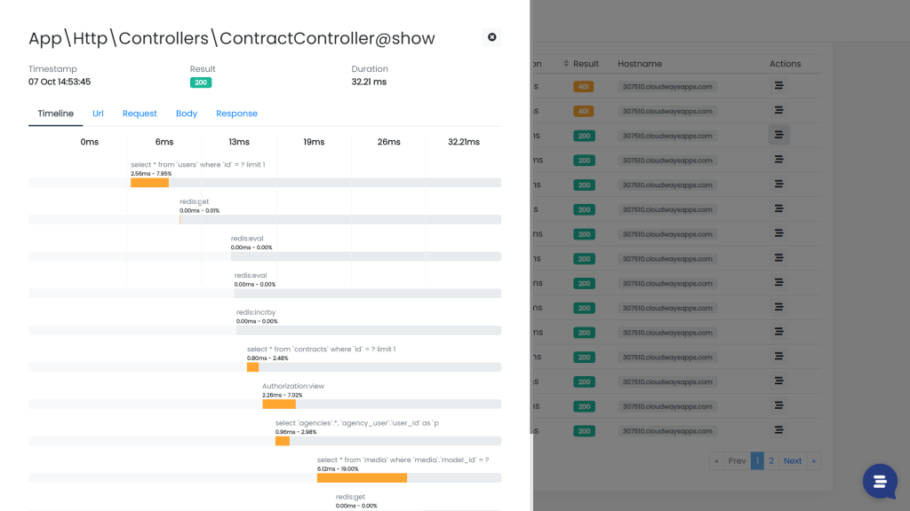

Recently, more and more Inspector customers are writing to me for advice on how to integrate our observability platform to monitor their Laravel application deployed in the AWS serverless environment with Vapor.

So I decided to write an extended tutorial for the different options you have to use Inspector to monitor your serverless Laravel application.

Let me start by giving you a bit of context.

## What is Inspector? When should you take it into consideration?

Inspector is a composer package to add real-time code execution monitoring to your Laravel application. It allows you to work on continuous code changes while catching bugs and bottlenecks automatically. Before your users do.



To be honest, not all software development teams need to monitor their applications "professionally". You have to experience the pain of not having a monitoring tool on your skin before you decide to invest in it.

Monitoring is the way to connect developers to the customers experience, to make them accountable for the success of the software development project.

You don't need monitoring, so you will not be motivated to spend time and invest money on this task, if:

- **You don't care about the users** - Maybe they're not paying you, and the decision to adopt a monitoring system rests with the company you work for as a consultant.
- **The application you are working on, doesn't generate income to sustain your business** - Many projects are managed only to make a customer happy, from which, however, you earn little or nothing.
- **You work for short-term projects** - If the project you are working on has a short duration by nature, it is useless to waste time with monitoring.

Monitoring is to take care of your customers over time and protect the sources of income that are important to grow your business. If this resonates with you check out our website for more information: [https://inspector.dev/laravel](/laravel/)

## How to make Inspector work on Laravel Vapor

The serverless environment has different default settings than a normal LAMP server. So the integration in the Vapor environment depends on the type of runtime you use.

> *You can learn more about Vapor runtimes in this* [***official video lesson***](https://www.youtube.com/watch?v=0Ayy2SXvC4s&list=PLcjapmjyX17gqhjUz8mgTaWzSv1FPgePD&index=9)*.*

Inspector requires two native PHP functions to send monitoring data to the remote API: [proc_open](https://www.php.net/manual/en/function.proc-open.php), and [proc_close](https://www.php.net/manual/en/function.proc-close.php). So the integration depends by the type of runtime you use for your Vapor application.

## Use Docker runtime (recommended)

Docker based runtimes offer much more control over the configuration of the execution environment. You can deploy applications up to 10GB in size and it allows you to install additional PHP extensions or libraries.

In order to use a Docker image instead of the Vapor native runtimes, set the runtime configuration option to **docker** within your **vapor.yml**

```yaml
id: 2
name: vapor-laravel-app
environments:
    production:
        runtime: docker # Use docker as runtime environment
        build:
            - 'composer install --no-dev'
```

Learn more about [Docker runtime](https://docs.vapor.build/1.0/projects/environments.html#docker-runtimes) in Vapor.

To make Inspector work you must be sure that the current PHP installation in the Docker image has *proc_open*, and *proc_close* php native functions enabled.

The default Docker runtime should have these functions enabled by default. In alternative you need to create a custom **php.ini** file in your project root directory with these two functions not listed in the *disable_functions* parameter:

```bash
disable_functions=exec,passthru,shell_exec,system,popen,curl_exec,curl_multi_exec,parse_ini_file,show_source
```

Add the entry below to your environment **.Dockerfile** to override the default **php.ini** configuration:

```docker
# Update the `php.ini` file...
# Requires a `php.ini` file at the root of your project...
COPY ./php.ini /usr/local/etc/php/conf.d/overrides.ini
```

## Use Vapor native runtimes

The AWS standard serverless environment has the *proc_open* and *proc_close* functions disabled by default. So Inspector isn’t able to send data to the inspection API with the standard transport class included in the package.

In a normal server environment you can enable these functions by changing the **php.ini** settings, but Vapor native runtimes currently don't provide a way to overwrite this configuration during deployment, so you can't enable them.

### Set up a custom transport

The design of the Inspector package allows you to inject a custom transport implementation at runtime. Add the code below in the boot method of your **ApplicationServiceProvider**:

```php
$this->app->inspector->setTransport(function ($configuration) {
    return new QueueTransport($configuration);
});
```

The callback will receive an instance of the **Inspector\\Configuration** class, that contains the Ingestion Key, the URL of our remote API, and all other information needed to build the appropriate HTTP call.

### QueueTransport implementation

To keep the data sending process “asynchronously” the **QueueTransport** class should schedule a job to send monitoring data in background:

```php
namespace App\Inspector\Transports;


use Exception;
use Inspector\Transports\AbstractApiTransport;
use Inspector\Transports\TransportInterface;
use App\Inspector\Jobs\SendInspectorChunkJob;

class QueueTransport extends AbstractApiTransport implements TransportInterface
{
    /**
     * @param string $data
     * @throws Exception
     */
    protected function sendChunk($data)
    {
        dispatch(new SendInspectorChunkJob($this->config, $data));
    }
}
```

**SendInspectorChunkJob** receives the data in its constructor to be sent when the job is scheduled for execution. Here is the implementation of the Job:

```php
namespace App\Inspector\Jobs;


use Exception;
use Illuminate\Bus\Queueable;
use Illuminate\Contracts\Queue\ShouldQueue;
use Inspector\Transports\AbstractApiTransport;
use Inspector\Transports\TransportInterface;
use Inspector\Configuration;

class SendInspectorChunkJob implements ShouldQueue
{
    use Queueable;

    /**
     * Monitoring Data
     * 
     * @var string
     */
    protected $data;

    /**
     * Inspector configuration.
     * 
     * @var Configuration 
     */
    protected $configuration;

    /**
     * SendInspectorChunkJob constructor.
     *
     * @param Configuration $configuration
     * @param string $data
     */
    public function __construct(Configuration $configuration, string $data)
    {
        $this->data = $data;
        $this->configuration = $configuration;
    }

    /**
     * Use the original CurlTransport.
     * 
     * @param \Inspector\Configuration $configuration
     * @throws \Inspector\Exceptions\InspectorException
     */
    public function handle()
    {
        $transport = new \Inspector\Transports\CurlTransport($this->configuration);

        $transport->sendChunk($this->data);
    }
}
```

### Avoid the infinite loop

Finally, we must inform Inspector to ignore the **SendInspectorChunkJob** from monitoring. Otherwise, when the job is executed it will run a new transaction itself that generates another job and so on… the infinite loop start.

Inspector provides a configuration property to specify the job classes that you want to exclude from monitoring.

Publish the inspector config file if you haven't already done, using the command below:

```bash
php artisan vendor:publish --provider="Inspector\Laravel\InspectorServiceProvider"
```

Now you should have the inspector.php file in your config directory. Add the **SendInspectorChunkJob**:

```php
/*
|--------------------------------------------------------------------------
| Job classes to ignore
|--------------------------------------------------------------------------
|
| Add at this list the job classes that you don't want monitoring
| in your Inspector dashboard.
|
*/

'ignore_jobs' => [
    \App\Inspector\Jobs\SendInspectorChunkJob::class,
],
```

**Running the job to send data will consume additional execution resources on your AWS account. For this reason we strongly encourage you to consider using the Docker runtime that natively supports the built-in transport method with no additional costs.**
