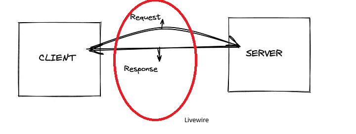
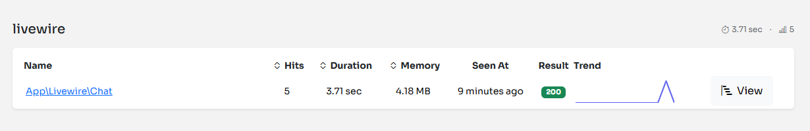
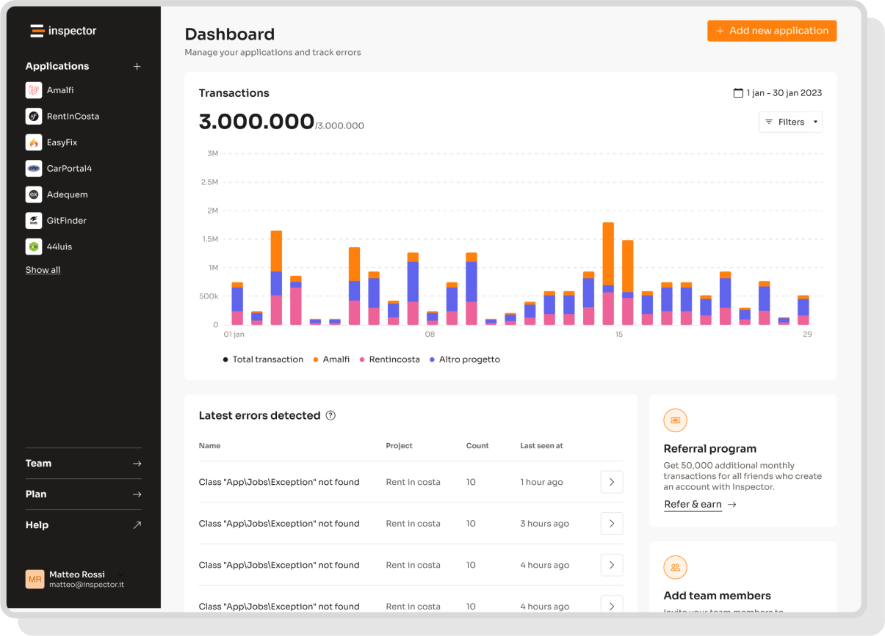

[Livewire](https://livewire.laravel.com/) is a full-stack framework in Laravel that makes it easy to create reactive interfaces without writing any Javascript, just using PHP. This means developers can leverage the power of Laravel and Blade templates to build dynamic UIs. You can respond to user’s actions such as form submissions, scrolling, mouse movements, or button clicks, using PHP classes and methods.

After the initial rendering of the page containing the Livewire component, Livewire binds some javascript event listeners to its components and watches for every action. Each action is sent to the server as an asynchronous API request.



## The Problem

When the user clicks on a button in the UI, Livewire makes a network request to the server to interact with the PHP component associated. The server then performs the action, generates a new template and the current new state of the component, and sends it back to the client.

Take a look at the example below that implement a simple counter:

```javascript title="resources/views/livewire/counter.blade.php"
<div>
    <h1>{{ $count }}</h1>
 
    <button wire:click="increment">+</button>
 
    <button wire:click="decrement">-</button>
</div>
```

```php title="app/Livewire/Counter.php"
class Counter extends Component
{
    public $count = 1;

    public function increment() {
        $this->count++;
    }

    public function decrement() {
        $this->count--;
    }

    public function render()
    {
        return view('livewire.counter');
    }
}
```

Every click on the counter button generates an HTTP request handled by the associated PHP component. And this happen for all UI component you have in the user interface.

All these HTTP requests are routed to the default Livewire URL: `/livewire/update`

That's why you see tons of requests to the endpoint **"POST /livewire/update"** in your Inspector monitoring dashboard. So, everything under `/livewire/update` it's like a grey area, because you don't have any clue of what component is behing executed, what is its state, etc.

This behaviour it's also the reason many applications in performance sensible environments do not adopt this stack, and eventually go for a dedicated Javscript framework like [Vue](https://vuejs.org/) or [React](https://react.dev/) to manage reactivity entirely on the frontend side, offloading the server.

## Inspector Configuration

To solve this problem the Inspector Laravel package includes a specifc configuration to monitor Livewire components.

When the user interact with Livewire components a dedicated transaction category, livewire, will now appear in the Inspector dashboard:



As you can see, the transaction name is the name of the component class. This way, you'll have all the components monitored individually.

From the individual component's detail page, you can access the history of every time that component has been run. Any exceptions will also be attached to the component's transaction, so everything remains clear.

### Ignore Components

You can exclude components from being reported on Inspector listing the component classes in the `inspector.livewire.ignore_components` configuiration property:

```php
'livewire' => [
    ...
    'ignore_components' => [
        // \App\Livewire\MyComponent::class
    ],
],
```

Here the link to the documentation: [https://docs.inspector.dev/guides/laravel/livewire](https://docs.inspector.dev/guides/laravel/livewire)

### Livewire Path

In order to make Inspector able to recognize the execution of livewire components instead of normal HTTP requests you should keep in sync the Livewire URL with the Inspector configuration. The Livewire URL is customizable, so if you use a custom path instead of the default one, you should change the Inspector configuration accordingly:

```php
'livewire' => [
    ...
    'path' => env('INSPECTOR_LIVEWIRE_PATH', '/livewire/update'),
    ...
],
```

## Monitor your Laravel application for free

Inspector is a Code Execution Monitoring tool specifically designed for PHP developers. You don’t need to install anything on the server level, just install the [**Laravel package**](https://github.com/inspector-apm/inspector-laravel) and you are ready to go.

If you are looking for HTTP monitoring, database query insights, and the ability to forward alerts and notifications into your preferred messaging environment try Inspector for free. [**Register your account**](https://app.inspector.dev/register).

Or learn more on the website: [**https://inspector.dev**](/)


