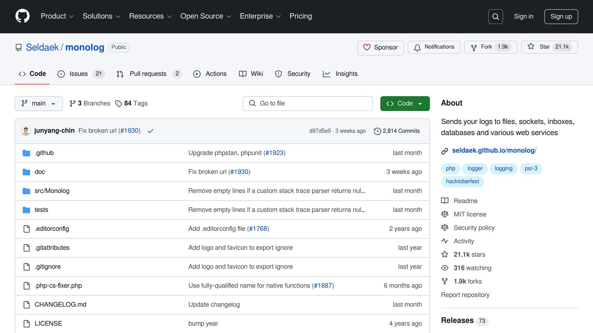

The [Laravel](/laravel/) logging system helps you track application events and errors using configurable log channels. Here's what you need to know:

- **Log Channels**: Define where and how logs are stored (e.g., files, [Slack](https://slack.com/help/articles/115004071768-What-is-Slack-), databases).
- **Drivers**: Choose from built-in options like `single`, `daily`, `stack`, or create custom ones.
- **Configuration**: Managed through the `config/logging.php` file.
- **Customization**: Use the `tap` option to modify log formats or behaviors.
- **Advanced Tools**: Integrate with services like [Inspector](/) for real-time monitoring and debugging.

## Quick Comparison of Log Drivers

| Driver | Purpose | Best Use Case |
| --- | --- | --- |
| `single` | Logs everything into one file | Local development with basic logging |
| `daily` | Creates new log files daily | Production environments needing rotation |
| `stack` | Combines multiple log channels | Logging to multiple destinations |
| `custom` | Allows custom logging logic | External integrations or unique setups |

This article walks you through setting up and using Laravel's log channels effectively, including custom configurations and advanced features.

## Configuring and viewing logs in [Laravel](https://laravel.com/)

[Watch the video on YouTube](https://www.youtube.com/watch?v=MGASWCQ6TJ0)

## How to Configure Log Channels in Laravel

Setting up log channels in Laravel involves selecting the right drivers based on your application's needs. With the correct configuration, you can capture and analyze critical events, making debugging and performance tracking much easier.

### Overview of Log Channel Drivers

Laravel offers several logging drivers, each designed for specific scenarios:

| Driver | Purpose | Best Use Case |
| --- | --- | --- |
| `single` | Logs everything into one file | Ideal for local development with basic logging |
| `daily` | Creates a new log file every day | Suitable for production environments needing log rotation |
| `stack` | Combines multiple log channels | Useful for logging to multiple destinations |
| `monolog` | Leverages Monolog handlers | For advanced logging formats or destinations |
| `custom` | Allows custom logging logic | Perfect for integrating with external logging services |

With these options in mind, you can choose the driver that best fits your logging requirements. Let’s now look at how to set up custom log channels for more tailored solutions.

### Creating Custom Log Channels

To define a custom log channel, edit the `config/logging.php` file and add your configuration:

```php
'custom_channel' => [
    'driver' => 'custom',
    'via' => App\Logging\CreateCustomLogger::class,
    'tap' => [App\Logging\CustomizeLogger::class],
]
```

Next, implement the logic for your custom channel:

```php
namespace App\Logging;

use Monolog\Logger;

class CreateCustomLogger
{
    public function __invoke(array $config)
    {
        return new Logger('custom', []);
    }
}
```

The `tap` option allows you to modify the Monolog instance after it's created, giving you the flexibility to customize your logging setup further. This method ensures you can integrate advanced logging features while maintaining Laravel's straightforward configuration structure.

## Advanced Logging Features in Laravel

Laravel provides powerful tools for applications that require more complex logging setups, giving developers greater control and customization options.

### Using the `Stack` Driver for Multi-Channel Logging

The `stack` driver allows you to log to multiple channels at the same time, all managed from a single configuration. Here's an example:

```php
'channels' => [
    'stack' => [
        'driver' => 'stack',
        'channels' => ['single', 'syslog'],
        'ignore_exceptions' => false, // Logs exceptions instead of suppressing them
    ],
    'single' => [
        'driver' => 'single',
        'path' => storage_path('logs/laravel.log'),
        'level' => env('LOG_LEVEL', 'debug'),
    ],
    'syslog' => [
        'driver' => 'syslog',
        'level' => env('LOG_LEVEL', 'debug'),
    ],
],
```

With this setup, logs are saved in multiple locations, improving reliability and ensuring no critical data is lost.

### Customizing [Monolog](https://github.com/Seldaek/monolog) with the `Tap` Option



The `tap` option lets you modify Monolog instances for specific needs. For instance, you can create a custom log format to standardize messages across all handlers:

```php
namespace App\Logging;

use Monolog\Formatter\LineFormatter;

class CustomizeFormatter
{
    public function __invoke($logger)
    {
        foreach ($logger->getHandlers() as $handler) {
            $handler->setFormatter(new LineFormatter(
                '[%datetime%] %channel%.%level_name%: %message% %context% %extra%\n',
                'Y-m-d H:i:s'
            ));
        }
    }
}
```

To use this custom formatter, include it in your channel configuration:

```php
'single' => [
    'driver' => 'single',
    'tap' => [App\Logging\CustomizeFormatter::class],
    'path' => storage_path('logs/laravel.log'),
    'level' => env('LOG_LEVEL', 'debug'),
],
```

This approach ensures your logs are consistently formatted, making them easier to read and analyze.

## Using Log Channels in Laravel Projects

To make logs meaningful and easy to work with in [Laravel projects](/blog/), you need a well-organized approach. Here's how you can implement log channels effectively.

### How to Use Structured Logging

Structured logging makes logs easier to read and analyze by presenting data in a consistent, machine-readable format. Here's a simple example:

```php
use Illuminate\Support\Facades\Log;

Log::channel('daily')->info('User action completed', [
    'user_id' => $user->id,
    'action' => 'profile_update',
    'timestamp' => now()->toIso8601String(),
]);
```

To take it a step further, you can use a custom formatter like `JsonFormatter`. This ensures your logs are standardized and include key details, such as server and environment information:

```php
namespace App\Logging;

use Monolog\Formatter\JsonFormatter;

class StructuredLogFormatter
{
    public function __invoke($logger)
    {
        foreach ($logger->getHandlers() as $handler) {
            $handler->setFormatter(new JsonFormatter());
        }
    }
}
```

Options like the `tap` setting for custom formatters or the `stack` driver for combining multiple channels can make your logging setup more flexible and compatible with third-party tools.

### Integrating Laravel Logs with [Inspector](/)


Structured logging is a great start, but adding a tool like Inspector can give you real-time monitoring and analysis capabilities.

First, install the Inspector package:

```bash
composer require inspector-apm/inspector-laravel
```

Add the Ingestion Key to your environment file to start monitoring your application:

```
INSPECTOR_INGESTION_KEY=b3u472y3ubexxxxxxxxxxxxxxxxxxxxxxxxxxxx 
```

Inspector enhances Laravel's logging by offering features like real-time monitoring, AI-powered error analysis, transaction tracking, and collaboration tools. These capabilities help you quickly pinpoint and fix issues while gaining deeper insights into your application's performance. It integrates seamlessly with Laravel, making it a powerful addition to your logging strategy.

## Summary of Laravel Log Channels

The `config/logging.php` file is where Laravel's logging channels are managed, offering a solid base for monitoring and debugging applications.

### Key Log Channel Types and Uses

Laravel comes with several built-in log channel drivers, each suited for specific tasks. Here's a quick overview of the main types and their purposes:

| Channel Type | Primary Use Case | Key Features |
| --- | --- | --- |
| Stack | Merges multiple channels | Sends logs to multiple destinations at once |
| Single | Simple file-based logging | Logs everything to one file |
| Daily | Creates logs by date | Generates a new log file each day |
| Slack | Sends alerts to teams | Posts logs directly to Slack |
| Custom | Handles unique needs | Fully customizable for specific use cases |

### Advanced Configuration and Best Practices

Laravel relies on Monolog for its logging system, which offers a wide range of customization options [<sup>\[1\]</sup>](https://laravel.com/docs/11.x/logging). The `tap` option, explained in the Advanced Logging Features section, adds even more flexibility, making it suitable for both straightforward and complex logging setups.

To get the most out of Laravel's logging:

- Set logging levels based on your environment (e.g., `debug` for development, `error` for production).
- Use separate channels for different types of logs.
- Apply log rotation policies to manage storage efficiently.

Laravel's `Log` facade lets you configure logs dynamically. For example:

```php
Log::build([
    'driver' => 'single',
    'path' => storage_path('logs/custom.log')
])->info('Custom log entry');
```

Thanks to its flexibility and wide range of drivers, Laravel's logging system can be customized to fit almost any application. Next, we'll dive into common questions about using these features in the FAQ section.

## FAQs

### Creating Custom Log Channels in Laravel

To set up a custom log channel in Laravel, you need to define a new configuration in `config/logging.php`. Use the `custom` driver and specify a factory class for the `via` option, like this:

```php
'custom_channel' => [
    'driver' => 'custom',
    'via' => \App\Logging\CustomLoggerFactory::class,
]
```

Once configured, Laravel's logging system allows for more tailored debugging and monitoring options.

### Understanding Laravel's Logging System

Laravel's logging system is built on Monolog and uses channels to manage how and where logs are stored. This system supports a variety of channel types, catering to both simple file logging and more advanced monitoring setups.

For example, you can log specific events to a custom channel with this code:

```php
Log::channel('custom_channel')->info('Important application event');
```

For deeper insights and monitoring, tools like Inspector can be integrated with Laravel's logging. These features help developers track their application's performance and troubleshoot issues effectively.

## Related Blog Posts

- [5 Ways to Optimize Symfony Application Performance](/5-ways-to-optimize-symfony-application-performance/)
- [Real-Time Error Tracking vs. Log Analysis: A Comparison](/real-time-error-tracking-vs-log-analysis-a-comparison/)
- [Laravel Logging: Channels and Stacks Explained](/laravel-logging-channels-and-stacks-explained/)
- [Common JOIN Query Indexing Mistakes to Avoid](/common-join-query-indexing-mistakes-to-avoid/)
