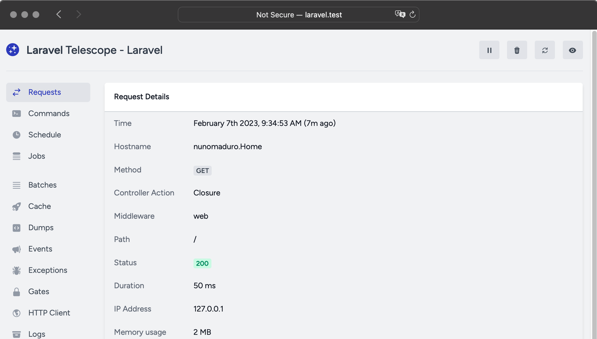
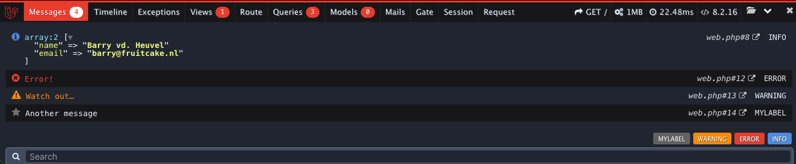
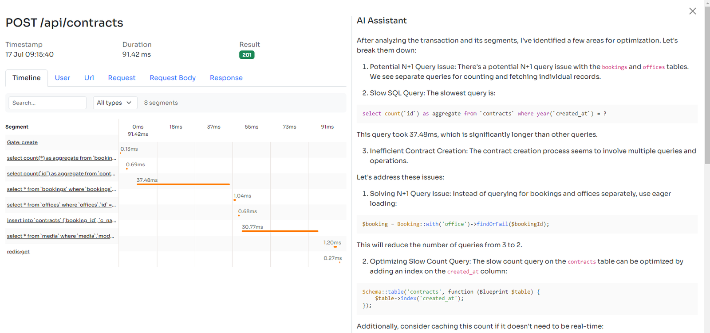

Having a more clear understanding of what your application really does during its execution is an increasing necessity. Logging the raw database queries generated by your preferred ORM is one of the most common needs to be more aware of what is happening behind the scenes.

More and more abstraction layers are becoming available in modern web applications. Although they are so important for speeding up development and reducing errors, they often leave us with some doubts about the low-level instructions into which the code we write is translated.

Typically you need to delve deeper into the abstraction layer when an error occurs or when your application starts to noticeably slow down. Then you will have to extract information about what happens behind the scenes of Eloquent ORM and Laravel.

In this article I will go deeper into implementing database query logging mechanisms using Eloquent ORM, enhancing your Laravel project’s scalability and debuggability.

For more technical articles you can follow me on [**Linkedin**](https://www.linkedin.com/in/valeriobarbera/) or **[X](https://x.com/Barbalerio)**.

## Eloquent ORM

Eloquent ORM (Object-Relational Mapping) is a Laravel component that allows you to interact with the database using a simple, expressive Object Oriented syntax rather than raw SQL queries.

Deep dive into Eloquent ORM stands out with its active record implementation, meaning each model corresponds to a table in the database, and instances of the model represent individual records.

```php
namespace App\Models;

use Illuminate\Database\Eloquent\Model;

class Organization extends Model
{
	// ...
}
```

It’s vital for Laravel developers to harness Eloquent full potential to streamline their development experience.

## Logging Database Queries with Eloquent ORM

The most solid abstraction layers are ready to support developers in their debugging needs. This is probably the main reason they are broadly adopted, because they help developers by speeding up implementation, but they allow them to investigate the low level instructions if needed.

The beautiful part of Eloquent is its event driven architecture. The Laravel ORM generates events that you can hook into to perform intermediate actions.

For our purpose of Logging Database Query we can listen to the **Illuminate\\Database\\Events\\QueryExecuted** event.

In the boot method of one of your service provider you can use this code:

```php
namespace App\Providers;

use Illuminate\Database\Events\QueryExecuted;

class AppServiceProvider extends ServiceProvider
{
    /**
     * Booting of services.
     *
     * @return void
     */
    public function boot()
    {
        \Event::listen(QueryExecuted::class, function (QueryExecuted $query) {
			if ($this->app->environment('local')) {
				\Log::debug("Query Executed: ", [
					"sql" => $query->sql,
					"bindings" => $query->bindings,
					"connection" => $query->connectionName,
				]);
			}
        });
    }
	
	// ...
}
```

This is basically what the Inspector package does to capture database queries:

<https://github.com/inspector-apm/inspector-laravel/blob/master/src/Providers/DatabaseQueryServiceProvider.php#L20-L24>

## Logging Database Queries for specific Eloquent Models

In some cases you may need to collect information only on queries executed by one or more specific Eloquent models. To do this you could use Eloquent model Observers.

Eloquent model observers in Laravel are classes that listen to the lifecycle events of a model, such as **creating**, **updating**, **deleting**, and **saving**. Observers provide a convenient way to run custom logic when these events occur.

### Define an Eloquent Model Observer

In the OrganizationObserver class, you can define methods corresponding to the Eloquent events you want to listen to. I added another method that simply retrieves the latest database query executed when these events fire.

Here’s an example of an observer that logs the query when a user is created and deleted:

```php
namespace App\Observers;

use App\Models\Organization;
use Illuminate\Support\Facades\Log;
use Illuminate\Support\Facades\DB;

class OrganizationObserver
{
    /**
     * Handle the Organization "created" event.
     *
     * @param  \App\Models\Organization  $organization
     * @return void
     */
    public function created(Organization $organization)
    {
        Log::info('Organization created: ', $this->getQuery());
    }

    /**
     * Handle the Organization "deleted" event.
     *
     * @param  \App\Models\Organization  $organization
     * @return void
     */
    public function deleted(Organization $organization)
    {
        Log::info('Organization deleted: ', $this->getQuery());
    }
	
    /**
     * Get the last query executed.
     *
     * @return array
     */
	protected function getQuery(): array
	{
		$stack = DB::getQueryLog();
		return end($stack);
	}
}
```

### Register the Observer

You need to register the observer in the boot method of the **AppServiceProvider** or in a custom service provider:

```php
namespace App\Providers;

use Illuminate\Support\ServiceProvider;
use App\Models\Organization;
use App\Observers\OrganizationObserver;

class AppServiceProvider extends ServiceProvider
{
    /**
     * Bootstrap any application services.
     *
     * @return void
     */
    public function boot()
    {
        Organization::observe(OrganizationObserver::class);
    }

    /**
     * Register any application services.
     *
     * @return void
     */
    public function register()
    {
        //
    }
}
```

## Advanced Tools for Query Logging

Today there are several options available for gathering debugging information from your application.

## Laravel Telescope

[Telescope](https://laravel.com/docs/11.x/telescope) is a debugging tool for Laravel applications. It provides insight into the internal workings of your application by capturing and displaying detailed information about requests, exceptions, database queries, logs, and more.

It’s a dev tool to use in your local environment since it works on your application database. It may compromise application stability in the production environment.



## Laravel DebugBar

[DebugBar](https://github.com/barryvdh/laravel-debugbar) integrates a bar to monitor data directly on the UI, including queries, HTTP requests, and exceptions.

DebugBar is designed only for development environments. Do not use Debugbar on publicly accessible websites, as it will leak information from stored requests. It can also slow the application down.



## Inspector

**[Inspector](/)** is a monitoring tool that stores and processes data outside of your system so you can use it in the production environment for real-time monitoring and debugging.

It can analyze the execution flow of your application processes (database queries, view rendering, authentication and authorization tasks, etc.) providing you with code tips to increase application reliability and performance.



For more technical articles you can follow me on [**Linkedin**](https://www.linkedin.com/in/valeriobarbera/) or **[X](https://x.com/Barbalerio)**.
