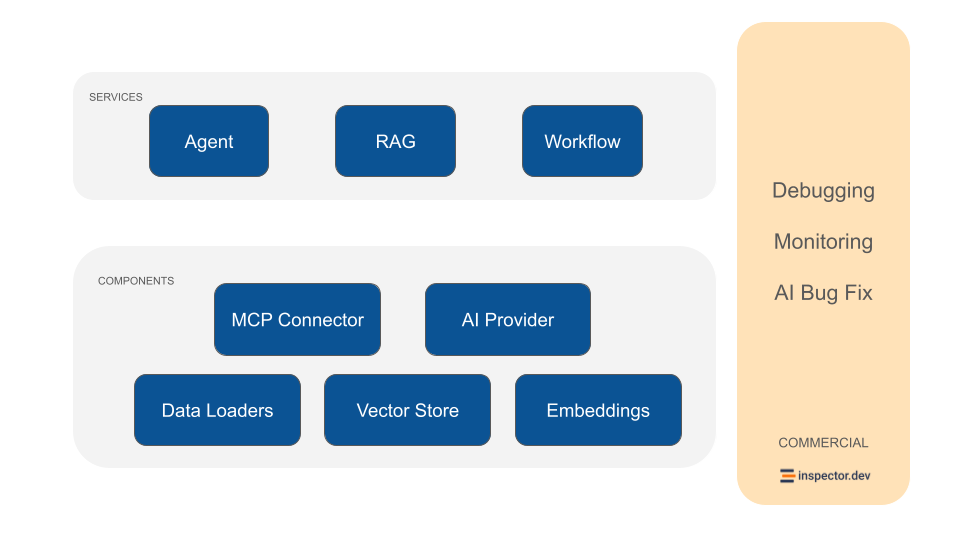

For a long time, the implicit message from the AI tooling industry has been: if you want to build agents, learn Python. The frameworks, the tutorials, the conference talks, all pointed in the same direction. PHP developers who wanted to experiment with autonomous systems had two options: switch stacks or stitch something together from raw API calls and hope it holds.

That's the gap [Neuron AI](https://neuron-ai.dev) was built to close. And now, with Neuron v3 introducing a workflow-first architecture, I wanted to prove the point in the most direct way possible: build a CLI agent that the ecosystem assumes can only exist in another language. That's how [Maestro](https://github.com/neuron-core/maestro) was born — a fully customizable, extension-driven CLI agent built entirely in PHP.

[**https://github.com/neuron-core/maestro**](https://github.com/neuron-core/maestro)

I really believe that it is important to create the basis for agentic systems development in PHP, and this project is a further step to provide PHP developers with all the necessary elements to build a native AI stack they can build upon to power the next generation of software solutions.

[MAESTRO](https://www.youtube.com/watch?v=F01ZQWSAsw0)

## What is Neuron AI

Neuron is a PHP framework for developing agentic applications. By handling the heavy lifting of orchestration, data loading, and debugging, Neuron clears the path for you to focus on the creative soul of your project. From the first line of code to a fully orchestrated multi-agent system, you have the freedom to build AI entities that think and act exactly how you envision them.

We provide tools for the entire agentic application development lifecycle — from LLM interfaces, to data loading, to multi-agent orchestration, to monitoring and debugging. Neuron's architecture prioritizes the fundamentals that experienced engineers expect from production-grade software: a strong PHP 8 typing system with 100% PHPStan coverage, IDE-friendly method signatures, minimal external dependencies through standard PSR interfaces, and a design that works identically whether you're building a microservice in pure PHP, a Laravel application, or a Symfony project.



### An Agent Runtime, Not a Coding Tool

The easiest way to describe Maestro is to start with what it is *not*. It's not a code completion plugin. It's not a fixed-purpose tool that does one thing. It's a CLI agent runtime — a framework for running an AI agent in your terminal that you can shape toward any purpose through its extension system.

Out of the box, Maestro ships with a `CodingExtension` that turns it into a coding assistant: it gives the agent filesystem tools, a code-aware system prompt, and everything you'd expect from a tool that reads your project and proposes changes. But that extension is just a bundle of capabilities that happens to ship with the default installation. You can disable it. You can replace it. You can install extensions built by other people from Packagist. The agent runtime underneath — the conversation loop, the event system, the tool approval flow, the UI rendering pipeline — knows nothing about coding. It only knows how to run an agent and expose the right hooks for extensions to plug into.

This is the architectural decision that makes Maestro interesting as a project. The coding agent was the first demonstration, a proof that the patterns the industry has been building in Python and TypeScript are fully expressible in PHP. But "coding agent" was never the destination.

## The Extension System

An extension is a PHP class that implements `ExtensionInterface`. The contract is intentionally minimal: a `name()` method that returns a string identifier, and a `register()` method that receives an `ExtensionApi` instance where you wire everything up.

```php
class MyExtension implements ExtensionInterface
{
    public function name(): string
    {
        return 'my-extension';
    }

    public function register(ExtensionApi $api): void
    {
        $api->registerTool($myTool);
        $api->registerCommand($myCommand);
        $api->registerRenderer('my_tool', $myRenderer);
        $api->registerMemory('my-extension.guidelines', __DIR__ . '/memory/guidelines.md');
        $api->on(AgentResponseEvent::class, function ($event, $context) {
            // react to agent responses
        });
    }
}
```

Through the `ExtensionApi`, you have access to five integration points. Tools are the actions the AI agent can take — anything you register here becomes something the agent can decide to call during a conversation. Inline commands are slash-prefixed commands available in the interactive terminal session (`/deploy`, `/status`, `/help`) that run outside the AI loop, handled directly by your code. Memory files are Markdown documents injected into the agent's system prompt before the conversation starts, giving the agent domain knowledge, conventions, and instructions specific to your use case. Renderers control how the output of specific tools is displayed in the terminal. And event handlers let you react to what the agent is doing — thinking, responding, requesting tool approval — with arbitrary code.

The `registerMemory` call is worth dwelling on, because it's the mechanism that controls the agent's personality and expertise. When you install the `CodingExtension`, the memory file it registers contains instructions about how to read and modify code safely, how to reason about diffs, when to ask for clarification. If you build a database migration assistant, your memory file contains your conventions for writing migrations, your team's naming rules, which tables are sensitive. If you build a deployment workflow agent, it contains your environment topology, your rollback procedures, what the agent should always confirm before proceeding. The agent isn't smart about your domain because it was trained on it — it's smart because your extension told it what to know.

## Getting Started

Install as a global Composer tool:

```bash
composer global require neuron-core/maestro
```

Make sure Composer's global bin directory is in your system PATH:

```bash
echo 'export PATH="$(composer config -g home)/vendor/bin:$PATH"' >> ~/.bashrc
```

Configuration lives in `.maestro/settings.json` at the root of your project. Run the init command to start the interactive setup guide:

```bash
cd /path/to/your/project
maestro init
```

At minimum, you need a provider and an API key. Maestro supports all the providers available through Neuron — Anthropic, OpenAI, Gemini, Cohere, Mistral, Ollama, Grok, and Deepseek — all routed through a `ProviderFactory` that maps the `default` field to the corresponding Neuron AI provider instance:

```json
{
    "default": "anthropic",
    "providers": {
        "anthropic": {
            "api_key": "sk-ant-your-key-here",
            "model": "claude-sonnet-4-6"
        }
    }
}
```

If you want to run everything locally without sending data to an external API, point it at an Ollama instance instead:

```json
{
    "default": "ollama",
    "providers": {
        "ollama": {
            "base_url": "http://localhost:11434",
            "model": "llama2"
        }
    }
}
```

## The Tool Approval Flow

When the agent wants to modify a file, execution doesn't just proceed. It stops, and you see something like this:

```bash
The agent wants to write changes to src/Service/UserService.php

[1] Allow once
[2] Allow for session
[3] Reject
```

"Allow for session" is the option I use most in practice. It means I approve write operations on a given file type or tool once per session, without having to confirm each individual change. "Always allow" persists the preference to `.maestro/settings.json` under an `allowed_tools` key, so future sessions skip the prompt entirely for that operation.

This granularity matters. You probably want to approve the first few changes in an unfamiliar session to build confidence, then let the agent run more freely once it's demonstrated it understands what you're asking.

This is one of the most interesting feature provided by the Neuron AI framework, thanks to the Workflow architecture. Neuron Workflow support execution interruption, so you can create fully customizable huma-in-the-loop experience. The agent will stop its execution, waiting to be resumed exactly from where it left off. Learn more on the [official documentation](https://docs.neuron-ai.dev/workflow/human-in-the-loop).

## Managing Extensions

Extensions are declared in the same `settings.json` file. You can enable or disable individual extensions, pass them configuration values, and control exactly what the agent is capable of in a given project:

```json
{
    "default": "anthropic",
    "providers": { "..." },
    "extensions": {
        "NeuronCore\\Maestro\\Extension\\CodingExtension": {
            "enabled": true
        },
        "MyVendor\\DeployExtension\\DeployExtension": {
            "enabled": true,
            "config": {
                "environment": "staging",
                "api_key": "your-key"
            }
        }
    }
}
```

Disabling the \`CodingExtension\` and enabling only your own extension turns Maestro into a completely different agent — one that knows nothing about code and everything about your specific domain. The runtime doesn't change. The conversation loop, the tool approval flow, the event system — all of that stays exactly the same.

## Packaging and Distributing Extensions

Extensions are Composer packages. You write the code, define a `composer.json` with a dependency on `neuron-core/maestro`, and add an `extra.maestro` field that declares your extension class names:

```json
{
    "name": "my-vendor/my-extension",
    "require": {
        "neuron-core/maestro": "^1.0"
    },
    "extra": {
        "maestro": {
            "extensions": [
                "MyVendor\\MyExtension\\MyExtension"
            ]
        }
    },
    "autoload": {
        "psr-4": {
            "MyVendor\\MyExtension\\": "src/"
        }
    }
}
```

Once a user installs your package with `composer require my-vendor/my-extension`, running `composer dump-autoload` triggers auto-discovery. Maestro reads the extension class names from the `extra` field and registers them without the user needing to touch `settings.json` at all, unless they want to configure or disable the extension explicitly.

This is intentionally familiar territory for any PHP developer who has worked with Laravel packages or Symfony bundles. Ship a package, declare what it contributes, let the host framework discover and integrate it. The entire extension ecosystem lives on Packagist, installed and updated the same way every other PHP dependency in your project.

## MCP Integration

For extensions that need to reach beyond the local environment, Maestro supports Model Context Protocol servers in the configuration:

```json
{
    "mcp_servers": {
        "tavily": {
            "url": "https://mcp.tavily.com/mcp/?tavilyApiKey=your-key"
        }
    }
}
```

Each entry spins up a subprocess and connects it to the agent as an additional tool source. This is how an extension targeting a GitHub workflow gives the agent the ability to read issues, open pull requests, and trigger CI runs — without you having to implement those integrations yourself.

## What This Demonstrates

Maestro is a working proof that the patterns the rest of the industry has been building in Python and TypeScript are fully expressible in PHP. But more than that, it's a proof that the PHP ecosystem has the right primitives to build a platform, not just a tool.

The extension system is what makes that distinction real. A coding agent is something you install and use. A platform with an extension system is something you build on, contribute to, and share through the package manager your entire community already uses. That's the version of the story I'm most excited about — not what Maestro does out of the box, but what it enables once developers start building on it.

I'm really looking forward to hearing your feedback, experiments, and ideas on how to develop this new chapter of the AI ​​in the PHP space.

If you want to explore the code, the repository is at [github.com/neuron-core/maestro](https://github.com/neuron-core/maestro). The Neuron AI documentation lives at [docs.neuron-ai.dev](https://docs.neuron-ai.dev). Questions, issues, and pull requests are open.
