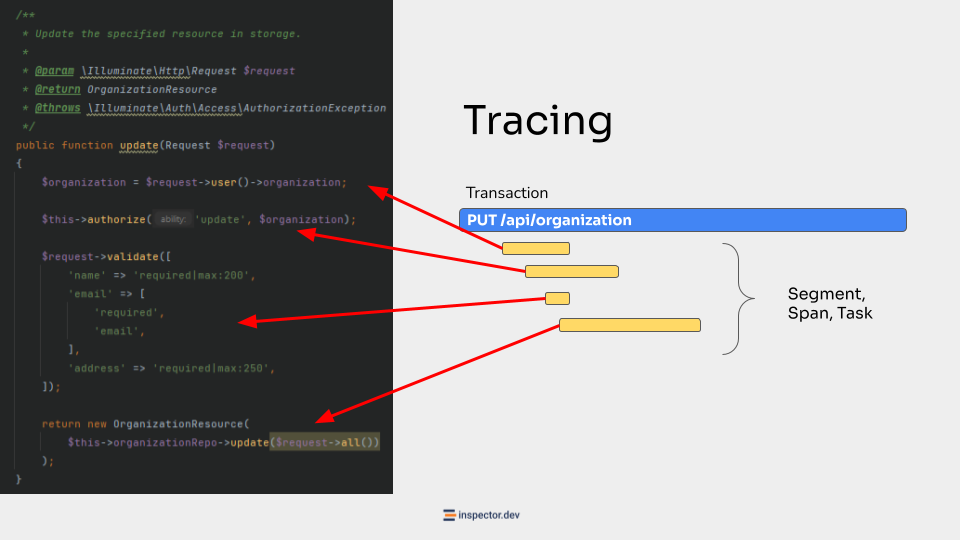
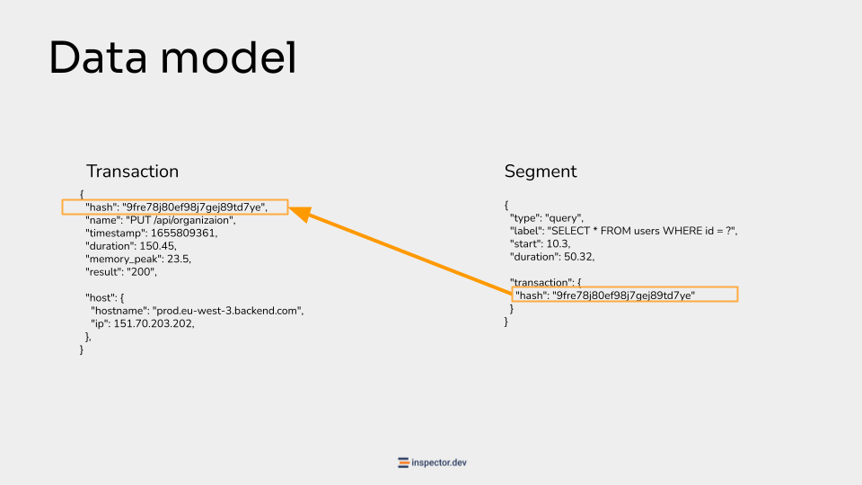

Following the recent series of posts your familiarity with these topics should begin to improve. You will naturally look for a more complete picture of your application state.

The concept of Observability in fact concerns the possibility of having a basic picture that represents the state of the application as a whole, with a set of data that allows you to dig deeper and deeper based on your current analysis needs.

**View the full video: [https://www.youtube.com/watch?v=034KK_syVd4](https://www.youtube.com/watch?v=034KK_syVd4)**

Sometimes Observability turns out to be a controversial topic, because it exposes you to the risk of over-engineering the idea of monitoring and adopting tools that are so complicated that their integration and use is more difficult than the normal software development activities themselves.

From the beginning of the course we have framed Monitoring as an automation tool. If it complicates your life, you need to ask yourself a question.

Now I want to show you how these tools work internally by explaining the Tracing technique.

## Mastering Observability: Tracing

The most important mechanism on which Observability tools are based is Tracing.

That is the ability to collect a set of data that allows you to visually represent the behavior of the application at a level as granular as possible.

In this slide I show you a classic example of Tracing, in which you can see two fundamental elements: Transaction, and Segments.

The Transaction is intended to represent an execution cycle of the application. An execution cycle can be triggered in different ways, for example by an HTTP request from input to the response, or the background execution of a cron job.

Obviously in most cases the bulk of the transactions will be generated by HTTP traffic, but it is just to make you understand that the transaction is the highest level object and it represents the entire execution.

Segments instead represent the code instructions performed within an execution cycle. And here we can have many different things, like database queries, authentication procedures, data validations, calls to external services, etc.

## Mastering Observability: Data Model

These two objects Transactions, and Segments are in practice json objects created by the monitoring library during the normal execution of the application, and streamed to the remote platform where you can visualize them in real time.

The one shown in this slide is an example taken from how Inspector works. It is an example of a data packet used by our platform to understand how your application works. The concept of tracing is quite standard, by learning some technical jargon and knowing what they refer to, you will be able to independently evaluate any monitoring tool.

At the start of the Transaction the library generates a unique hash that will be used to link subsequent segments to the current execution cycle.

Thanks to this connection, the monitoring tool should be able to automatically trace the chain of events inside your application and build a visual representation of it like the Timeline I showed you before.

One of the most important reasons why you need to know what transactions and segments are is to evaluate the pricing of these types of tools.

## Evaluate Pricing Policy

One tool may place more emphasis on effort to manage segments, while another may have transaction-based pricing.

Having an idea of these characteristics and terminologies is important to help you do the math.

For example, understanding whether with the same characteristics, one tool could cost you less than the other based on the type of data you are most interested in.
