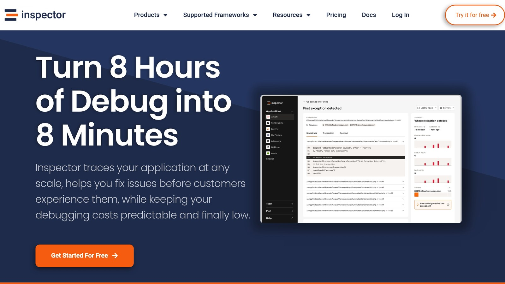

**Want faster apps and lower database load?** [Memcached](https://memcached.org/) is your answer. It's an in-memory caching system that stores frequently accessed data, making your app quicker and more efficient.

Here’s what you’ll learn:

- **Why Use Memcached?** Reduce database queries, save costs, and speed up response times.
- **Key Strategies for Success:**
  - Use clear, structured cache keys to avoid conflicts.
  - Set appropriate expiration times (TTL) for different data types.
  - Monitor cache performance with tools like [Inspector](/).
- **Boost Performance:** Learn how to preload data, manage high traffic, and prevent memory issues.
- **Advanced Techniques:** Use versioning, dependency tracking, and dynamic TTLs to keep your cache fresh and efficient.

**Quick Overview:**

| Strategy | Benefit |
| --- | --- |
| Structured Cache Keys | Avoids collisions, aids debugging |
| TTL Management | Balances freshness and performance |
| Multi-Server Setup | Handles high traffic efficiently |
| Monitoring Tools | Tracks issues in real time |

Memcached is a game-changer for apps that rely on frequent database queries. Let’s dive into how you can master it.

## Cache Key Structure

Properly structuring cache keys can significantly improve Memcached performance. A good key naming system helps avoid collisions, makes debugging easier, and ensures efficient memory usage.

### Key Naming Standards

When creating cache keys, it's important to follow a clear and systematic format that balances readability and performance. Here's a recommended structure:

```
[prefix]:[entity]:[identifier]:[attribute]
```

**Examples**:

- `query:users:1234:profile`
- `query:products:active:count`
- `query:orders:2025-03:summary`

If there's a chance the underlying data structure might change, include version numbers in your keys:

```
[prefix]:[version]:[entity]:[identifier]
```

**Example**:

- `query:v2:customers:premium:list`

This method allows you to easily invalidate all related cached items during schema updates without impacting other data.

Now, let’s dive into how to prevent conflicts when multiple platforms are involved.

### Preventing Key Conflicts

In environments where multiple applications or services use the same Memcached instance, avoiding key collisions is critical. Here are some effective strategies:

- **Use Application-Specific Prefixes**: Assign a unique prefix to each application.

  ```
  [app_name]:[environment]:[entity]:[identifier]
  ```

  **Examples**:

  - `inventory:prod:products:categories`
  - `crm:staging:contacts:recent`

- **Namespace Isolation**: Separate logical namespaces for features or modules within an application.

  ```
  [app]:[module]:[function]:[params]
  ```

  **Examples**:

  - `shop:catalog:featured:2025-03`
  - `shop:cart:user-123:items`

- **Hash Long Keys**: For queries with many parameters or lengthy identifiers, use a hash function to generate a compact and unique key.

  ```php
  $key = "query:" . md5($sql . serialize($params));
  ```

  This ensures keys stay within the 250-byte limit while remaining unique.

For more complex applications, consider using a key registry to manage and document cache keys. Aim for key lengths between 80–120 bytes to strike a balance between efficient memory usage and debugging ease.

## Cache Expiration Management

Managing cache expiration is crucial for keeping data accurate while maintaining performance. Setting appropriate TTLs (Time-To-Live) helps strike a balance between how long data persists and how fresh it remains.

### TTL Configuration

When setting TTLs, tailor them to the type of data being cached:

**Data-Specific Expiration**

Different data types require different TTL settings based on how often they change and their importance:

| Data Type | Recommended TTL | Reasoning |
| --- | --- | --- |
| Product inventory | 5-15 minutes | Updates frequently, accuracy is key |
| User profiles | 24-48 hours | Changes are rare, less time-sensitive |
| Blog posts | 1-2 weeks | Static content, updated infrequently |
| System settings | 1 hour | Balances responsiveness and performance |

**Dynamic TTL Adjustment**

For even better control, use dynamic TTLs that adapt to access patterns. Here's an example in PHP:

```php
$baseExpiration = 3600; // Base TTL of 1 hour
$accessCount = getKeyAccessCount($key);
$ttl = $baseExpiration * min(1 + ($accessCount / 100), 24);
memcached->set($key, $value, $ttl);
```

This method extends the TTL for frequently accessed keys, ensuring popular data stays cached longer.

### Targeted Cache Clearing

Instead of clearing the entire cache, focus on specific entries to minimize disruption.

**Pattern-Based Invalidation**

You can clear cache entries based on patterns. For example, to remove all product-related cache entries:

```php
// Clear all keys related to products
$keys = memcached->getAllKeys();
foreach ($keys as $key) {
    if (strpos($key, 'product:') === 0) {
        memcached->delete($key);
    }
}
```

**Dependency Tracking**

Track relationships between cached items to clear only the relevant entries. Here's how:

```php
// Store dependency info
$mainKey = 'product:1234';
$dependentKeys = [
    'category:electronics:count',
    'featured:products'
];
memcached->set($mainKey . ':deps', $dependentKeys);

// Clear dependent keys during updates
$deps = memcached->get($mainKey . ':deps');
foreach ($deps as $depKey) {
    memcached->delete($depKey);
}
```

**Version-Based Invalidation**

Instead of deleting cache entries outright, use versioning to manage updates:

```php
// Use versioned keys
$version = memcached->get('version:products') ?: 1;
$cacheKey = "query:products:active:v{$version}";
```

When data needs to be invalidated, simply increment the version number. This avoids race conditions and works well for high-traffic systems.

## Cache Success Rate Optimization

Boost your system's performance by increasing the cache hit rate. A higher hit rate means less database load and faster response times.

### Performance Metrics Tracking

Keep an eye on key metrics like **cache hit rate**, **response time**, **memory usage**, and **evictions**. Tools like Inspector can provide real-time updates and send alerts if something goes off track.

By regularly monitoring these metrics, you can take steps like proactively warming your cache to reduce initial latency and improve overall performance.

### Cache Initialization

Here are some practical strategies for initializing your cache:

**Preloading Queries** (PHP Example):

```php
function warmCache() {
    $commonQueries = [
        'SELECT * FROM popular_products LIMIT 100',
        'SELECT * FROM categories WHERE active = 1',
        'SELECT * FROM settings'
    ];

    foreach ($commonQueries as $query) {
        $cacheKey = 'query:' . md5($query);
        if (!$memcached->get($cacheKey)) {
            $result = executeQuery($query);
            $memcached->set($cacheKey, $result, 3600);
        }
    }
}
```

**Batch Loading Data** (PHP Example):

```php
function batchLoadCategories() {
    $offset = 0;
    $limit = 1000;

    while ($categories = getCategories($offset, $limit)) {
        foreach ($categories as $category) {
            $key = 'category:' . $category->id;
            $memcached->set($key, $category, 7200);
        }
        $offset += $limit;
    }
}
```

**Scheduled Cache Warming** (PHP Example):

```php
$schedule->command('cache:warm')->dailyAt('03:00')->withoutOverlapping();
```

After warming the cache, track your hit rates to see if the strategies are working. Adjust your preloading methods based on real usage patterns to ensure you're targeting the right data. These techniques can significantly improve cache efficiency and reduce the strain on your database.

## High-Traffic [Memcached](https://memcached.org/) Setup

Managing Memcached in high-traffic scenarios calls for careful server distribution and memory allocation to maintain performance and avoid bottlenecks.

### Multi-Server Distribution

In demanding environments, distributing Memcached across multiple servers is key. Here's an example setup using PHP:

```php
$servers = [
    ['host' => '10.0.1.10', 'port' => 11211, 'weight' => 40],
    ['host' => '10.0.1.11', 'port' => 11211, 'weight' => 40],
    ['host' => '10.0.1.12', 'port' => 11211, 'weight' => 20]
];

$memcached = new Memcached();
$memcached->addServers($servers);
$memcached->setOption(Memcached::OPT_LIBKETAMA_COMPATIBLE, true);
```

The **consistent hashing** algorithm, enabled by `LIBKETAMA_COMPATIBLE`, ensures even key distribution and reduces remapping when servers are added or removed. Server weights are set based on capacity: two main servers handle 40% each, while a backup server is assigned 20%.

Key distribution strategies to consider:

| Strategy | Description | Best For |
| --- | --- | --- |
| Even Distribution | Spreads data equally across servers | General caching needs |
| Capacity-Based | Allocates based on server resources | Mixed hardware setups |
| Geographic | Distributes by user location | Global applications |

These strategies help tailor caching to your specific workload and infrastructure.

### Memory Usage Planning

Proper memory allocation is critical to avoid evictions and ensure smooth performance. Here's an example configuration for a 32GB server:

```bash
# Allocate 24GB for Memcached, support 20,000 connections, and use 4 threads
memcached -m 24576 -c 20000 -t 4 -v
```

This setup leaves room for the operating system while supporting high connection counts. Monitor and fine-tune these settings based on usage and eviction rates. Key metrics to watch:

| Metric | Target Range | Warning Signs |
| --- | --- | --- |
| Memory Usage | 60-80% | Over 90% indicates eviction risk |
| Eviction Rate | Under 1%/hr | Over 5% signals memory pressure |
| Connection Count | Under 75% max | Nearing max may cause bottlenecks |

Keep at least 20% memory free to minimize evictions. Use monitoring tools like Inspector to track these metrics and address issues early.

For item size limits, configure Memcached to prevent large items from causing performance issues:

```bash
# Set a 1MB limit for individual items
memcached -I 1m
```

If you need to store larger data, split it into smaller chunks to avoid latency and fragmentation. This approach helps maintain efficient memory usage and smooth operations.

## [Inspector](/) Performance Tools



Inspector offers **real-time monitoring** to pinpoint Memcached bottlenecks. Its streamlined approach makes it easy to dive into its live monitoring features.

### Live Monitoring Features

Inspector's dashboard provides detailed insights into Memcached metrics:

| Feature | Purpose | Benefit |
| --- | --- | --- |
| **Query Timing** | Tracks cache hit/miss latency | Identifies slow queries |
| **Memory Usage** | Monitors cache utilization | Avoids eviction problems |
| **Connection Stats** | Keeps tabs on active connections | Spots potential bottlenecks |
| **Error Detection** | Flags cache failures | Reduces downtime |

Getting started is straightforward - just install the package and initialize:

```php
// Install via Composer
composer require inspector-apm/inspector-php

// Initialize monitoring
$inspector = new Inspector([
    'key' => 'your-key',
    'transport' => 'async'
]);

// Monitor Memcached operations
$inspector->startTransaction('cache-operation');
```

These tools work smoothly across widely-used frameworks.

### Framework Compatibility

Inspector integrates directly with popular PHP frameworks, offering tailored features for each:

```php
// Laravel integration
composer require inspector-apm/inspector-laravel

// Symfony integration
composer require inspector-apm/inspector-symfony
```

Here’s what you can expect from specific frameworks:

| Framework | Benefits |
| --- | --- |
| [**Laravel**](https://laravel.com/) | Tracks database queries automatically |
| [**Symfony**](https://symfony.com/) | Monitors custom events |
| [**CodeIgniter**](https://www.codeigniter.com/) | Profiles application performance |
| [**Drupal**](https://docs.inspector.dev/guides/drupal) | CMS observability |
| [**Spring Boot**](https://spring.io/projects/spring-boot) | Tracks JVM metrics |

> "We like Inspector because it's really simple to install and use. It doesn't require any configuration. It allows us to immediately identify and fix issues in our code!" - Miller Adulu, Founder & Team Lead - FrogTech

Inspector offers a **free plan** for up to 30,000 monthly transactions. For larger needs, paid plans start at $15/month, perfect for high-traffic applications needing advanced monitoring. This flexibility ensures Memcached performance is optimized no matter your traffic volume.

## Conclusion

### Main Points

To make the most of Memcached caching, focus on these key strategies:

| Strategy | Method | Impact |
| --- | --- | --- |
| **Key Structure** | Use standardized naming, avoid conflicts | Speeds up lookups |
| **Cache Expiration** | Configure dynamic TTLs | Improves memory efficiency |
| **Multi-Server Setup** | Distribute load across servers | Manages high traffic |
| **Memory Planning** | Allocate resources proactively | Reduces eviction risks |

These strategies lay the groundwork for effective caching. Next, ensure you monitor performance consistently for long-term success.

### Monitoring Recommendations

Strong monitoring is essential for keeping Memcached running smoothly. When paired with the strategies above, it helps maintain efficiency over time. Tools like Inspector simplify real-time tracking and bring several benefits:

- **Quick Issue Identification**: Monitor cache in real time to avoid bottlenecks.
- **Built-In Framework Support**: Works seamlessly with popular frameworks.
- **Scalable Options**: Offers solutions ranging from a free tier to enterprise-level capabilities.

Start with basic metrics and expand as your needs grow. Inspector's easy setup and user-friendly dashboard make it simple to maintain performance without adding unnecessary complexity.

Monitoring isn’t just about gathering data - it’s about acting on what you learn. Regular audits and timely alerts ensure your caching stays efficient and dependable. Combining these practices will help you achieve reliable and high-performing caching.

## Related Blog Posts

- [5 Ways to Optimize Symfony Application Performance](/5-ways-to-optimize-symfony-application-performance/)
- [Ultimate Guide to MySQL Query Caching in PHP](/ultimate-guide-to-mysql-query-caching-in-php/)
- [How to Benchmark PHP Code Performance](/how-to-benchmark-php-code-performance/)
- [Best Practices for PHP Database Schema Design](/best-practices-for-php-database-schema-design/)
