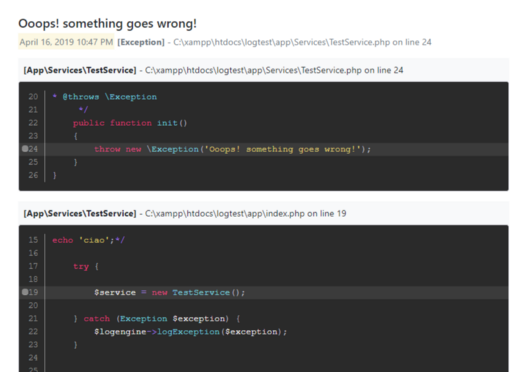
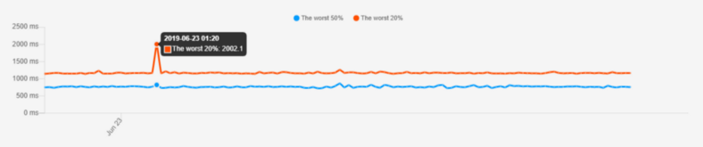
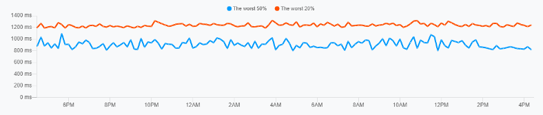

Hi I'm Valerio, software engineer, founder and CTO of [Inspector](/).

As product owner I know that being able to prevent users from noticing an application issue is probably the best way for developers to contribute to the success of a software-based business.

We could talk about user complaints, customer churn, a thousand other things, but in short, in a highly competitive market any application error can expose developers to competitive or even financial risks.

It’s too important for developers to catch errors on their products — **before** — their users stumble onto the problem drastically reducing negative impact on their experience.

I work to refine and search every day new metrics to understand how to move my business forward. My product itself is a tool that provides instant and actionable metrics.

I study and practice a lot to find the best possible **application performance monitoring metrics** to avoid unnecessary risks in a software driven business.

I’m not interested to create charts that looks good (even if they are), my priority are useful, indeed needful metrics to distinguish between something that doesn’t need to be rushed and something that needs immediate attention to keep my application (and my business) stable and secure.

## Why don't averages work?

Anyone that has ever made a decision uses or has used averages. They are simple to understand and calculate.

But although all of us use them, we tend to ignore just how wrong the picture that averages paint of the world is. Let me give you a real-world example.

Imagine being a Formula 1 driver.

Your average “execution” time for a lap is comparable with the top three in the ranking, but you are in fifth position.

According to the average, everything is fine. According to your fans, it’s not so good.

Your “Team Principal” — the person who owns and is in charge of your team during the race weekend — knows that relying on averages is not a good way to understand what’s going wrong. He know that, when it comes to making decisions, the average sucks.

When calculating the average, it’s likely that in some races you’re so fast that you can make up for the next four races with bad performances.

> As F1 driver you can compare your “execution” time and results with other drivers, but with your application you are alone, the only feedback you have is customer churn.

Your team principal knows that focusing too hard on the best performances is not so useful to understand what’s going wrong and how to fix it (car settings, pit stop, physical training, etc.).

He recalculates the average taking into consideration only the worst 20% of your races. Isolating these executions from the noise he can now analyze them and clearly see that every time something goes wrong it is because of the pit stop.

Measuring the worst 20% of your execution cycles in real-time gives you the same opportunity.

You’re able to understand what is going wrong when your application slow down (a too time-consuming query, slow external services, etc.) and avoid bad customer experiences, because you always have the right information before your users stumble into the problem.

In a typical web back-end we experience the same scenario: some transactions are very fast, but the bulk are normal.

The main reason for this scenario is failed transactions, more specifically **transactions that failed fast, not for bugs but due to user errors or data validation errors**.

These failed transactions are often magnitudes faster than the real ones because the application barely starts running and then stops immediately; consequently, they distort the average.

## The secret to using averages successfully is: “Measure the worst side”

Inspector shows you the “execution time analysis” of the worst 50% and the worst 20% of application cycles.

As you can see the 50% line (or median) is rather stable but has a couple of jumps. These jumps represent real performance degradation for the majority (50%) of the transactions.

The 20% line is more volatile, which means that the outliers slowness depends on data, user behavior, or external services performance.

In this way you will automatically focus only on transactions that have bad performance or problems that need to be solved.

Inspector eliminates any misunderstanding and offers a dashboard that informs you directly about things that can cause problems to your users and even to your business, including errors and unexpected exceptions.

## Automatic alerting

In real-world environments, performance gets attention when it is poor and has a negative impact on the business and users.

But how can we identify performance issues quickly to prevent negative effects?

We cannot send out alerts for every slow transaction, since there are always some. In addition, most operations teams have to maintain a large number of applications and are not familiar with all of them, so manually setting thresholds can be inaccurate, time-consuming and leave a huge margin for errors.

## 1 — Blue line still flat, Red line jump (low priority)

If the 20% degrade from 1 second to 2 seconds while the 50% is stable at 700ms. This means that your application as a whole is stable, but a few outliers have worsened. It’s nothing to worry about immediately but thanks to inspector you can drill down into these transactions to inspect what happened.

Inspector metrics don’t miss any important performance degradation, but in this case we don’t alert you, because the issue involves only a small part of your transactions and is probably only a temporary problem!

Thanks to Inspector you can check if the problem repeats itself and eventually investigate why.

## 2 — Blue line jump, Red line still flat (high priority)

If the worst 50% moves from 500ms to 800ms I know that 50% of my transactions suffered an important performance degradation. It’s probably necessary to react to that.

In many cases, we see that the worst 20% line does not change at all in such a scenario. This means the slow transactions didn’t get any slower; only the normal ones did with a high impact on your users.

In this scenario Inspector will alert you immediately.

## Conclusion

Your team can now work for a better pit stop and you will soon be able to compete with the best drivers in the league. Measure continuously potential problems is the secret behind the great Formula 1 teams to achieve success not once, but to remain in the top teams for all the years to come.

Inspector is a developer tool that automatically puts you and your team in the right direction without any effort, drastically reducing the impact of any application issue because you will be aware of it before your users stumble into the problem.
