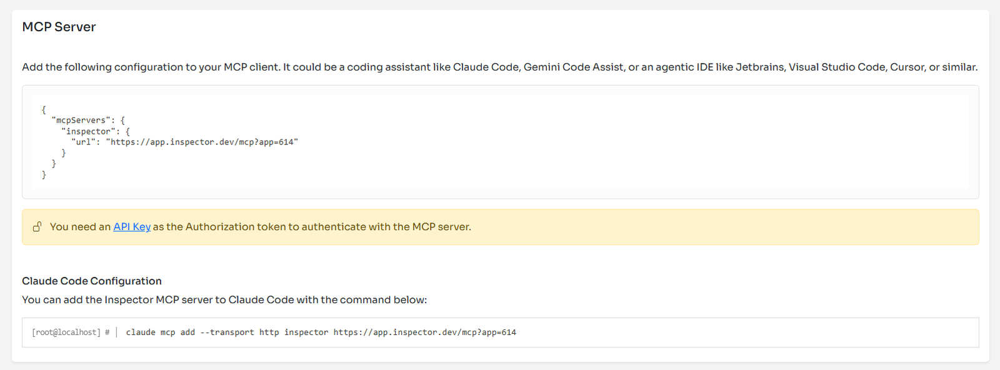

You push code, hope it works, and discover issues when users complain or error rates spike. Traditional monitoring tools require constant context switching—jumping between your IDE, terminal, dashboard tabs, and documentation. This friction kills productivity and delays problem resolution.

Inspector's new MCP server changes this dynamic by connecting your AI coding assistant directly to your production monitoring data. Instead of manually checking dashboards, you can simply ask your AI assistant about your application's current state and receive real-time insights without leaving your development environment.

## What the Inspector MCP Server Actually Does

The MCP server creates a bridge between AI clients like Claude Desktop, Cursor, Windsurf, or Continue and your Inspector monitoring data. Your AI assistant gains access to performance metrics, error analyses, database queries, and application health indicators—all through natural language queries.

This integration supports the most popular AI-powered development environments:

- **Claude Desktop** for general development assistance
- **Cursor** and **Windsurf** for AI-powered code editing
- **Continue** for open-source AI coding assistance
- **Codeium** for autocomplete and code generation

Rather than switching between multiple tools, you maintain a single conversation thread where coding questions and production monitoring blend seamlessly.

## Real Development Scenarios

Consider debugging a performance issue. Previously, you'd write code, deploy, check multiple monitoring tabs, correlate metrics across dashboards, then return to your IDE with fragmented information. With Inspector's MCP server, this becomes a fluid conversation:

```bash
You: "I just deployed the new user registration feature. How's it performing?"

AI Assistant: "Looking at your Inspector data, the registration endpoint is averaging 1.2s response time and no errors. The main bottleneck appears to be database queries - specifically the user validation query is taking 800ms on average. There are also 3 failed Redis cache operations in the last hour."
```

Your AI assistant now understands both your code and its production behavior, enabling more informed suggestions. When you ask for optimization recommendations, the assistant can reference actual performance data rather than making generic suggestions.

For error investigation, the workflow becomes remarkably efficient:

Instead of manually checking error logs, you can ask: "*Are there any errors in the user profile update functionality?*" Your assistant might respond: "*Yes, there have been 15 ValidationException errors over the last 2 hours. The pattern suggests issues with phone number validation for international formats.*"

This contextual awareness accelerates debugging because your assistant understands both the code structure and its runtime behavior.

## Enhanced Code Review and Optimization

The most significant benefit emerges during code implementation and optimization sessions. Your AI assistant can evaluate proposed changes against actual production execution performance data:

```php
// Proposed optimization
public function getRecentOrders($userId, $limit = 10) {
    return Cache::remember("user_orders_{$userId}_{$limit}", 3600, function() use ($userId, $limit) {
        return Order::where('user_id', $userId)
                   ->with('items', 'shipping')
                   ->latest()
                   ->limit($limit)
                   ->get();
    });
}
```

You can ask: "*Will this caching strategy help with the order listing performance?*" The assistant, with access to your monitoring data, can provide specific insights: "*Your current getRecentOrders endpoint averages 450ms response time with 200 daily calls. The proposed caching should reduce this to under 50ms for cache hits, which would affect about 80% of requests based on your current usage patterns.*"

This data-driven feedback loop helps prioritize optimization efforts based on actual impact rather than assumptions.

## Production Health at a Glance

Daily development workflows benefit from casual health checks. Starting your day with "How did my application perform overnight?" provides immediate awareness of any issues that developed while you were away. Your assistant can summarize key metrics, highlight anomalies, and suggest priorities for the day.

During feature development, you can validate assumptions in real-time: "Is the new search feature causing any performance issues?" This immediate feedback helps catch problems before they escalate, reducing the typical delay between deployment and issue discovery.

The integration also enhances incident response. When problems occur, your assistant can quickly correlate symptoms across different system components: "The checkout process is failing - let me check both the error rates and related database performance..." This holistic view speeds diagnosis and resolution.

## Getting Started

Setting up the Inspector MCP server requires minimal configuration. Navigate to your application Settings in the Inspector dashboard to copy the proper configuration.



Here is an example of how it looke like:

```json
{
  "mcpServers": {
    "inspector": {
      "url": "https://app.inspector.dev/mcp?app=YOUR_APP_ID"
    }
  }
}
```

The setup process involves:

1. Create an API Key from your account: [API Key](https://app.inspector.dev/account/api)
2. Adding the server configuration to your AI client
3. Use your personal API Key as the Authorization token

Verify the connection with a simple prompt, like: "Are there errors in the app production environment?"

Once connected, your AI assistant gains access to comprehensive monitoring data, including performance metrics, errors, bug fix suggestions, database query analysis, etc.

## The Practical Impact

The real value it's in the reduced cognitive load. Instead of maintaining mental models of both your code and its production behavior separately, you work with an AI assistant that understands both contexts simultaneously.

This unified perspective leads to better architectural decisions, faster debugging, and more informed optimization choices. You spend less time gathering information and more time solving problems.

For teams, this shared context improves collaboration. When discussing performance issues or planning optimizations, everyone can reference the same real-time data through their AI assistants, leading to more productive technical discussions.

The integration doesn't replace traditional monitoring dashboards—it augments them by bringing monitoring insights directly into your development workflow. Critical alerts and detailed analysis still require dedicated monitoring interfaces, but routine health checks and development-related queries happen naturally within your coding environment.

Your development workflow becomes more informed, efficient, and responsive to production realities. The distance between writing code and understanding its impact in production has decreased significantly, creating a more integrated development experience that scales with application complexity.

Ready to connect your AI assistant to your production environment? Set up the Inspector MCP server and ask: "**What's happening in my application production environment?**"
