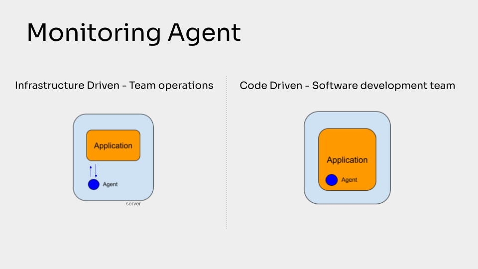

The last fundamental concept to fully evaluate whether, and how, to invest in a monitoring stack is the type of monitoring agent.

Very briefly, a monitoring system is always composed of two elements.

The agent, which is a software package that you must install in your application or infrastructure.

And the dashboard to view the data.

**View the full video: [https://www.youtube.com/watch?v=s3HZDrn1uBs](https://www.youtube.com/watch?v=s3HZDrn1uBs)**

## Monitoring Agent

In principle there are two types of agents.

One that requires to be installed at the infrastructure level, therefore on servers or virtual machines. In this case we can define it as an Infrastructure-Driven tool.

Other tools, however, offer monitoring agents in the form of purely software libraries, which are therefore installed as a library among the application dependencies, and therefore we can define it as a Code-Driven tool.

As you can see in this slide, the infrastructure-driven tools look at your application from the outside of your code. So they couldn’t be able to provide some types of information, but they can grab very deep feedback from the server level.

The Code-Driven tool instead lives inside your application, so they can gather really helpful information about the execution of the application code, but they are less coupled with the server.

It really depends on what you are more interested in.

## Software Developers or Operations Hands?

Very often I have noticed that when the platform has a monitoring agent installed on the servers, then the interaction with the monitoring platform is in the first instance in the hands of the operations team, i.e. the team that deals with the management and maintenance of the infrastructure.

Even more so if technologies such as Kubernetes, containers or similar are involved, or Infrastructure as a Service platforms in general.

**While if the agent is in the form of a software library, the control of the monitoring system passes into the hands of the software developers.**

At first glance it may seem like just a technical feature, which instead has a significant impact on the success of the adoption of a specific monitoring solution.

This is because it drastically impacts the developer experience.

These two teams (Infrastructure Management and Application Development) are often two distinct working groups. Therefore, depending on who is in charge of the interaction with the monitoring system, the other will find himself acting as a passive user and losing interest.

## Promote efficiency

The conflict between different teams or members inside a company is one of the most relevant problems that I have noticed, especially as the size of the team grows.

Since today 90% of Observability platforms provide an agent that requires to be installed on infrastructures, and are therefore tools managed by operations teams. As a software developer you risk experiencing monitoring as a bad experience, which does not bring value to your daily work, but rather complicates it.

The direct consequence is that today monitoring is perceived as too complex by software developers, imagining that it is viable only for large companies.

However, it could just be the wrong tool for your team's needs.

I hope I have given you a useful contribution to free you from these prejudices and help you improve your developer experience.

You now have the right information to better evaluate your real needs and the data you may need to make your software development activity successful.

Don't be afraid of experimentation, you never know what insights you're going to uncover inside your application that could end up making all the difference.
