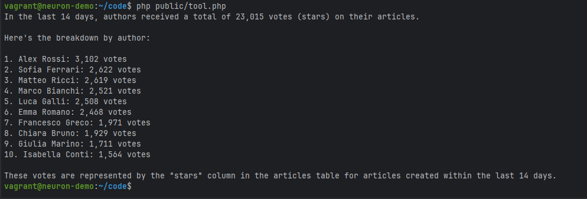
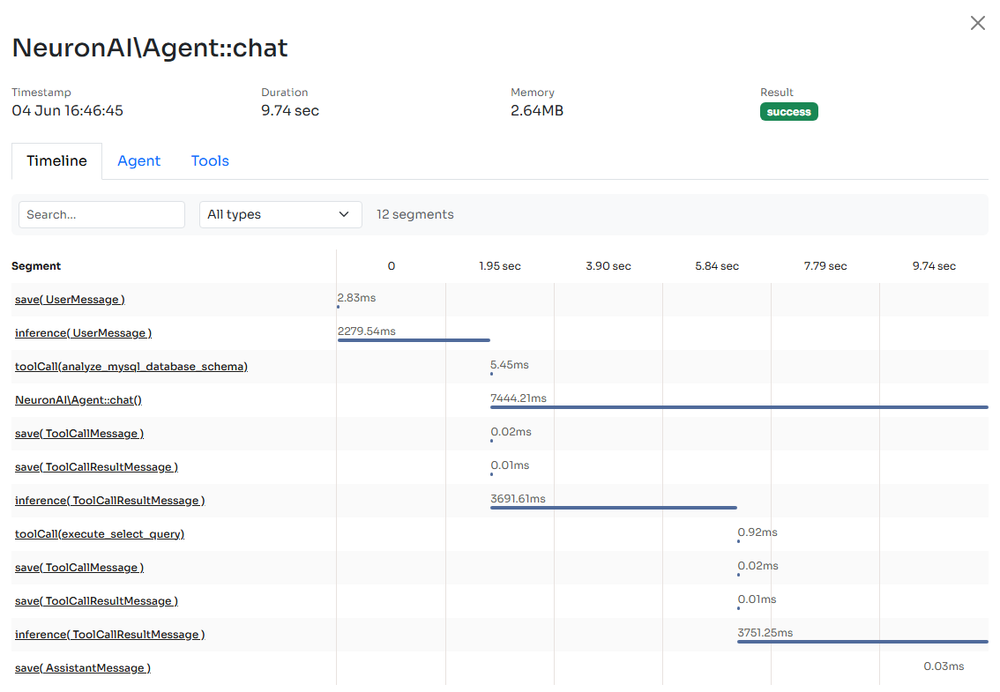
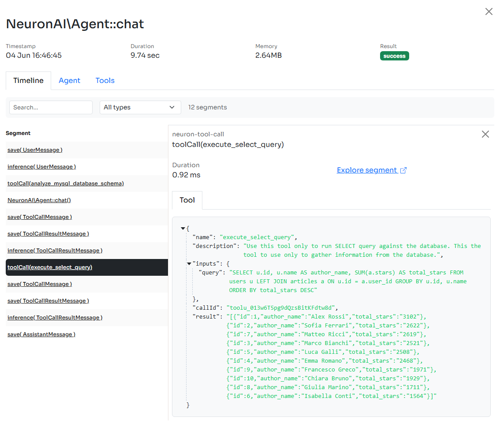

When I first began developing NeuronAI, I encountered the conceptual hurdle that trips up nearly every developer in their initial approach to AI agent development. Coming from years of building traditional web applications, where data flows predictably through controllers, models, and views, the notion of an AI agent that could autonomously interact with databases seemed almost unsettling.

The transition from writing explicit code that does exactly what you tell it to do, to creating agents that can reason about your data and take independent action, represents one of the most radical shifts in how we think about software architecture.

In classical web development, when a user wants to retrieve information from a database, we write specific routes, controllers, and queries that execute in a predetermined sequence. The flow is rigid, predictable, and entirely under our control. But AI agents operate on an different paradigm: they analyze requests in natural language, determine what actions are necessary, and then dynamically select and execute the appropriate tools to accomplish their goals.

This different flow it's a bit hard to digest because it challenges our deeply ingrained assumptions about control and predictability in application development. During the early development of Neuron's MySQL toolkit, I spent a lot of hours wrestling with this fundamental tension. How do you maintain the reliability and security that production grade applications demand while simultaneously granting an AI agent the autonomy to make decisions about database operations? The answer lies in understanding that tools and function calls provide a structured way to extend an agent's capabilities while maintaining strict boundaries around what actions it can perform.

## MySQL AI Toolkit: Bringing Intelligence to Your Database Layer

Before exploring the technical details of the MySQL Toolkit I want to show you how you can create a data analyst agent in just a few lines of code. To play with this toolkit you obviously need a MySQL database. I created a script to create and populate a blog database as an example. You can execute it with `php load_db.php`: [https://gist.github.com/ilvalerione/a2215a81b63ff3a41fe87a014141c1fb](https://gist.github.com/ilvalerione/a2215a81b63ff3a41fe87a014141c1fb)

Create the `DataAnalystAgent` with the `MySQLToolkit`:

```php
<?php

namespace App\Neuron;

use NeuronAI\Agent;
use NeuronAI\SystemPrompt;
use NeuronAI\Providers\AIProviderInterface;
use NeuronAI\Providers\Anthropic\Anthropic;
use NeuronAI\Tools\Toolkits\MySQL\MySQLToolkit;

class DataAnalystAgent extends Agent
{
    protected function provider(): AIProviderInterface
    {
        return new Anthropic(
            key: 'ANTHROPIC_API_KEY',
            model: 'ANTHROPIC_MODEL',
        );
    }
    
    public function instructions(): string 
    {
        return new SystemPrompt(
            background: ["You are a data analyst."],
        );
    }
    
    protected function tools(): array
    {
        return [
            MySQLToolkit::make(
                new \PDO("mysql:host=localhost;dbname=blog;charset=utf8mb4", 'root', '')
            );
        ];
    }
}
```

If your application is built on top of a framewrok you can easily get the PDO connection from the ORM. Here are a couple of examples in the context of Laravel or Symfony applications:

### Laravel Eloquent ORM

```php
namespace App\Neuron;

use NeuronAI\Agent;
use NeuronAI\Tools\Toolkits\MySQL\MySQLToolkit;

class DataAnalystAgent extends Agent
{
    ...
    
    protected function tools(): array
    {
        return [
            MySQLToolkit::make(
                \DB::connection()->getPdo()
            ),
        ];
    }
}
```

### Symfony and Doctrine ORM

Inject the database connection instance into your controller, and pass the PDO instance to the agent:

```php
namespace App\Controller;

use App\Neuron\DataAnalystAgent;
use Doctrine\DBAL\Connection;
use Symfony\Bundle\FrameworkBundle\Controller\AbstractController;
use Symfony\Component\HttpFoundation\Response;

class YourController extends AbstractController
{
    public function someAction(Connection $connection): Response
    {
        // Get the underlying PDO instance
        $pdo = $connection->getNativeConnection();
        
        $response = DataAnalystAgent::make($pdo)->chat(...);
        
        return $response->getContent();
    }
}
```

The Agent will look like this:

```php
namespace App\Neuron;

use NeuronAI\Agent;
use NeuronAI\Providers\AIProviderInterface;
use NeuronAI\Tools\Toolkits\MySQL\MySQLToolkit;

class DataAnalystAgent extends Agent
{
    public function __construct(protected \PDO $pdo){}

    ...

    protected function tools(): array
    {
        return [
            MySQLToolkit::make($this->pdo),
        ];
    }
}
```

More advanced Symfony users can configure the Agent itself as a service to automatically autowire the connection into the agent contructor.

### Ask The DataAnalystAgent For A Report

Now we can ask the agent to generate a report. This a simple PHP script you can run in the terminal:

```php
<?php

use App\Neuron\DataAnalystAgent;
use NeuronAI\Chat\Messages\UserMessage;

$response = DataAnalystAgent::make()->chat(
    new UserMessage("How many votes did the authors get in the last 14 days?");
);

echo $response->getContent();
```

The result will be something like:



If it sounds interesting enough I strongly recommend to follow the rest of the article to uncover all the development opportunities it can brings for your applications.

## NeuronAI Toolkits: Composable AI Agent Capabilities

The philosophy behind Neuron’s toolkit system emerged from a fundamental observation during AI Agents development: while individual tools provide specific capabilities, real-world AI agents often require coordinated sets of related functionalities. Rather than forcing developers to manually assemble collections of tools for common use cases, Neuron introduces toolkits as an abstraction layer that transforms how we think about agent capability composition.

The MySQL toolkit becomes more than just a database interface—it becomes part of a larger ecosystem where agents can seamlessly combine data retrieval and analysis with other capabilities like mathematical reasoning, web search, and more.

When a user asks an agent "How many active customers do we have this month?", the agent doesn't simply guess. Instead, it recognizes that this question requires database access, identifies the appropriate tool from its available arsenal, constructs the appropriate SQL query, and executes a tool that retrieves real data from your system.

If you want to learn more about the Toolkit system check out the article below:

[Introducing Toolkits: Composable AI Agent Capabilities In PHP](/introducing-toolkits-composable-ai-agent-capabilities-in-php/)

## NeuronAI MySQL Toolkit In-Depth

The [MySQL toolkit](https://docs.neuron-ai.dev/tools-and-function-calls#mysql) in Neuron exemplifies this principle in practice. Rather than forcing developers to build custom integrations or write complex prompt engineering to handle database interactions, the toolkit provides three distinct tools that map directly to the fundamental operations any data-driven application requires.

The **MySQLSchemaTool** allows agents to understand the structure of your database, enabling them to construct intelligent queries without requiring you to hardcode table structures or relationships into prompts.

The **MySQLSelectTool** enables read operations, allowing agents to retrieve and analyze data in response to natural language queries.

The **MySQLWriteTool** extends this capability to modifications, enabling agents to insert, update, or delete records based on conversational instructions.

What makes this approach particularly powerful is how it preserves the separation of concerns that experienced developers value while dramatically expanding the interface through which users can interact with your applications.

All tools in the MySQL toolkit require a [PDO](https://www.php.net/manual/en/class.pdo.php) instance as a constructor argument, which provides both flexibility and security in how you configure database access for your agents. If you're working within a framework environment or already using an ORM, you can easily extract the underlying PDO instance from your existing database layer and pass it directly to the tools.

The PDO requirement also opens up strategic possibilities for controlling agent behavior. Since the PDO instance represents a connection to a specific database with specific credentials, you can create dedicated database users with precisely the permissions your agent needs. This approach allows you to implement fine-grained access control, potentially limiting agents to read-only operations on sensitive tables while granting full access to others. The toolkit recognizes this security consideration by providing separate tools for reading and writing operations, allowing you to selectively grant capabilities based on your confidence in the agent's behavior and the sensitivity of the operations.

### MySQLSchemaTool

The *MySQLSchemaTool* serves as your agent's introduction to your database structure, providing detailed information about tables, columns, relationships, and constraints that enables the generation of precise and efficient queries. This tool essentially gives your agent the equivalent of a database administrator's understanding of your schema, allowing it to craft queries that respect your data model and take advantage of existing indexes and relationships.

```php
namespace App\Neuron;

use NeuronAI\Agent;
use NeuronAI\Tools\Toolkits\MySQL\MySQLSchemaTool;

class DataAnalystAgent extends Agent
{
    ...
    
    protected function tools(): array
    {
        return [
            MySQLSchemaTool::make(
                new \PDO("mysql:host=localhost;dbname=$dbname;charset=utf8mb4", $dbuser, $dbpass),
            ),
        ];
    }
}
```

The schema tool's real power emerges when you consider the alternative approaches to providing database context to AI agents. Without this tool, developers typically resort to embedding schema information directly in prompts or system messages, creating static descriptions that quickly become outdated as databases evolve. The MySQLSchemaTool dynamically retrieves current schema information, ensuring your agent always works with accurate, up-to-date database structure data.

For applications with large or complex databases, the tool accepts an optional second parameter that allows you to specify which tables should be included in the schema information passed to the language model. This capability proves invaluable for focusing agent attention on relevant data while reducing token usage and improving response times.

```php
namespace App\Neuron;

use NeuronAI\Agent;
use NeuronAI\Tools\Toolkits\MySQL\MySQLSchemaTool;

class DataAnalystAgent extends Agent
{
    ...
    
    protected function tools(): array
    {
        return [
            MySQLSchemaTool::make(
                new \PDO(...),
                ['users', 'categories', 'articles', 'tags']
            ),
        ];
    }
}
```

By limiting the schema scope, you can create specialized agents that focus on specific areas of your application. A content management agent might only need access to articles, categories, and tags, while a user administration agent requires visibility into users, roles, and permissions tables. This approach not only improves performance but also reduces the cognitive load on the language model, leading to more accurate and focused responses.

### MySQLSelectTool: Querying with Natural Language

The *MySQLSelectTool* allows the agent to access the database to run SELECT statements.

The select tool's implementation demonstrates the sophisticated reasoning capabilities that modern language models bring to database interactions. When a user asks "Show me all articles published this month by authors from Italy", the agent must understand temporal references, join relationships between articles and authors, and construct appropriate WHERE clauses.

This tool implements some guardrails to avoid any "write" operations even if they are nested in subqueries.

```php
namespace App\Neuron;

use NeuronAI\Agent;
use NeuronAI\Tools\Toolkits\MySQL\MySQLSelectTool;
use NeuronAI\Tools\Toolkits\MySQL\MySQLSchemaTool;

class DataAnalystAgent extends Agent
{
    ...
    
    protected function tools(): array
    {
        return [
            MySQLSchemaTool::make(new \PDO(...)),
            MySQLSelectTool::make(new \PDO(...)),
        ];
    }
}
```

This capability proves particularly valuable for business intelligence and reporting scenarios where you need to explore data without technical expertise ensuring the agent has readonly access.

Sales managers can ask for "*revenue trends by region over the last quarter*", content editors can request "*the most popular articles in the technology category*", and customer service representatives can find "*all support tickets from premium customers in the last week*". Each of these requests gets translated into precise SQL queries without requiring previous understanding of table structures, join syntax, or date functions.

### MySQLWriteTool: Enabling Data Modifications Through Conversation

The MySQLWriteTool extends agent capabilities to include INSERT, UPDATE, and DELETE operations, enabling applications to accept natural language instructions for data modifications. This tool represents the most powerful—and potentially sensitive—capability in the MySQL toolkit, allowing agents to make permanent changes to your database based on conversational input.

Remember to take in consideration to limiting the tables your agent will be able to interact with using the “tables” property in the MySQLSchemaTool.

```php
namespace App\Neuron;

use NeuronAI\Agent;
use NeuronAI\Tools\Toolkits\MySQL\MySQLWriteTool;
use NeuronAI\Tools\Toolkits\MySQL\MySQLSchemaTool;

class DataAnalystAgent extends Agent
{
    ...
    
    protected function tools(): array
    {
        return [
            MySQLSchemaTool::make(new \PDO(...), ['users', 'articles']),
            MySQLWriteTool::make(new \PDO(...)),
        ];
    }
}
```

The separation between read and write tools allows for graduated trust models in agent deployment. Applications can begin by deploying agents with only schema and select capabilities, allowing users to explore and analyze data safely. As you [continue to monitor](https://docs.neuron-ai.dev/advanced/observability) the agentic flow, and confidence in agent behavior grows, write capabilities can be selectively enabled for specific operations or user roles.

## The Path vs Intelligent Applications With Neuron AI

An agent equipped with database tools, file processing capabilities, and external API access can handle complex workflows that previously required custom development. A content management agent might retrieve article data from the database, generate summaries using language model capabilities, update publication status based on editorial guidelines, and notify stakeholders through external communication tools—all from a single conversational interface.

The implications for PHP developers are particularly significant because this capability comes from within the ecosystem they already know and trust.

## Production-Grade Monitoring

When I first demonstrated an early version of a database-connected agent to a customer, their initial excitement quickly turned to concern. "This is impressive", the CTO said, "but how do I know what it's actually doing? How do I debug when something goes wrong? How do I optimize performance when my database queries start timing out?".

Traditional web applications have mature monitoring ecosystems precisely because developers learned that you cannot reliably operate what you cannot observe. AI agents, with their dynamic decision-making and autonomous tool usage, amplify this need exponentially. When an agent constructs a database query based on natural language input, the query's performance characteristics, execution plan, and resource consumption become critical operational metrics.

This integration represents exactly why Neuron emerged from [Inspector](/). The MySQL toolkit isn't just a set of database tools—it's a production-ready system with the observability infrastructure that modern businesses require to trust autonomous systems with their critical data operations.

Here is an example of how you can see the agent execution flow using the MySQL toolkit and Inspector:

[](/neuron-ai/)

[](https://docs.neuron-ai.dev/advanced/observability)

## Resources

If you are getting started with AI Agents, or you simply want to elevate your skills to a new level here is a list of resources to help you go in the right direction:

- **MySQL Toolkit Doc**: [https://docs.neuron-ai.dev/tools-and-function-calls#mysql](https://docs.neuron-ai.dev/tools-and-function-calls#mysql)
- **Neuron AI – Agent Development Kit for PHP**: [https://github.com/inspector-apm/neuron-ai](https://github.com/inspector-apm/neuron-ai)
- **Newsletter**: [https://neuron-ai.dev](https://neuron-ai.dev/)
- **E-Book (Start With AI Agents In PHP)**: [https://www.amazon.com/dp/B0F1YX8KJB](https://www.amazon.com/dp/B0F1YX8KJB)
