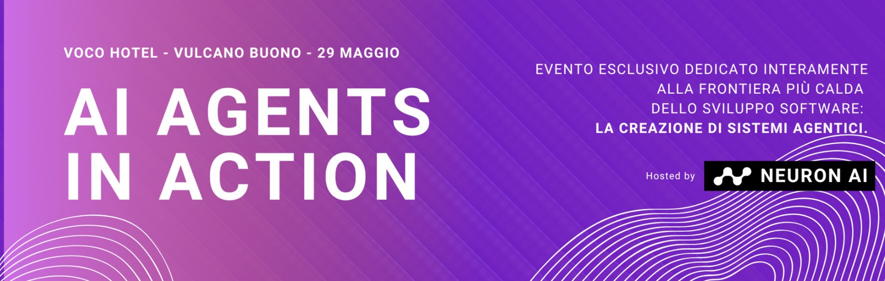

In late 2024 the parts of the internet I follow filled up with posts about AI agents. YouTube tutorials. Reddit threads. Blog after blog. Conference recordings. And underneath all of it, one technical stack: Python. The vocabulary of an entire field was being written in a language I had never used.

In my corner of the internet, the PHP and the web development corner, there was silence. No threads about agents. No serious discussion about how one of the top programming languages in the world, the king of web's backends was going to participate in what looked like the largest shift in application development in a decade. As CTO of a product company whose entire stack is PHP, that silence scared me. Inspector exists because thousands of teams ship PHP into production every day and need to know what's happening inside those applications. If those applications were about to gain a new layer that none of us could build, then the company I had co-founded with Sebastiano and Francesco was sitting on top of a foundation the industry was quietly walking away from.

Fear is what moved me at the beginning. Not strategy. Not ambition. Just the very specific dread of watching your professional world become invisible while the rest of the industry holds a conversation you weren't invited to.

So I started learning. I read about agents, tools, memory, RAG, workflows. I built small things in Python because there was no other option. And somewhere in that period, line of code after line of code, the fear started turning into something else. A question. If I was scared, and I had a company behind me, what about the freelancer in Naples or Krakow or Lagos who was watching their pipeline slowly tilt away from PHP work toward "AI integration" they had no way to deliver? What about the senior engineer at a SaaS company being asked, in the next planning meeting, whether the team could "do something with agents," and quietly realizing the honest answer was no? What about the team lead whose company had spent fifteen years building a custom PHP platform and was suddenly wondering whether all of it had hit a dead end?

In Python the agentic movement was a system. Books, courses, frameworks, model providers integrating natively, conferences. In PHP it was just an unknown. And unknowns, in software, do not stay unknown for long. They either get filled by someone who shows up to do the work, or the void itself becomes the answer, and the answer is "you're irrelevant now".

I decided to fill the unknown.

## The First Release

The first version of Neuron didn't try to be a complete framework. It didn't even remotely resemble the ecosystem you see today. It tried to be honest. PHP developers don't need a translation of LangChain. They need PHP-native abstractions for agents, tools, RAG, structured output, and the dozen other primitives that make agentic applications feel like applications and not glued-together demos. The first goal was just to make it possible to experiment without leaving the language.

I shipped v1 without much fanfare. I didn't know what to expect.

What happened was the first signal that this story wasn't going to be mine alone.

[Pawel Trela](https://www.linkedin.com/in/trela-pawel/), a developer from Poland I had never met, found Neuron in those early weeks and used it to build [Devtimate](https://devtimate.com/), an AI estimation tool for software projects, the kind of product that needs the agent layer to actually function. He built it on Neuron v1, when v1 was barely a framework and more of a working hypothesis. A few months later, the company exited. I remember reading that news and sitting still for a moment. I had been looking for permission to keep going, and Pawel had given it to me without knowing he was. Someone had built a real business on top of a thing I had shipped from fear.

Pawel did not disappear after the exit. He stayed in the community. When the project needed a new website, he designed and built one and donated it. The current [neuron-ai.dev](https://neuron-ai.dev) is his work. I'm grateful in a way that is hard to put into a sentence. He didn't owe us anything. He showed up because he wanted to.

The next one was Alessandro Astarita, CTO of [Capri.com](https://capri.com), one of the most important booking portals in Italy, found the early Neuron and used it to rebuild parts of his platform. Alessandro didn't just use Neuron. He reshaped the RAG module from the inside, contributed back, and is now building the next chapter of Capri.com on top of the framework. When we run our first live event the next week, "*AI Agents in Action*", Alessandro will be one of the speakers. The heroes return home and gather, but some of them helped build the house.

## The Messages I Wasn't Expecting

The thing I did not anticipate was the inbound. The emails. The GitHub discussions.

In December 2025 a developer named Mark opened a discussion on the Neuron repository. He started with appreciation, and then wrote something that I read three times the first time I saw it that the project was giving him hope his company's "15 year investment in a custom PHP platform has not hit a dead end". Fifteen years. The rest of his message was a critique: he wanted documentation that didn't presume Laravel or any other web frameworks, examples that would work without them, a faster path to RAG. I took the critique gladly because the critique was the easy part. The first line was the part I had been working for without knowing. That message lives publicly on [discussion #420](https://github.com/neuron-core/neuron-ai/discussions/420), and I think about it often.

There were others. [A developer wrote](https://github.com/neuron-core/neuron-ai/discussions/156#discussioncomment-13436693) about being on the verge of being moved off his team because his company was shifting "the AI part" toward a Python contractor. A freelancer wrote about losing two retainers in the same quarter to agencies that promised "agent integration" without specifying how. Junior developers asked whether they should give up on PHP entirely and relearn the basics in another language to stay employable.

I don't have an answer for all of them. I have one answer: you can build agentic systems in PHP now. The unknown is filled. You don't have to leave.

## The Pattern

In open ecosystems I have noticed a recurring pattern. Larger ecosystems notice things late. When they finally do notice, the size of their reach lets them write the story as if they were the protagonists from the beginning. This is not malice. It is how attention works. The audience that hears about something first tends to assume that's where it started.

What that pattern tries to do, is ignore the years of professional work that came before. What it actually does is something else.

A blog post can present its ecosystem as the first to do something. It cannot change the developers running Neuron in production. It cannot change the contributors whose names fill the changelog. It cannot change Pawel in Poland, who built a product and then went on to donate the new Neuron website. It cannot change Alessandro in Naples, who rebuilt the RAG module from the inside and is now running the next chapter of Capri.com on the framework. It cannot change Mark, whose company can keep building on fifteen years of PHP investment because Neuron exists. The git log knows what was built when. The community knows. The production deployments know.

What is actually at risk in attempts to dismiss the work of professinals contributors is the credibility of the people making them. Reputation in open source is one of the few currencies that cannot be inflated. The PHP ecosystem is large enough for many efforts. LLPhant, Prism, and others have done real work, and the developers using these tools know exactly who shipped what, and when.

## What This Cost

I want to be honest about the part that doesn't show up in blog posts.

The decision to commit Inspector's resources to Neuron was not a quick one. Inspector is a product company with paying customers, a roadmap, and a team. Spending company time on what was, at the start, an open-source framework with no obvious commercial path was not a no-brainer. It was a conversation. Sebastiano, our CEO, and Francesco, who runs the marketing side, both had to look at the same question I was looking at and decide whether the bet was worth making.

We made the bet for two reasons. The first is that Inspector is natively integrated into Neuron, which means anyone building production agents in PHP has a monitoring layer available the moment they need one. The second is harder to put into a slide. We believed, and still believe, that the PHP developer community deserved a serious answer to the agent question, and we were in a position to provide one. That kind of belief is not a strategy. It is a friendship and a shared desire to do something that matters.

I would not have shipped Neuron alone. I shipped it with them and thousands of PHP developers coming from every corner of the world.

## Where We Are Now

Neuron is at v3 now. The framework includes agents, tools, toolkits, RAG and data loaders, async and parallel execution, workflows, structured outputs, Evaluation, multimodality. [Maestro](https://github.com/neuron-core/maestro) is a general-purpose CLI agent runtime built on Neuron. [AIForm](https://github.com/neuron-core/ai-form) gives PHP developers a way to handle data collection through agents. [Router](https://github.com/neuron-core/router) to forward inference calls to different underlying providers based on a routing strategy you define.

AI providers and companies are reaching out instead of being chased.

After working so hard together, the developers are now creating a whole new class of products, looking to the future with confidence, not fear. At the beginning, none of this was the case. At the beginning it was just adventure.

## AI Agents in Action

Next week we are running our first live event in Italy, "[**AI Agents in Action**](https://www.tickettailor.com/events/inspectorsrl/2111250)". It's a local event, most of the people reading this blog won't be able to attend, but it matters to me because it is the first time the people who built this thing and the people who use it will be in the same room. Alessandro will be there. So will others whose names you will learn that day.

The hero's journey, when it ends, is supposed to bring the hero home. The agent revolution sent a lot of PHP developers into Python territory for a while, where they didn't recognize the vocabulary and weren't sure they belonged. The point of the event, and the point of this article, is to say that there is a way home, and that other people made it back too.

If you've read this far and you're a PHP developer who has been quietly wondering whether to leave the language, I have a small ask. Don't leave yet. Try this first.

**Start building with Neuron AI — The First Agentic Framework Of The PHP Ecosystem: [https://neuron-ai.dev](https://neuron-ai.dev)**
