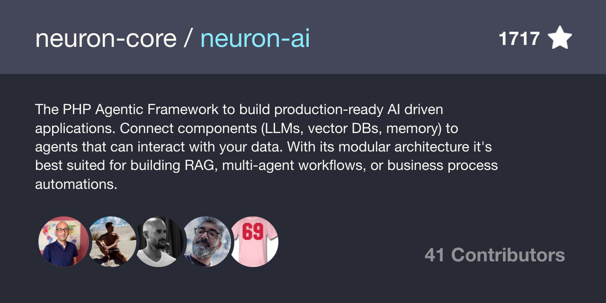

Exactly one year ago, we shared the first public lines of Neuron AI with the world. Six months ago, we stood at the crossroads of V2, refining our vision. Today, we arrive at Version 3 as the first agentic framework of the PHP world.

I'm aware that a major release every six months is a demanding pace. As developers, we value stability, we value the quiet confidence of code that doesn't shift beneath our feet. But the air in the AI space is thick with change. The landscape isn't just evolving, it's exploring totally new patterns of power and possibility. To wait would be to leave opportunities on the table, and my commitment to you has always been to bring these discoveries into the PHP ecosystem the moment they become substantial.

## What does Neuron v3 means?

V3 is a decisive architectural shift which definitively put a lid on the gap with other technologies and makes PHP a first-class citizen in the world of agentic systems development.

This new major version introduces a Workflow-First architecture. This is a clear design choice that really marks the difference between Neuron and any other project in the PHP space. Workflow is what makes possible features that were impossible to implement in a monolothic design, such as:

- The unified [messaging layer](https://docs.neuron-ai.dev/agent/messages) for multi-modal agents.
- Native support for [tool approval](https://docs.neuron-ai.dev/agent/middleware#tool-approval-human-in-the-loop) and fully customized human-in-the-loop flows.
- Multi-agent [streaming](https://docs.neuron-ai.dev/workflow/streaming) and collaboration.

Workflow is a solid primitive thanks to which you will be able to transform any PHP application into an autonomous agentic system, or breathe life into entirely new AI-powered products from scratch.

Check out the repository:

## Why build with Neuron AI

This journey made me understand that developers today finds themselves at a daunting threshold. You feel the pressure from other ecosystems, the noise of a hundred new technologies and trends, and the weight of an important question: "How can I learn, experiment, and integrate such technologies into my creations without losing my way? How can I stay relevant and navigate this change?"

It's easy to fall into the "hole" of indecision, choosing out-of-PHP-stack that feels alien, or frenetically trying tools just because they are new. By building Neuron as an ecosystem-wide framework rather than a scoped package, we are focused on protecting your knowledge and creating a diverse and large community of AI builders in PHP.

Whether you are moving between different projects, your skills become a universal key. When you learn to build an agentic system in Neuron, that mastery travels with you and your company. It doesn't matter where your code lives, what matters is that you, the creator, have a consistent, reliable methodology to turn ideas into reality, using the most advanced technology in the programming language you know and love.

## The Community

Most important, we are not building this in a vacuum, and we don't have all the answers. My role, and the role of the core team, is to listen. We have spent countless hours studying more advanced ecosystems, listen to your experiences, and test completely new paths. This contamination is the reason why Neuron offers a unique perspective on agentic applications development in PHP.

One of the most significant advantages of this project is the human contribution. When you choose this path, you aren't just adding a new entry in the composer file, but you're joining a conversation with hundreds of thousands of other developers around the world who believe "agentic" is the future of software products. And they are building it.

We want to empower creators in every form:

- **The Software Architect** crafting the next generation of intelligent software.
- **The Content Creator** building educational bridges for the next wave of developers.
- **The Contributor** who sees a gap and helps us bridge it for everyone.

## Moving Forward Together

Neuron V3 is our invitation to you to stop feeling like a passenger in the AI revolution but becoming the architect. We have worked hard to ensure that while the world outside is chaotic, your development environment is intuitive, elegant, and above all, deeply rooted in the PHP way.

We are here to help, in person, chat and collaborate with you to solve the unique problems that arise when theory meets production. Feel free to contact me on [Linkedin](https://www.linkedin.com/in/valeriobarbera/) or [X](https://x.com/Barbalerio), or follow Neuron channels to stay up to date:

- Newsletter: [https://neuron-ai.dev](https://neuron-ai.dev/)
- Linkedin: [https://www.linkedin.com/company/neuron-ai-php-framework](https://www.linkedin.com/company/neuron-ai-php-framework)
- X: [https://x.com/neuronai_php](https://x.com/neuronai_php)
- Instagram: [https://www.instagram.com/neuronai_php_adk/](https://www.instagram.com/neuronai_php_adk/)

Your feedback, your skepticism, and your successes are what built V3.

Let's see what we can create together.

[**https://docs.neuron-ai.dev**](https://docs.neuron-ai.dev)
