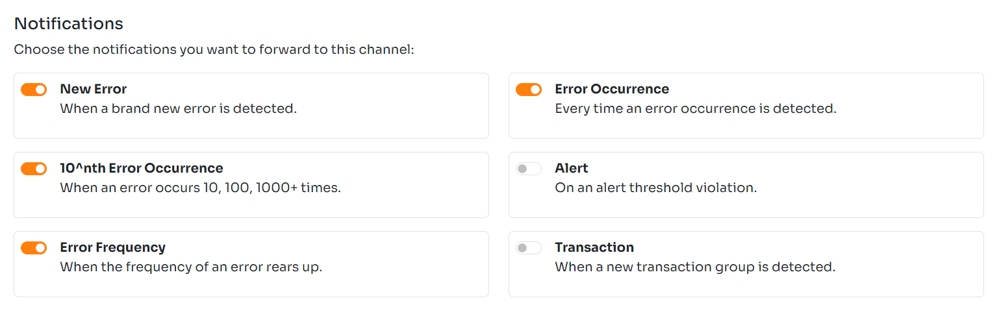
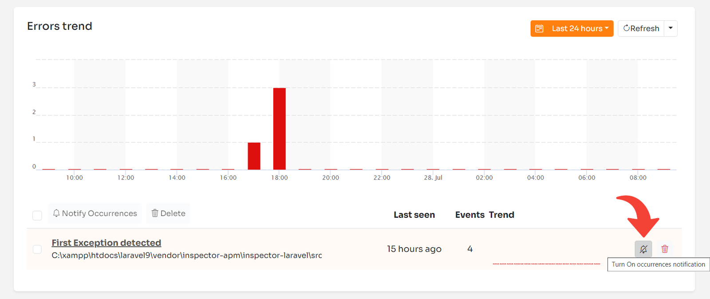

The latest product update includes some changes in the configuration of error notifications. Now you can configure error occurrences notification separately for each error group and not only at global level.

Let me show you how this change ensures much more flexibility for error notifications.

## Error occurrences notifications (before)

Inspector works with two concepts dealing with errors: Error groups, and error occurrences.

When an exception is fired in your application Inspector generates a fingerprint of the error. Thanks to this hash Inspector can distinguish between brand new error groups or occurences of an error already detected.

You can receive "New Error" notification every time a new error group is detected. But there may be some scenarios where you want to be notified of every occurrence of a particular error.

Before this release you can configure error occurrences notification only at the notification channel level, enabling or disabling it globally for all error groups or none.

This is the section that you can find in any notification channel to configure what notification you want to propagate through the channel.

Until now you couldn't activate the error occurrence notification for each error group individually. I knew this was a limitation, so today we released the solution.

## Error occurrences notifications (now)

The flag on the notification channel configuration screen is always available. So you can choose in what channel this type of notification should be sent.

In addition to this you can now use the "bell" on each error in your list to turn on/off the notification for each occurrence.

Occurrences notifications will be sent through the channel where they were enabled.

This system also helps configuring different channels for different purposes. You can attach the Mail channel to receive notifications only for new errors, and a Webhook channel to send occurrences notification to an external reporting system.

Remember that notifications for error occurrences can flood your channel with messages. So take care of this aspect enabling this type of notifications.

## New to Inspector? Try it for free now

Are you responsible for application development in your company? Consider trying my product [**Inspector**](/) to find out bugs and bottlenecks in your code automatically. Before your customers stumble onto the problem.

Inspector is usable by any IT leader who doesn’t need anything complicated. If you want effective automation, deep insights, and the ability to forward alerts and notifications into your preferred messaging environment try Inspector for free. [**Register your account**](https://app.inspector.dev/register).

Or learn more on the website: [**https://inspector.dev**](/)
