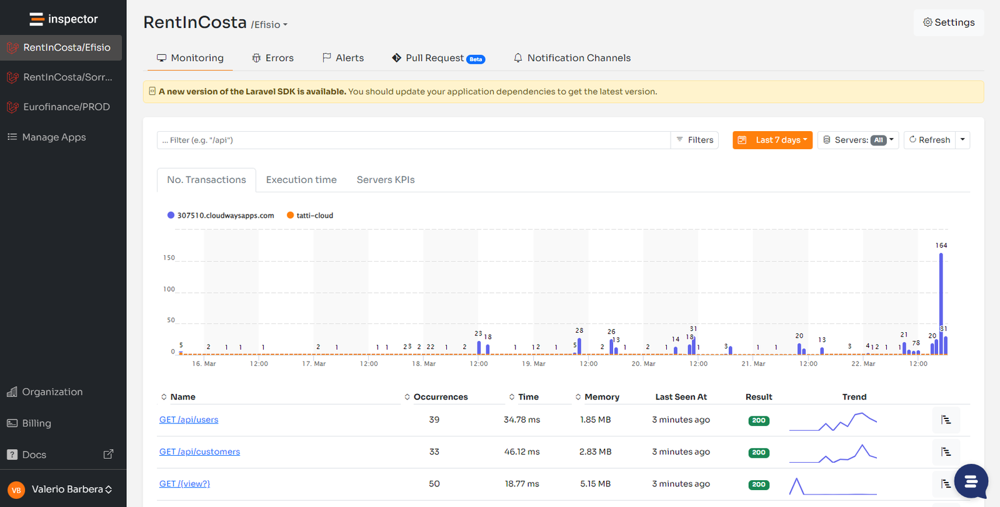

I recently had the opportunity to discuss the adoption of Inspector by a team of developers based in Brazil. At the time they were using NewRelic to monitor their applications, but found that it was not compatible with Laravel Octane.

Ever since Laravel Octane was released I have thoroughly studied its internal dynamics to make sure that Inspector Laravel package continues to work as usual. Due to its characteristics I always suspected that Octane could cause a lot of headaches for "infrastructure oriented" monitoring platforms.

Let me give you some technical details.

## Introduction to Laravel Octane

[Laravel Octane](https://laravel.com/docs/master/octane) is a high-performance application server for Laravel, designed to significantly boost the performance of Laravel applications. It was introduced in Laravel 8.x and provides a way to serve Laravel applications using high-performance application servers like Swoole and RoadRunner.

As the official documentation says:

> Octane boots your application once, keeps it in memory, and then feeds it requests at supersonic speeds.
>
> — Laravel documentation

Your Laravel application runs inside a long-running process which can create problems for the monitoring agents installed on your machine to know what is happening inside it.

### Install Laravel Octane

To install Laravel Octane, run the following command in your terminal:

```bash
composer require laravel/octane
```

Then, install the desired server (Swoole or RoadRunner). I choose swoole for this demostration:

```bash
composer require swoole/ide-helper
php artisan octane:install --server=swoole
```

### Running the Laravel Octane server

Once installed, you can run Octane using the following Artisan command:

```bash
php artisan octane:start
```

This will start a Swoole or RoadRunner-based server, depending on your configuration. Now, every request that comes in will be served by this long-running server, significantly reducing the overhead of starting the Laravel application for each HTTP request.

## Internal workflow of Laravel Octane

To better understand its characteristics let's break down the internal workflow in a simplified way.

**Server Start**:

- Octane boots Laravel once and keeps it in memory.
- Workers (child processes) are spawned to handle requests.
- These workers run in a loop, processing requests in the background.

**Request Handling**:

- When an HTTP request arrives, it is assigned to a worker.
- The worker processes the request (e.g., resolving routes, handling controller logic).
- The worker returns the response to the client.

**Concurrency Management**:

- If multiple requests arrive simultaneously, they are handled by different workers concurrently.
- Swoole or RoadRunner ensures asynchronous I/O operations to maximize performance and responsiveness.

**Task Dispatching**:

- Octane can dispatch background tasks (e.g., queues or asynchronous jobs) to reduce blocking in the main request flow.

Here is a graphical representation of these steps:

```bash
┌──────────────┐  1. Start Laravel App
│   Artisan    │─────────────────────┐
│ octane:start │                     │
└───────┬──────┘                     ▼
        │                  ┌─────────────────┐
        │ 2. Bootstrap App │  Laravel Kernel │
        │                  └─────────────────┘
        │                            │
        ▼                            ▼
┌─────────────────────────────┐  ┌───────────────────┐
│  Start Workers in Pool      │  │ Framework Loaded  │
└──────────────┬──────────────┘  └───────────────────┘
               │
               ▼
        ┌─────────────┐
        │ Worker Pool │─────┐
        └─────────────┘     │
                            ▼
                   ┌──────────────────┐
                   │ Incoming Request │
                   └─────┬────────────┘
                         │
              ┌──────────▼───────────┐
              │ Assign Request to    │
              │ Free Worker          │
              └──────────┬───────────┘
                         │
                         ▼
           ┌─────────────────────────┐
           │ Process Request (Worker)│
           └───────────┬─────────────┘
                       │
                       ▼
              ┌─────────────────┐
              │ Return Response │
              └─────────────────┘
                       │
                       ▼
             ┌──────────────────┐
             │ Worker Ready for │
             │ Next Request     │
             └──────────────────┘
```

## How to monitor Laravel with Octane

NewRelic as many other monitoring platform try to monitor your application using monitoring agents installed on the server, at the infrastructure level. So outside your application.

Since Laravel Octane execute your application in a long-running process that never ends, these kind of agents can't be able to monitor what's happening inside.

Inspector instead works with a simple [**Laravel package**](https://github.com/inspector-apm/inspector-laravel) so it's installed inside your application. You don't need to install anything on the VM or the cloud infrastructure. It doesn’t matter where your application is running. Inspector is integrated with your framework, not with the server.

Recently the package has surpassed 1.2 million installations. **[Stats from Packagist](https://packagist.org/packages/inspector-apm/inspector-laravel/stats)**.

After [**installing the package**](https://docs.inspector.dev/guides/laravel/installation) you should attach the Octane specialized middleware to the application routes:

### Laravel 11

```php
use \Inspector\Laravel\Middleware\InspectorOctaneMiddleware;

return Application::configure(basePath: dirname(__DIR__))
    ->withRouting(
        // routes
    )
    ->withMiddleware(function (Middleware $middleware) {
        // Append the middleware
        $middleware->appendToGroup('web', InspectorOctaneMiddleware::class)
            ->appendToGroup('api', InspectorOctaneMiddleware::class);
    })
    ->withExceptions(function (Exceptions $exceptions) {
        //
    })->create();
```

### Laravel <= 10

```php
/**
 * The application's route middleware groups.
 *
 * @var array
 */
protected $middlewareGroups = [
    'web' => [
        ...,
        //\Inspector\Laravel\Middleware\WebRequestMonitoring::class,
        \Inspector\Laravel\Middleware\InspectorOctaneMiddleware::class,
    ],
    
    'api' => [
        ...,
        //\Inspector\Laravel\Middleware\WebRequestMonitoring::class,
        \Inspector\Laravel\Middleware\InspectorOctaneMiddleware::class,
    ],
]
```

That’s it.

Your application will continue to be monitored as a "standard" Laravel installation without any side effect.



## Other NewRelic bottlenecks

The team of Brazilian devs delved even deeper into the motivations that drove them to look for valid alternatives to NewRelic.

They wanted to monitor other internal applications as well. Applications that are less critical but for which the company would benefit from real-time monitoring data.

The problem was the complexity of making NewRelic at work on other applications and even more problematic was the big increase in costs.

Costs to monitor other hosts, costs to share the monitoring environment with other users, and the complexity to configure and use the platform.

For me it was a revealing discussion. I had never heard all these details about the various use cases in which Inspector provides a design and pricing policy much more convenient than platforms aimed at large corporations.

So, thank you guys, I’m happy to collaborate with such open minded developers like you. The Inspector community continues to grow.
