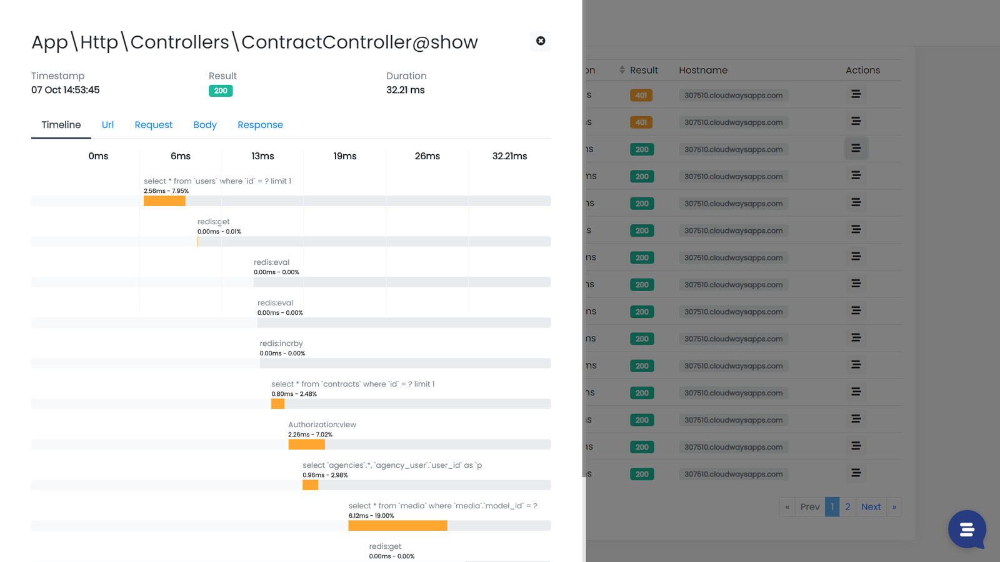
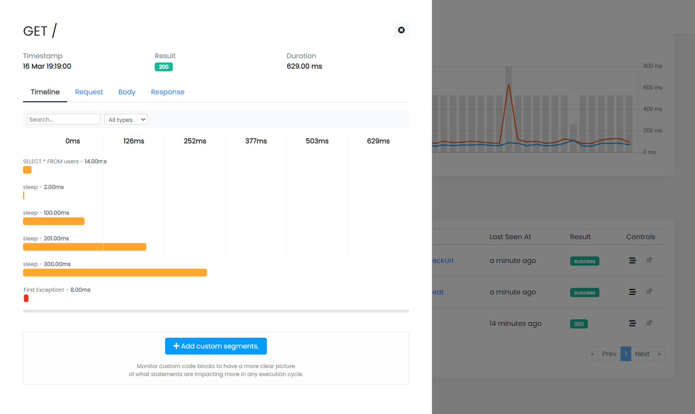

Hi, I'm Valerio, software engineer and CTO at Inspector.

Whether you've looked at async/await and promises in javascript before, but haven't quite mastered them yet, this article aims to help you to better understand the real effects of the Nodejs async engine on your code execution flow.

Furthermore we'll do it visually, navigating the code execution flow in real-time thanks to Inspector. At the end of the article you'll find a really interesting video talk to test the asynchronous execution in nodejs by yourself.

## Synchronous Programming

In traditional programming languages, most operations happen synchronously. If you think about PHP, and about how you would read a file using PHP, you would end up with something like this:

```php
echo "Start reading the file...";

$content = file_get_contents('./export.csv');

echo $content;

echo "End of the script...";
```

The main thread will be blocked until the file is read, which means that nothing else can be done in the meantime, so we are sure that the script will echo the content of the file.

When you execute a synchronous script, you wait for each task to finish before moving on to another task.

```bash
Start reading the file...
#Content of the file
End of the script...
```

As you can see in the image below, this behaviour become clear taking a look to the code execution timeline of a Laravel application. The endpoint below runs a bunch of query against the database and the redis server, and each task has been executed sequentially, one after the other.

When a task is finished another one is executed until the end of the program.



*Code Execution flow visualization in Inspector.*

## Asynchronous programming

In an asynchronous environmet like Nodejs some tasks can be scheduled to be executed in parallel with the main script, leaving the main program to continue running subsequent tasks in the script.

Take a look on the following code example to read a file in nodejs:

```javascript
const fs = require('fs')

console.log("Start reading the file...")

fs.read('./export.csv', function(err, content) {
    console.log(content)
})

console.log("End of the script...")
```

We read a file using the **fs** module, and the **content** variable is logged after *"End of the script..."* string.

```bash
Start reading the file...
End of the script...
#Content of the file
```

Once we started to read the file the execution continued, and the application printed "End of the script..." first, and the callback was only called once the file read was finished.

We can see the parallel execution in anction using Inspector to have a visual representation of the code execution flow in an async context:



*Nodejs execution flow*

Where needed the tasks are executed simultaneously, each with its own duration. Code Execution Monitoring often allows us to become more aware of the behavior of the code we write. That's why its adoption continue to grow in the Nodejs and Laravel communities.

To understand the async nature of NodeJs more in-depth, you need to absolutely watch this video:

[What the heck is the event loop anyway? | Philip Roberts | JSConf EU](https://www.youtube.com/watch?v=8aGhZQkoFbQ)

## Next Up: Your First Node.js Server

In the next chapter, you will learn how to deploy [your Node.js server using Laravel Forge](https://blog.risingstack.com/your-first-node-js-http-server/) - in the meantime if you have any questions, don't hesitate to ask!
