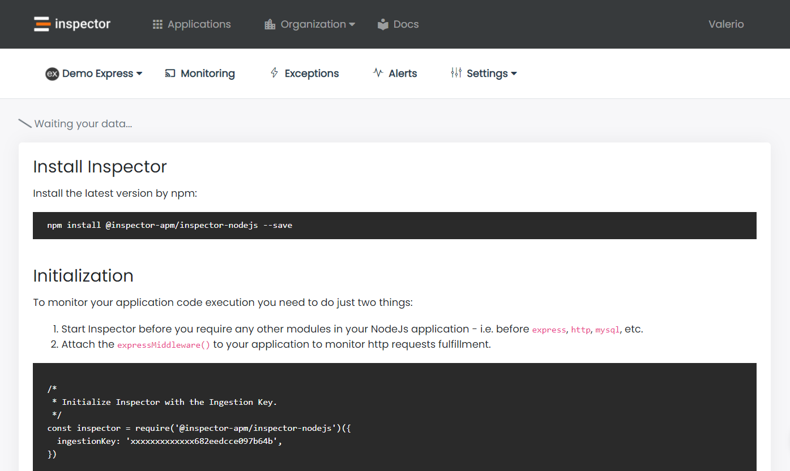
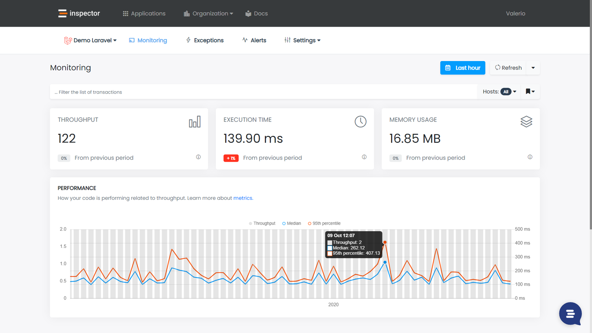
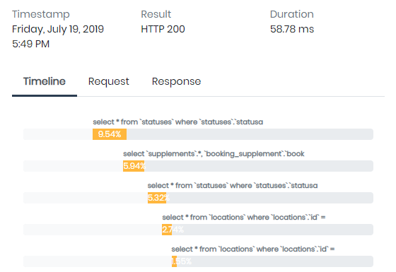
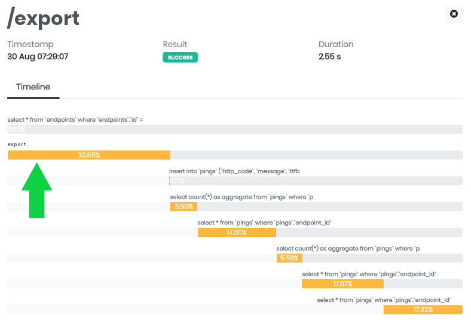
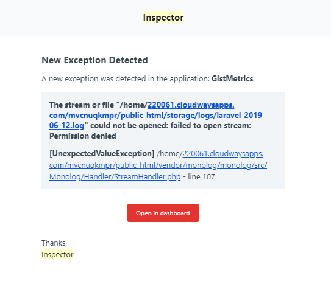
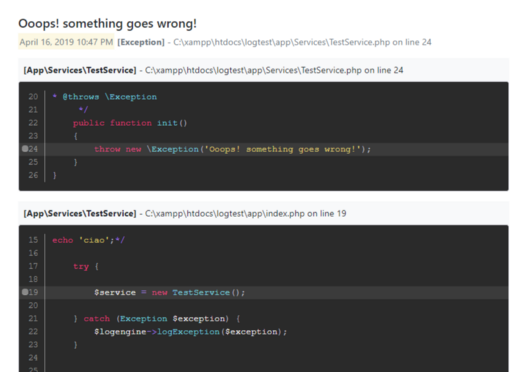

I'm one of those developers who release new code changes almost every week and unfortunately it’s quite impossible to anticipate all the problems that could happen after every release. I used performance monitoring for Nodejs in the last project I worked on before launching my SaaS company. this experience made me passionate about this aspect of the developer's work. Very important for companies that invoice important figures thanks to their software.

I learned on my skin that users don't spend their time reporting bugs, they just stop using your application, looking for another one that just doesn't give any problems. But technical problems also have the undesirable effect of blocking new potential customers during on-boarding.

When I started to share my idea behind Inspector I realized that many developers know the problem: **they spend a lot of time to investigate strange behaviors inside their application, but they didn’t know that there’s a solution to eliminate this complexity, avoiding customer complaints or even the loss of the customer.**

Be the first to know if your application is in trouble “**before**” users stumble onto the problem, drastically reduce the negative impact on their experience, giving you the right foundation to run a successful users acquisition process and to continually increase engagement with less interruptions as possible.

Inspector is an **npm** module to add real-time performancen monitoring to your NodeJS application, allowing you to work on continuous code changes while catching bugs and bottlenecks at a glance before users do.

In this article I'll use Express framework to build code snippets, but you are free to use Inspector with Fastify or in any plain Nodejs script.

## NodeJS Performance Monitoring: how it works

We will use a simple middleware to monitor the HTTP traffic against your express app ang get performance insights to help you take your application under control.

It takes less than one minute to get started. Let me show you how it works.

### Install Inspector

Install from npm with the command below:

```bash
npm install @inspector-apm/inspector-nodejs --save
```

### Configure the Ingestion Key

Get a fresh Ingestion key by signing up for Inspector ([https://app.inspector.dev/register](https://app.inspector.dev/register)) and create a new project, it takes just a few seconds.

You’ll see installation instructions directly in the app screen:



### Initialization

To monitor the code execution in real time you need to initialize Inspector before you require any other modules in your application - i.e. before `express`, `http`, `mysql`, etc.

Then you have to attach the `expressMiddleware()` to your express instance.

```javascript
/* 
 * -------------------------------------------
 * Initialize Inspector with the Ingestion Key.
 * --------------------------------------------
 */
const inspector = require('@inspector-apm/inspector-nodejs')({
  ingestionKey: 'xxxxxxxxxxxxx',
});

const app = require('express')();

/* 
 * -----------------------------------------------
 * Attach the middleware to monitor HTTP requests.
 * ------------------------------------------------
 */
app.use(inspector.expressMiddleware());


/* 
 * ---------------------------------
 * Other application routes.
 * ---------------------------------
 */
app.get('/', function (req, res) {
    return res.send('Home Page!');
});

app.listen(3006);
```

That's it.

## Navigate your application

Now when your application receive a request Inspector automatically detect the most important events and create a visual representation of what's happening inside your code during its normal operations.

Launch the app with `node app.js` command, and navigate it in the browser on **`http://localhost:3006`**.

Instantly you will see transaction streams in your dashboard and for each transaction you can monitor what your application is executing:





### Enrich your timeline

Inspector monitors database query, with many type of driver (mysql2, postgre, mongodb) by default, but there might be many critical statements in your code that needs to be monitored in terms of performance and errors:

- Algorithms
- Function that deals with files (pdf, excel, images)

**Thanks to our module you can add custom segments in your timeline in addition to those detected by default, to measure the impact that an hidden code block has on a transaction’s performance.**

Let me show you a real life example.

Suppose you have a function that export data from the database in a csv file.

```javascript
app.get('/export', function (req, res) {
    connection.query(
        'SELECT * FROM users',
        function (err, results, fields) {
           res.download(
               ExportService.createCsv(results)
           )
        }
    );
});
```

The query will be automatically detected by Inspector but **it could be interesting to monitor and measure the execution of the exprot function and activate alerting if somethings goes wrong.** Here you can create a custom segment to add the file export statement in your timeline and monitor its impact on the request fulfillment over time.

```javascript
app.get('/export', function (req, res) {
    connection.query(
        'SELECT * FROM users',
        function (err, results, fields) {

           // Add the export procedure to the timeline
           inspector.addSegment(() => {
              return ExportService.createCsv(results)
           }, 'export').then(file => {
              res.download(file)
           })

        }
    )
})
```

You will easily identify the impact of the new segment in the transaction timeline:



### Errors & Exceptions Alerting

**By default, every exception fired in your Nodejs app will be reported automatically to be sure you're alerted for unpredictable errors in real time.**

I wish that every change I make to my code could be perfect. But the reality is, this is not always the case. Some errors appear immediately after an update, while others pop up unpredictably. It’s an unfortunate fact of life for developers which often also depends on problems caused by the connection between our application and other services.

However, Inspector makes the job easier. It automates the detection of unknown issues so I no longer need to manually check the status of my apps continuously or wait reports directly from users. If something goes wrong It will send a notification in real time, and after each release I can stay informed about the impact of the latest code refactor.

If your code fires an exception but you don't want to block the execution, you can report the error to inspector manually for personal monitoring.

```javascript
try {   

    // Your dangerous external call here...

} catch (e) {
   inspector.reportException(e)
}
```

Furthermore, if the export method fails, you will be alerted in real time in your inbox to take a look at the error as it appears.



You even get access to detailed information gathered by Inspector in real time:



### Conclusion

When a customer reports to you that something isn’t working, it forces you to drop whatever you are doing and start trying to reproduce the scenario, then recapture and reanalyze the logs in your own toolset.

Getting a true picture of what’s happening can require hours or, based on my experience, even days. Inspector can make a huge difference in terms of efficiency, productivity and customers happiness.

By delegating bug discovery to an automatic **NodeJs monitoring tool**, it makes 90% of the work behind the scene, and you can solve issues before users even know about them.
