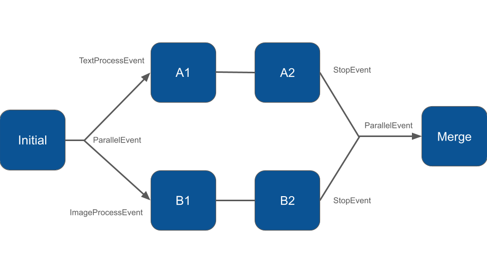

One of the things I didn't expect when I started building Neuron AI was how much the design of the framework would be shaped by the people using it. I started this project to solve my own problems: I wanted PHP developers to have a clean, idiomatic way to integrate AI into their applications without having to learn Python or rewire their entire mental model. But at some point, the users started driving the direction more than I did. That's probably the clearest signal that something is actually being used in the real world.

Issue [#530](https://github.com/neuron-core/neuron-ai/issues/530) is a good example. A developer came in with a well-structured request: they had an agentic document processing pipeline where several independent tasks (extracting text, analyzing images, classifying metadata) were all running sequentially. Each step was calling an LLM. The total latency was roughly the sum of all individual calls. The question was simple: can these branches run in parallel?

It's the kind of request that feels obvious in hindsight. Of course they should run in parallel when there's no dependency between them. But when you're in the middle of building a framework, you're thinking about the happy path, the core abstraction, the learning curve. Edge cases, even smart ones, come later. This was one of those cases where a user saw the full potential of the architecture before I had fully mapped it myself.

## How Parallel Branches work

The [Workflow](https://docs.neuron-ai.dev/workflow/loops-and-branches#parallel-branches) in Neuron AI is event-driven. Each node receives an event, does its work, and returns an event that determines which node runs next.

Sequential pipelines, loops, conditional branches, all of that emerges from which events a node declares as its input and return types. Parallel execution fits naturally into this model.

When a node needs to fan out into multiple independent branches, it returns a `ParallelEvent` instead of a regular event. You pass an array of branch name and first-event pairs to its constructor:

```php
use NeuronAI\Workflow\Events\ParallelEvent;

class DocumentProcessing extends Node
{
    public function __invoke(StartEvent $event, WorkflowState $state): ParallelEvent
    {
        return new ParallelEvent([
            'text'  => new TextProcessEvent(),
            'image' => new ImageProcessEvent(),
        ]);
    }
}
```

Each branch is a named key mapping to the first event of that branch. The nodes that handle those events, and all subsequent nodes in each branch, are registered in the workflow as usual:

```php
class MyWorkflow extends Workflow
{
    protected function nodes(): array
    {
        return [
            new DocumentProcessing(),

            // "text" branch
            new DescriptionGenerationNode(),
            new TextRefactorNode(),

            // "image" branch
            new ImageProcessNode(),
            new AddWatermarkNode(),

            new MergeNode(),
        ];
    }
}
```

Each branch ends when its last node returns a `StopEvent`. The `StopEvent` can carry a result payload, which is how data flows back from the branches to the main workflow:

```php
class TextRefactorNode extends Node
{
    public function __invoke(TextProcessEvent $event, WorkflowState $state): StopEvent
    {
        // ... do the work

        return new StopEvent(result: $refinedText);
    }
}
```

Once all branches have completed, the `ParallelEvent` is forwarded to the next node — the merge point. That node receives the `ParallelEvent` and can read each branch's result by name:

```php
class MergeNode extends Node
{
    public function __invoke(ParallelEvent $event, WorkflowState $state): StopEvent
    {
        $textResult  = $event->getResult('text');
        $imageResult = $event->getResult('image');

        // Combine, persist, return a final event...
        return new StopEvent();
    }
}
```

One detail worth noting: **each branch gets an isolated copy of the workflow state**. They start with the same snapshot, but mutations inside a branch don't propagate to sibling branches or to the main workflow. The only way to pass data back is through the `StopEvent` result. This is intentional, it avoids a whole class of concurrency bugs where branches step on each other's state.

## Running Branches Concurrently



By default, Neuron AI runs all nodes, including parallel branches, with its default `WorkflowExecutor`. The branches will still execute correctly, but in a sequential manner, just one after the other. For most use cases where the branches are lightweight, this is fine.

If you want the branches to actually run at the same time, you need the `AsyncExecutor`, which is built on [Amp](https://github.com/amphp/amp):

```bash
composer require amphp/amp
```

Then override the `executor()` method in your workflow:

```php
use NeuronAI\Workflow\Executor\AsyncExecutor;

class MyWorkflow extends Workflow
{
    protected function executor(): WorkflowExecutorInterface
    {
        return new AsyncExecutor();
    }

    protected function nodes(): array
    {
        return [...];
    }
}
```

To make the async executor actually useful for LLM calls inside nodes, you also need to use the `AmpHttpClient` when building your agents within those nodes. [**Neuron AI already provides it**](https://docs.neuron-ai.dev/agent/async#amphttpclient):

```php
use NeuronAI\HttpClient\AmpHttpClient;

class DescriptionGenerationNode extends Node
{
    public function __invoke(TextProcessEvent $event, WorkflowState $state): StopEvent
    {
        $response = AsyncAgent::make()
            ->chat(new UserMessage('Describe this image'))
            ->getMessage();

        return new StopEvent(result: $response);
    }
}
```

The performance difference is real. In the test suite, two branches each with a 100ms simulated delay complete in roughly 100ms with the `AsyncExecutor`, versus roughly 200ms when running sequentially. When you're dealing with actual LLM calls that take several seconds each, that gap becomes significant.

## What this is useful for

The document processing scenario from issue [#530](https://github.com/neuron-core/neuron-ai/issues/530) is the clearest example: you have a file, and you want to extract structured data from it while simultaneously generating a description. These two tasks don't depend on each other. There's no reason to wait for one before starting the other.

The same pattern applies to any pipeline where independent enrichment steps need to converge before a final decision: running multiple agents with different specializations, fetching data from several sources in parallel before synthesizing a report, or evaluating a generated output across multiple dimensions simultaneously. The merge node is just a regular node, it can do whatever you need once it has all the branch results in hand.

Full documentation is available at [docs.neuron-ai.dev](https://docs.neuron-ai.dev/workflow/loops-and-branches#parallel-branches).
