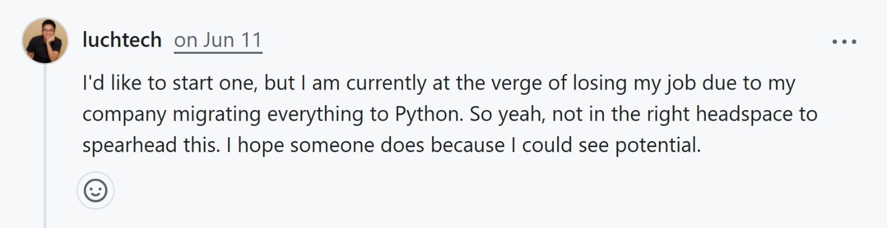

I've spent the last year building **[Neuron](https://neuron-ai.dev)**, a PHP framework designed specifically for agentic AI applications. What started as a technical challenge became something else entirely when developers began reaching out with stories I wasn't prepared to hear. They weren't asking about framework features or deployment strategies. They were telling me about losing their jobs.

One senior developer had spent eight years at a fintech company, building and maintaining their entire backend infrastructure in PHP. The systems worked. The codebase was clean. Then the leadership decided to pivot toward AI-driven automation. Within six months, the entire PHP team was let go, replaced by Python engineers who could integrate LangChain and build agent workflows. He watched his expertise become irrelevant not because he wasn't skilled, but because the tools he knew couldn't participate in the conversation that mattered to his company's future.

Here is the link to the post on the Neuron GitHub repository: [https://github.com/neuron-core/neuron-ai/discussions/156#discussioncomment-13436693](https://github.com/neuron-core/neuron-ai/discussions/156#discussioncomment-13436693)

Another engineer contacted me after his SaaS company made a similar shift. They didn't abandon PHP because it was slow or outdated. They abandoned it because when the CTO asked "can we build autonomous agents that handle customer support and data analysis", the answer from the PHP ecosystem was silence. No frameworks, no examples, no path forward. Python had entire conferences dedicated to agentic architectures while PHP developers were still arguing about whether type hints mattered.

These aren't isolated incidents. I hear versions of this story regularly now, and what disturbs me most is how predictable it all was. The PHP community saw the AI wave coming and collectively decided it was someone else's problem. We kept optimizing for the web patterns we've always known, reassuring ourselves that "PHP powers a significant portion of the internet" as if market share from past decisions protects against future irrelevance.

## The Cost of Ignoring What's Actually Happening

Some people dismiss AI development as a trend, a temporary excitement that will settle down and return us to familiar patterns. This perspective fundamentally misunderstands what's occurring. Agentic applications aren't a feature being added to existing software. They represent a different approach to building systems entirely. Companies aren't experimenting with this because it's fashionable. They're adopting it because it changes their operational economics in ways that matter to survival.

When a business realizes they can automate complex workflows that previously required multiple employees, they don't care about your framework preference or language loyalty. They care about implementation speed and ecosystem maturity to deploy effective solutions as soon as possible. If the only credible path to building these systems runs through Python, then Python is what they'll use. Your years of PHP expertise become a liability rather than an asset because you can't deliver what the company needs to remain competitive.

The PHP community's response to this has been inadequate bordering on negligent. We write articles titled "Why PHP is the Best Choice" that convince nobody because they address none of the actual questions people are asking. Nobody talk about how to build agentic applications that can interact with multiple APIs, maintain conversation context, and make autonomous decisions. They don't provide patterns for integrating language models into Laravel applications or handling the operation complexity that agent workflows require. They just repeat the same defensive talking points about PHP's web capabilities while the industry moves toward problems PHP developers claim they can't solve.

This creates a self-fulfilling prophecy. PHP appears unsuitable for AI development because no one builds the tools to make it suitable. Talented developers leave for ecosystems that support their career growth. Companies hire outside the PHP community because we don't demonstrate competence in the areas they're investing in. Then we point to the exodus as evidence that maybe PHP really isn't meant for this kind of work, completing a cycle of irrelevance we constructed ourselves.

## What Happens When the Tools Finally Exist

The developers who lost their positions didn't lack skill or intelligence. They were caught in an ecosystem that hadn't yet evolved with the problems businesses needed solved. But some of them found their way to **[Neuron](https://github.com/neuron-core/neuron-ai)** and discovered something that changed their trajectory: PHP handles agentic applications naturally once you have the right enabling paltform in place. The language's mature capabilities, and large package ecosystem, provide exactly what these systems need.

**What was missing wasn't potential but actual implementation.**

These developers started building again. Not toy projects or proofs of concept, but production agentic systems handling real business logic. Customer service agents that resolve support tickets autonomously. Data analysis agents that generate insights from business metrics. Workflow automation that adapts to changing conditions without manual intervention.

They're now demonstrating capabilities their previous employers assumed required abandoning PHP entirely. What changed was their access to tools designed for the problems they were solving. They didn't have to become Python developers or learn entirely new paradigms. They applied their existing PHP knowledge to agentic architectures using a framework that understood both domains. Their career trajectories shifted because PHP finally has a credible answer when someone asks about building intelligent, autonomous systems.

The community forming around this work represents PHP's actual future, not its past. These developers understand that web frameworks were just the first chapter, and that the language's evolution doesn't end with serving HTTP requests. They're building the proof that PHP developers can lead in agentic development rather than watch from the sidelines. Every production agent they deploy, every autonomous workflow they implement, every business problem they solve with AI-driven systems reinforces that PHP belongs in this space.

That gap is closing now, and the developers who bridge it first are positioning themselves at the front of PHP's next chapter. Your expertise in PHP doesn't have to be a limitation in an AI-driven industry. The tools exist now to take what you already know and apply it to the systems companies are actually building. The question isn't whether PHP can participate in agentic development anymore. The question is whether you'll be part of this revolution.

Discover the new space Neuron is creating in the PHP ecosystem. Start developing your next application with Neuron-powered AI agents at [**https://neuron-ai.dev**](https://neuron-ai.dev)
