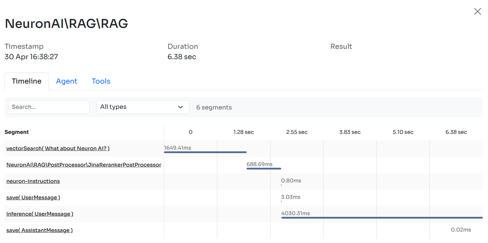

YouTube sees over 500 hours of video uploaded every minute, creating a vast ocean of knowledge and entertainment. But who has time to watch it all? This reality inspired me to develop an AI agent in PHP that automatically summarizes YouTube videos, extracting the essential information and takeaways.

Using PHP and the [Neuron AI framework](https://docs.neuron-ai.dev) as the foundation, I built an agent that processes video transcripts, identifies key points, and generates concise summaries that retain the core message of the original video.

As I've refined this tool, I've discovered numerous practical applications across different sectors. From educational settings to professional environments and content creation workflows, the ability to quickly distill video content can be helpful for various user groups.

Let's explore three real-world contexts where YouTube video summarization can be incredibly helpful.

**Educational Context**

Students, teachers, and researchers often need to extract key information from lengthy educational content. The YouTube Agent could help:

- Students can quickly determine if a 2-hour lecture contains the specific topic they're researching.
- Teachers can preview educational content before assigning it to students, ensuring relevance and quality.
- Researchers can efficiently process multiple conference presentations without watching them in full.

**Content Creation and Media Monitoring**

Creators and media professionals can use this Agent to:

- Journalists can quickly analyze trending video discussions without full viewing.
- Content creators can automate description generation for their contents.
- Social media managers can automate posts generation from YouTube videos ensuring more relevant content creation.

Just to give you some inspiration. You can eventually share your implementation of the Neuron AI forum: [https://github.com/inspector-apm/neuron-ai/discussions](https://github.com/inspector-apm/neuron-ai/discussions)

## Introducing Neuron AI PHP framework

Neuron is a fantastic PHP package that allows you to create full featured AI Agents in PHP in a few lines of code. It definitively fills the gap for AI Agents development between PHP and other ecosystems like Python or Javascript.

It provides you a standard toolkit to implement AI driven applications drastically reducing vendor lock-in. You can switch between LLMs, vector stores, embedding providers, etc. with just a few lines of code without the need to refactor big portions of your application.

Also, being able to encapsulate the full implementation of the Agent into a single class makes it so easy to add AI features within your existing PHP application.

If you are new to AI Agents development, or you already have experience Neuron can be the perfect playground to move your idea from experiments to extensive production implementations.

Here is the link to the GitHub repository of the YouTube-AI-Agent: [https://github.com/NeuronPHP/youtube-ai-agent](https://github.com/NeuronPHP/youtube-ai-agent)

## Install Neuron AI

You can install the package with the composer command below:

```bash
composer require inspector-apm/neuron-ai
```

I intentionally designed Neuron as free as possible from external dependencies.

Without bringing dozens of dependencies inside your application, you do not risk being locked out of Neuron if you need to upgrade your current architecture, like the web application framework (Laravel, Symfony, CodeIgniter, etc) to a newer version, or add new dependencies.

## Create the YouTubeAgent class

The implementation of an agent with Neuron AI starts extending the \`NeuornAI\\Agent\` class.This class allows you to define the agent’s properties in a very simple way. Let’s create the \`YouTubeAgent\` class extending \`NeuronAI\\Agent\`:

```php
use NeuronAI\Agent;
use NeuronAI\Providers\AIProviderInterface;
use NeuronAI\Providers\Anthropic\Anthropic;

class YouTubeAgent extends Agent
{
    public function provider(): AIProviderInterface
    {
        return new Anthropic(
            key: 'ANTHROPIC_API_KEY',
            model: 'claude-3-7-sonnet-latest'
        );
    }
}
```

You need to provide a valid [Anthropic API key](https://console.anthropic.com/settings/keys), or eventually you can consider using other supported AI providers like OpenAI, or Ollama if you want to run the model locally. Check out the documentation for [supported AI Providers](https://docs.neuron-ai.dev/components/ai-provider).

Just this few lines of code gives you the ability to talk with the model. This is how you can chat with the Agent:

```php
$response = YouTubeAgent::make()->chat(new UserMessage("Hi! Who are you?"));

echo $response->getContent();
// Hi, I'm an AI assistant ready to help you today! 
```

## The AI Agent System Instructions

The second important building block is the system instructions. System instructions provide directions for making the AI ​​act according to the task we want to achieve. They are fixed instructions that will be sent to the LLM on every interaction.

That’s why they are defined by an internal method, and stay encapsulated into the agent entity. Let's implement the \`instructions()\` method to fill the Agent with a structured system prompt:

```php
use NeuronAI\Agent;
use NeuronAI\Providers\AIProviderInterface;
use NeuronAI\Providers\Anthropic\Anthropic;
use NeuronAI\SystemPrompt;

class YouTubeAgent extends Agent
{
    public function provider(): AIProviderInterface
    {
        return new Anthropic(
            key: 'ANTHROPIC_API_KEY',
            model: 'claude-3-7-sonnet-latest'
        );
    }

    public function instructions(): string
    {
        return new SystemPrompt(
            background: ["You are an AI Agent specialized in writing YouTube video summaries."],
            steps: [
                "Get the url of a YouTube video, or ask the user to provide one.",
                "Use the tools you have available to retrieve the transcription of the video.",
                "Write the summary.",
            ],
            output: [
                "Write a summary in a paragraph without using lists. Use just fluent text.",
                "After the summary add a list of three sentences as the three most important take away from the video.",
            ]
        );
    }
}
```

Now if we send the same question to the agent “*Who are you?*” we likely receive a completely different answer.

```php
$response = YouTubeAgent::make()->chat(new UserMessage("Hi! Who are you?"));

echo $response->getContent();
// Hi, I'm a frindly AI agent specialized in summarizing YouTube videos!
// Can you give me the URL of a YouTube video you want a quick summary of?
```

To learn more about the role and capabilities of the system prompt you can check out the article below:

[System Prompt for AI Agents In PHP](/system-prompt-for-ai-agents-in-php/)

As you can see in the response of the agent, it’s asking the url of the YouTube video we want to summarize. But…

LLM can’t process videos, they can just elaborate text. So how can we possibly make the Agent able to process a video? We can use the YouTube transcriptions API to gather the content of the video as a text and then let the model create the summary for us.

## Tools & Function Calls

Tools enable Agents to go beyond generating text by facilitating interaction with your application services, or external APIs.

Think about Tools as special functions that your AI agent can use when it needs to perform specific tasks. They let you extend your Agent's capabilities by giving it access to specific functions it can call inside your code.

In the case of the `YouTubeAgent` we need to implement a tool to call the YouTube video transcription API to provide the Agent with the textual content of the video to complete its task: provide a summary of the video.

```php
use NeuronAI\Agent;
use NeuronAI\Providers\AIProviderInterface;
use NeuronAI\Providers\Anthropic\Anthropic;
use NeuronAI\SystemPrompt;
use NeuronAI\Tools\Tool;
use NeuronAI\Tools\ToolProperty;

class YouTubeAgent extends Agent
{
    public function provider(): AIProviderInterface
    {
        return new Anthropic(
            key: 'ANTHROPIC_API_KEY',
            model: 'claude-3-7-sonnet-latest'
        );
    }

    public function instructions(): string
    {
        return new SystemPrompt(
            background: ["You are an AI Agent specialized in writing YouTube video summaries."],
            steps: [
                "Get the url of a YouTube video, or ask the user to provide one.",
                "Use the tools you have available to retrieve the transcription of the video.",
                "Write the summary.",
            ],
            output: [
                "Write a summary in a paragraph without using lists. Use just fluent text.",
                "After the summary add a list of three sentences as the three most important take away from the video.",
            ]
        );
    }

    public function tools(): array
    {
        return [
            Tool::make(
                'get_transcription',
                'Retrieve the transcription of a youtube video.',
            )->addProperty(
                new ToolProperty(
                    name: 'video_url',
                    type: 'string',
                    description: 'The URL of the YouTube video.',
                    required: true
                )
            )->setCallable(function (string $video_url) {
		// ... do something
            })
        ];
    }
}
```

There are three most important things to take care of providing tools to the agent:

### Tool name and description

The name of the tool must be unique in the array of tools you attach to the agent, and should express the meaning of the tasks. The description can reinforce the why and when the agent should use this tool.

### Properties definition

Properties are the input arguments of the callable function. You must specify the name, description, and the data type the callable function expects to receive.

### The callable function

Here is where you can implement the tool like connect to the YouTube transcript API and return the textual content of the video to be processed by the Agent.

Notice that the input arguments of the callable function match with what we defined in the tool’s property.

## Retrieve the YouTube video transcription

Every time I implement an agent I prefer to separate the Tool definition in the agent class, from the implementation of the callable function.

Since it requires connecting to external APIs it’s better to implement this process into a dedicated class so it will be easier to organize the code or add new features later.Instead of defining the in-line function we can create a class implementing the PHP magic method \`\_\_invoke()\` and pass to the tool as it will behave like a function:

```php
use GuzzleHttp\Client;

class GetTranscription
{
    protected Client $client;

    public function __construct()
    {
        $this->client = new Client([
            'base_uri' => 'https://api.supadata.ai/v1/youtube/',
            'headers' => [
                'x-api-key' => 'SUPADATA_API_KEY',
            ]
        ]);
    }

    public function __invoke(string $video_url)
    {
        $response = $this->client->get('transcript?url=' . $video_url.'&text=true');

        if ($response->getStatusCode() !== 200) {
            return "Transcription APIs error: {$response->getBody()->getContents()}";
        }

        $response = json_decode($response->getBody()->getContents(), true);

        return $response['content'];
    }
}
```

Notice how the \`\_\_invoke()\` method accepts the same arguments expected by the tool callable function.

Now we can pass an instance of this class in the Tool definition:

```php
class YouTubeAgent extends Agent
{
	...
	
    public function tools(): array
    {
        return [
            Tool::make(
                'get_transcription',
                'Retrieve the transcription of a youtube video.',
            )->addProperty(
                new ToolProperty(
                    name: 'video_url',
                    type: 'string',
                    description: 'The URL of the YouTube video.',
                    required: true
                )
            )->setCallable(new GetTranscription())
        ];
    }
}
```

To retrieve the YouTube video transcription I used a very useful API called [Supadata.ai](https://supadata.ai/). It’s built on purpose to help you build better AI products faster.

They provide 100 monthly API requests for free, and you can also retrieve the video transcriptions in many languages.

Transcriptions are just an example. You can eventually implement other tools to make the Agent able to retrieve other video metadata to enhance its video analysis capabilities.

## Perform Video Analysis

We are ready to submit a YouTube video to the agent and get its summary and takeaways.

This is how you can interact with the final agent:

```php
$response = YouTubeAgent::make()->chat(
    new UserMessage("What about this video: https://www.youtube.com/watch?v=WmVLcj-XKnM")
);

echo $response->getContent();

/**

This video presents a monologue from the perspective of Nature herself, speaking directly to humanity. In an authoritative tone, Nature reminds us that she has existed for 4.5 billion years—22,500 times longer than humans—and doesn't need people, though people depend entirely on her. She warns that humanity's future rests on her wellbeing, as her flourishing means human flourishing, while her decline will bring worse consequences for us. Nature explains that she has nurtured species more magnificent than humans and has starved greater species to extinction. Her oceans, soil, rivers, and forests can either sustain humanity or abandon it. She concludes by stating that regardless of whether humans acknowledge or ignore her, their actions determine only their own fate, not hers, as Nature will endure through change while questioning if humanity can do the same.

Three most important takeaways:

1. Nature has existed for billions of years without humans and will continue to exist regardless of human actions, but humans cannot survive without Nature.

2. The wellbeing of humanity is directly linked to the wellbeing of natural systems—oceans, soil, rivers, and forests.

3. How humans choose to act toward Nature determines humanity's future, not Nature's, as she is built to endure change while humans may not be.

*/
```

Since we instructed the agent toward a specific task, once you provide a video URL it knows the need to call the tool you attached to retrieve the transcription in order to generate the final summary.

## Agent Monitoring

The Inspector team designed Neuron AI with built-in observability integration backed by [Inspector.dev](/), so you can monitor AI agents were running for error detection and performance analysis. Inspector helps you move your agents from prototype to production with confidence.

To enable the Agent monitoring, you need to provide the Inspector ingestion key in the `.env` file. You get a new key registering an account on the [Inspector](/) website.

```php
INSPECTOR_INGESTION_KEY=r3f3fthryh98xxxxxxxxxxxxxxxxxxxxxxxxxxxxx
```

Now, when you run the agent you will be able to explore its internal execution flow in the Inspector dashboard, and be alerted for unpredictable errors via email.



## Embracing AI Agents Development in PHP

As we look ahead, the development of AI agents in PHP represents not just a specific solution for YouTube summarization, but a broader opportunity for developers to create intelligent tools using accessible technology stacks.

What makes this YouTube summarization project particularly noteworthy is its implementation in PHP—a language many developers already know and use daily. This demonstrates that building practical AI solutions doesn't always require you to retool your skills toward other programming languages. By leveraging Neuron AI framework toolkit, developers can create sophisticated AI agents that deliver immediate value.

Learn more on the documentation: [https://docs.neuron-ai.dev](https://docs.neuron-ai.dev)

GitHub repository of this implementation: [https://github.com/neuron-core/youtube-ai-agent](https://github.com/neuron-core/youtube-ai-agent)

For those new to AI agent development in PHP, I’ve documented the foundational patterns and progressive implementation approaches in an educational resource that walks through the basic development lifecycle — [Start With AI Agents In PHP](https://www.amazon.it/dp/B0F1YX8KJB)
