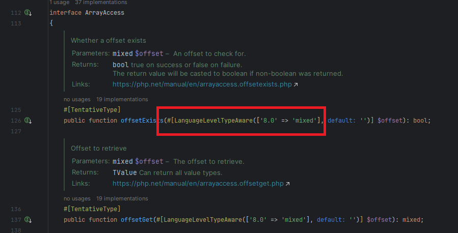

PHP attributes were introduced in PHP 8.0. This version marked a significant milestone for the language, bringing several new features and improvements, including the introduction of attributes for adding metadata to code declarations.

The first time I had to deal with attributes was due to an issue in the Inspector's PHP library. [**Check on GitHub**](https://github.com/inspector-apm/inspector-php/issues/12). Before digging deeper into the solution, let's take an overview of what attributes are and how they can be used in your PHP code.

Attributes are a powerful feature that allows you to add metadata to declarations like classes, methods, or properties. These metadata can be retrieved programmatically, opening up new possibilities for cleaner, more organized, and efficient code.

Remeber, Attributes have no effect at runtime. They will be available in the Reflection APIs to make your application aware of things you want to run based on attributes attached to a class, method, or a property.

For more technical articles you can follow me on [**Linkedin**](https://www.linkedin.com/in/valeriobarbera/) or **[X](https://x.com/Barbalerio)**.

## Built-in Attributes

PHP comes with several built-in attributes that serve different purposes. Here are a few notable ones:

**@Deprecated**

Marks a function or method as deprecated, signaling that it should be avoided as it may be removed in future versions.

```php
#[Deprecated("Use newFunction() instead")]
function oldFunction() 
{
    // Function implementation
}
```

**@Override**

Ensures that the method in a child class is intended to override a method in the parent class.

```php
class Child extends Parent {
    #[Override]
    public function defaultMethod() 
    {
        // Method implementation
    }
}
```

If **defaultMethod()** will eventually change its name in the parent class this is no longer an override. In this case PHP will raises a warning because we explicitly declared we expect to be an override and alert us about the misalignement.

Anyway, a good IDE should allow us to not incur in this kind of mistakes.

**@SuppressWarnings**

Suppresses specific warnings for a particular piece of code.

```php
#[SuppressWarnings("SomeWarning")]
function someFunction() 
{
    // Function implementation
}
```

## Creating Custom Attribute Classes

Now, let's create a custom attribute class. This is beneficial when you want to encapsulate specific behavior within an attribute.

```php
#[Attribute]
class CustomAttribute 
{
    public string $message;

    public function __construct(string $message) 
    {
        $this->message = $message;
    }
}
```

You can then use this custom attribute on various elements:

```php
class MyClass 
{
    #[CustomAttribute("This is a custom attribute")]
    public $myProperty;

    #[CustomAttribute("Another custom attribute")]
    public function myMethod() 
    {
        // Method implementation
    }
}
```

## Usage Examples

Let's explore a practical example. Suppose you're building a web application, and you want to create a custom attribute to define the length of a string:

```php
#[Attribute(Attribute::TARGET_PROPERTY)]
class MaxLength 
{
    public int $maxLength;

    public function __construct(int $maxLength) 
    {
        $this->maxLength = $maxLength;
    }
}
```

In the example above we restricted the ability to apply the attribute only to class properties. Now we can use it in the User class:

```php
class User 
{
    #[MaxLength(20, message: "Username must be 20 characters or less")]
    public string $username;

    // Other properties and methods
}
```

As mentioned before adding the attribute to the property have no impact during execution. But we can now retrive this information using reflection to take some action eventually.

## Adoption by PHP frameworks

The most used PHP frameworks like Symfony and Laravel are already adopting attributes to basically replace "Annotations". In Symfony 5.2 or greater you are able to declare a controller and wire it up to a route using attributes:

```php
use Symfony\Component\Routing\Annotation\Route;

class SomeController
{
    #[Route('/path', 'action_name')]
    public function someAction()
    {
        // ...
    }
}
```

Given the native support at the language level, and the possibility of interacting through the Reflection APIs, attributes offer advantages related to simplicity of query and performance, compared to parsing annotations in comments.

## Attributes in the Inspector PHP library

The issue in Inspector’s PHP library appeared because in PHP 8 the **ArrayAccess** interface introduced attributes to alert developers that the signature of some interface methods will be changed in future versions.

The original implementation if ArrayAccess in the library was:

```php
public class Arrayable implements \ArrayAccess
{
    …

    public function offsetExists($offset)
    {
        return isset($this->data[$offset]);
    }

    …
}
```

Since PHP 8 the definition of ArrayAccess interface changed to:



With use of attributes they enforced the declaration of data type for the arguments in offsets functions. Using the **LanguageLevelTypeAware** attribute, if the implementation doesn’t provide the data type for arguments it fires a “deprecation warning”.

But declaring the data type in function arguments breaks the compatibility with older versions of PHP that don't support arguments data type declaration.

Since it was just a warning for future changes we solved the problem with another built-in PHP attribute to suppress the warning:

```php
public class Arrayable implements \ArrayAccess
{
    …

    #[\ReturnTypeWillChange]
    public function offsetExists($offset)
    {
        return isset($this->data[$offset]);
    }

    …
}
```

The **ReturnTypeWillChange** attribute simply tell PHP that we know about the future changes in the language, and we have already planned the necessary updates.

For this change in particular they will be definitely implemented in PHP 9.

Remember to use attributes judiciously, keeping your codebase clean and well-documented. This is particularly crucial in a SaaS environment where scalability, maintainability, and efficiency are paramount.

For more technical articles you can follow me on [**Linkedin**](https://www.linkedin.com/in/valeriobarbera/) or **[X](https://x.com/Barbalerio)**.
