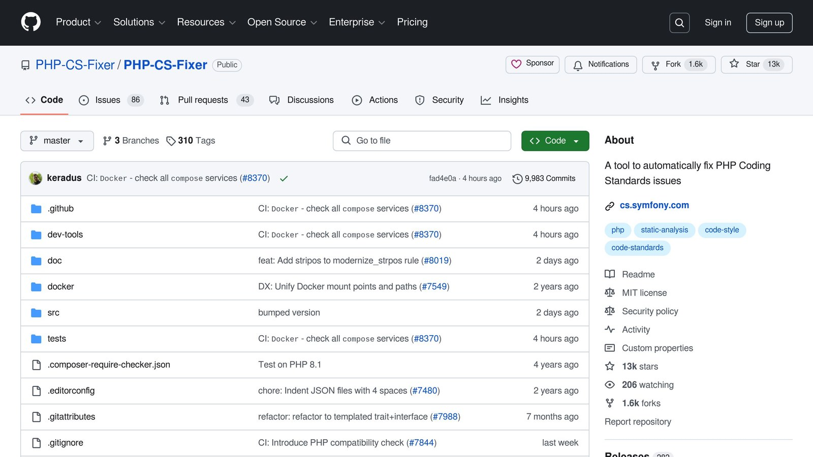

**Want cleaner PHP code without extra hassle?** Integrating [PHP CS Fixer](https://github.com/PHP-CS-Fixer/PHP-CS-Fixer) with [PHPStorm](https://www.jetbrains.com/phpstorm/) lets you automatically fix coding standards directly in your IDE. This setup ensures consistent formatting, saves time during reviews, and improves your workflow. Here's what you'll learn:

- **What is PHP CS Fixer?** A tool to fix PHP coding standards automatically.
- **Why pair it with PHPStorm?** Streamline your workflow, get real-time feedback, and customize rules for your project.
- **How to set it up:** Install PHP CS Fixer, configure it in PHPStorm, and create custom rules.

With this guide, you'll easily configure PHP CS Fixer, set up rules like PSR-12, and even automate fixes on file save. Ready to enhance your PHP development process? Let’s dive in.

## Setting Up [PHP CS Fixer](https://github.com/PHP-CS-Fixer/PHP-CS-Fixer) in [PHPStorm](https://www.jetbrains.com/phpstorm/)



### Installing PHP CS Fixer Using Composer

You can install PHP CS Fixer either globally or for a specific project. For team environments, it's usually better to go with a project-specific installation to maintain consistency:

```bash
composer require --dev friendsofphp/php-cs-fixer
```

If you prefer a global installation that works across multiple projects, use this command:

```bash
composer global require friendsofphp/php-cs-fixer
```

After installation, the next step is to configure PHPStorm to integrate PHP CS Fixer seamlessly.

### Configuring PHPStorm for PHP CS Fixer

To set up PHP CS Fixer as an external tool in PHPStorm, follow these steps:

1. Open PHPStorm Settings (File > Settings on Windows/Linux, PHPStorm > Preferences on macOS).
2. Go to **Tools > External Tools**.
3. Click the **+** button to add a new tool.
4. Use these settings to configure the tool:

| Setting | Value |
| --- | --- |
| Name | PHP CS Fixer |
| Program | Path to your PHP CS Fixer installation (e.g., `vendor/bin/php-cs-fixer` for project installation or `~/.composer/vendor/bin/php-cs-fixer` for global installation) |
| Arguments | `fix "$FileDir$/$FileName$" --config=$ProjectFileDir$/.php-cs-fixer.dist.php` |
| Working Directory | `$ProjectFileDir$` |

*Tip:* If your installation path is different, make sure to adjust the settings accordingly.

### Checking System Requirements

Before integrating PHP CS Fixer, make sure your system meets the necessary requirements:

| Component | Minimum Requirement |
| --- | --- |
| PHP Version | 7.2 or higher |
| Composer | Latest stable version |

You can check your PHP version by running:

```bash
php -v
```

Also, ensure that all required PHP extensions are installed. Once these requirements are confirmed, you're ready to configure PHPStorm and start using PHP CS Fixer to keep your code clean and consistent.

## PHP CS Fixer Setup and Configuration

[Watch the video on YouTube](https://www.youtube.com/watch?v=hMuCrjeEKpo)

## Configuring Rules and Formatting Standards

With PHP CS Fixer set up and linked to PHPStorm, the next step is setting the rules and standards that will shape your code formatting. This ensures your team sticks to consistent coding practices, making code reviews smoother and your codebase easier to maintain.

### Creating and Customizing Configuration

To define your project's coding standards, create a `.php-cs-fixer.dist.php` file in your project's root directory. This file can include predefined rulesets like PSR-12, along with custom rules tailored to your needs.

Here’s an example configuration:

```php
<?php

$finder = PhpCsFixer\Finder::create()
    ->exclude('vendor')
    ->in(__DIR__);

$config = new PhpCsFixer\Config();
return $config
    ->setRules([
        '@PSR12' => true,                    // Use PSR-12 coding standards
        'array_syntax' => [
            'syntax' => 'short'              // Enforce short array syntax
        ],
        'binary_operator_spaces' => [
            'default' => 'single_space'      // Ensure consistent spacing around operators
        ],
        'blank_line_before_statement' => [
            'statements' => [
                'return',
                'throw',
                'try'
            ]
        ],
        'method_chaining_indentation' => true,
        'no_unused_imports' => true,
        'ordered_imports' => [
            'sort_algorithm' => 'alpha',
            'imports_order' => ['class', 'function', 'const']
        ]
    ])
    ->setFinder($finder)
    ->setUsingCache(true)
    ->setRiskyAllowed(true);
```

### Key Configuration Settings

| Setting | Purpose | Value |
| --- | --- | --- |
| setUsingCache | Speeds up formatting by using cached data | true |
| setRiskyAllowed | Activates advanced formatting rules | true |
| exclude | Skips specific directories during checks | vendor |
| in | Targets specific directories for formatting | **DIR** |

Feel free to tweak these rules to suit your project's needs. The configuration above strikes a balance between widely accepted standards and customizations that fit most PHP projects.

Once your rules are in place, you can apply them directly in PHPStorm to simplify your coding workflow.

## Using PHP CS Fixer in PHPStorm

Once you've set up your rules and standards, you can integrate PHP CS Fixer into PHPStorm to keep your code consistently formatted.

### Running Fixes Manually

After setting up PHP CS Fixer as an external tool, you can run it by right-clicking on a file or folder in the Project view and selecting **External Tools > PHP CS Fixer**. The tool will apply your configured rules to the selected files or directories.

While manual fixes work well, automating the process can save you time and effort.

### Setting Up Automatic Fixes on Save

To automate fixes whenever you save a file, configure a File Watcher in PHPStorm:

- Open **Settings > Tools > File Watchers**.
- Click the '+' button and choose PHP CS Fixer.
- Set the Program path to `$ProjectFileDir$/vendor/bin/php-cs-fixer`.
- Add the following arguments: `fix --config=.php-cs-fixer.dist.php $FileDir$/$FileName$`.
- Enable the option to "Auto-save edited files to trigger the watcher."

This setup ensures that your code is automatically formatted every time you save a file.

### Viewing and Fixing Issues

PHPStorm flags code style issues in real time, making it easier to address them as you work. Here's how you can review and fix these problems:

- Open the **Problems Tool Window** (**View > Tool Windows > Problems**) to see a list of detected issues.
- Use `Alt+Enter` (Windows/Linux) or `⌥+Enter` (macOS) on highlighted code to apply quick fixes.
- To process multiple files at once, select a directory in the Project view and choose **External Tools > PHP CS Fixer**.

These features ensure your project maintains consistent formatting, cutting down on the time spent addressing formatting issues during code reviews.

## Troubleshooting and Advanced Tips

Even with a solid setup, occasional hiccups can happen. Here's how to address them and improve your workflow.

### Common Problems and Solutions

Sometimes, you can run into compatibility issues after a PHP update. To fix this, make sure your packages version matches your PHP installation.

Plugins like [PHP Code Sniffer](https://github.com/squizlabs/PHP_CodeSniffer), PHP Inspections (EA Extended) can also cause conflicts. Review your plugin settings to avoid overlapping functionality.

### Advanced Configuration Techniques

**Real-Time Monitoring Setup**

You can integrate PHPStorm's Inspector with PHP CS Fixer for deeper code analysis:

- Go to **Settings > Editor > Inspections**.
- Enable "PHP > Quality Tools > PHP CS Fixer validation."
- Adjust the severity levels for rule violations to suit your needs.

**Custom Ruleset for Specific Standards**

Tailor your rulesets to align with your project's coding guidelines. Here's an example configuration:

```php
return (new PhpCsFixer\Config())
    ->setRules([
        '@PSR2' => true,
        'array_syntax' => ['syntax' => 'short'],
        'no_unused_imports' => true,
        'ordered_imports' => true,
    ])
    ->setFinder($finder);
```

Customizing rulesets like this ensures your code stays consistent with your team's standards.

### Tips for Better Workflow

Once you've tackled the common issues, these tips can help you work more efficiently:

- **Keyboard Shortcuts**: Create custom shortcuts for actions, like 'Fix Current File,' under **Settings > Keymap**.
- **Performance Tweaks**:
  - Use the `--cache-file` option to enable caching and speed up repeated runs.
  - Exclude unnecessary directories from processing to save time.
- **Version Control Integration**: Add PHP CS Fixer to your pre-commit hooks to maintain consistent formatting and simplify code reviews.

These adjustments can make your coding process smoother and more efficient.

## Conclusion and Key Points

### Summary of Benefits

PHPStorm, favored by 70% of PHP developers ([JetBrains](https://www.jetbrains.com/) PHP Survey 2021), works seamlessly with PHP CS Fixer to streamline workflows. This setup automates code formatting, enforces consistent standards, and reduces the time spent on code reviews. By removing the need for manual formatting and ensuring uniform code quality checks, teams can concentrate on writing and improving code rather than debating style rules.

These features make it a powerful tool for boosting productivity and collaboration.

### Next Steps

To improve your development process even further:

**Refine Your Development Workflow**

- Add PHP CS Fixer to your CI/CD pipeline for consistent formatting checks.
- Use a shared configuration file to align coding standards across your team.

**Keep Your Setup Running Smoothly**

- Regularly update PHP CS Fixer and PHPStorm for the best performance.
- Join PHP communities to stay informed about new tips and practices.

## Related Blog Posts

- [5 Ways to Optimize Symfony Application Performance](/5-ways-to-optimize-symfony-application-performance/)
- [Symfony file upload examples and best practices](/symfony-file-upload-examples-and-best-practices/)
- [Error Pattern Recognition in PHP Applications](/error-pattern-recognition-in-php-applications/)
- [5 Ways to Reduce API Payload Size in PHP](/5-ways-to-reduce-api-payload-size-in-php/)
