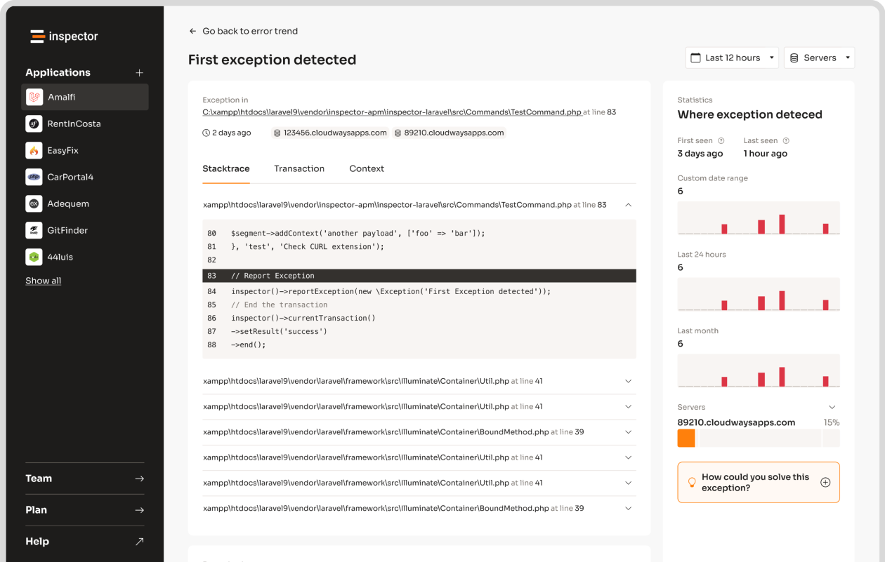

**Want to optimize your** [**PHP**](https://en.wikipedia.org/wiki/PHP) **application's memory usage?** The `memory_get_peak_usage()` function is your go-to tool for identifying peak memory consumption and improving performance. This guide covers everything you need to know, from basic usage to advanced tips.

### Key Takeaways:

- **What it does**: Tracks the highest memory usage during script execution.
- **Why it matters**: Helps prevent crashes, reduce costs, and improve scalability.
- **How to use it**:
  - Use `memory_get_peak_usage(false)` for PHP-specific memory.
  - Use `memory_get_peak_usage(true)` for total system memory.
- **Comparison**: Unlike `memory_get_usage()`, this function tracks peak usage, ideal for spotting bottlenecks.
- **Optimization tips**: Monitor high-memory operations, use lazy loading, and balance memory with performance.

### Quick Example:

```php
$peakMemory = memory_get_peak_usage(true);
echo "Peak Memory Usage: " . ($peakMemory / 1024 / 1024) . " MB";
```

Ready to dive deeper? Learn how to monitor, analyze, and optimize your PHP application's memory usage effectively.

## Mastering Memory Profiling in [PHP](https://en.wikipedia.org/wiki/PHP): Streamline Your Insights

## Understanding memory_get_peak_usage()

The `memory_get_peak_usage()` function shows the highest amount of memory your PHP script used during its execution. Here's a closer look at how it works.

Depending on the parameter you pass, the function measures memory usage differently:

| Parameter Value | What It Measures | When to Use |
| --- | --- | --- |
| `false` (default) | Memory allocated by PHP internally (via emalloc) | Debugging during development |
| `true` | Total memory allocated by the system | Monitoring in production environments |

### Return Value and Conversion

The function returns the memory usage in bytes. To make this more readable, developers often convert it to megabytes. Here's an example:

```php
$peakMemory = memory_get_peak_usage(true);
$peakMemoryMB = round($peakMemory / 1024 / 1024, 2);
```

### How It Differs from memory_get_usage()

Though both `memory_get_peak_usage()` and `memory_get_usage()` track memory, they serve different purposes:

| Function | What It Tracks | Ideal For |
| --- | --- | --- |
| `memory_get_peak_usage()` | Peak memory usage during execution | Spotting memory bottlenecks |
| `memory_get_usage()` | Current memory usage at the time of the call | Real-time memory checks |

The key difference is *when* they measure memory. `memory_get_peak_usage()` logs the highest memory usage during the script's run, which is helpful for identifying heavy memory operations. On the other hand, `memory_get_usage()` gives you a snapshot of memory usage at a specific moment, making it useful for tracking live memory consumption. Both tools are invaluable for [optimizing PHP applications](/php-performance-optimization/).

## Using memory_get_peak_usage() effectively

Now that we've covered the syntax basics, let's dive into practical ways to monitor memory usage in PHP.

### Basic usage example

Here's a simple script to compare memory usage at different stages:

```php
<?php
// Start of script
echo "Initial peak memory usage: " . memory_get_peak_usage(true) . " bytes\n";

// Perform some memory-intensive operations
$array = range(0, 100000);
$string = str_repeat("Hello", 1000);

// Check peak memory usage after operations
echo "Peak memory usage after operations: " . memory_get_peak_usage(true) . " bytes\n";

// Free up memory
unset($array);
unset($string);

// Check final peak memory usage
echo "Final peak memory usage: " . memory_get_peak_usage(true) . " bytes\n";
?>
```

This provides a straightforward way to measure memory consumption and establish benchmarks for optimization.

### Monitoring memory usage in real-time

To make memory tracking more efficient, you can create a reusable function:

```php
function logMemoryUsage($label) {
    $memory = memory_get_peak_usage(true);
    $formatted = number_format($memory / 1024 / 1024, 2) . ' MB';
    echo "{$label}: {$formatted}\n";
}
```

Use this function throughout your code to monitor memory usage at key points:

```php
logMemoryUsage("Start of script");
$data = array_fill(0, 100000, 'test');
logMemoryUsage("After creating large array");
$data = null;
logMemoryUsage("After nullifying array");
```

This approach helps pinpoint memory spikes and track how your code impacts resource consumption.

### Analyzing results for insights

To make the most of your data, focus on these steps:

- Establish a baseline for memory usage.
- Spot unexpected spikes or irregularities.
- Compare patterns across multiple runs.
- Maintain a consistent testing environment.
- Run tests repeatedly to ensure reliable results.
- Consider external factors, like background processes.

> "Understanding peak memory usage is crucial for optimizing [PHP applications](/product-features/), especially in high-traffic environments where every byte counts."

For deeper analysis, combine `memory_get_peak_usage()` with other memory-related functions. Here's an example:

```php
function memoryProfile($label) {
    $currentUsage = memory_get_usage(true);
    $peakUsage = memory_get_peak_usage(true);
    $memoryLimit = ini_get('memory_limit');

    echo "{$label}:\n";
    echo "Current Usage: " . number_format($currentUsage / 1024 / 1024, 2) . " MB\n";
    echo "Peak Usage: " . number_format($peakUsage / 1024 / 1024, 2) . " MB\n";
    echo "Memory Limit: {$memoryLimit}\n\n";
}
```

This function provides a snapshot of current and peak memory usage, along with the memory limit, giving you a more complete picture of your application's resource demands.

## Best practices for memory profiling in PHP

### When to use `memory_get_peak_usage()`

`memory_get_peak_usage()` can be a helpful tool in several scenarios:

- **During performance tuning** to pinpoint areas of code that use excessive memory and may need adjustments.
- **While debugging** to track down potential memory leaks in your application.
- **For resource planning** in systems that operate under tight memory limits.
- **To compare algorithms** and determine which implementation is more efficient in terms of memory usage.

### Using with other memory functions

Here's an example of how you can combine `memory_get_peak_usage()` with other memory-related functions to track and display memory usage:

```php
function memorySnapshot($label) {
    $current = memory_get_usage(true);
    $peak = memory_get_peak_usage(true);
    $limit = ini_get('memory_limit');

    echo sprintf(
        "%s:\nCurrent: %.2f MB\nPeak: %.2f MB\nLimit: %s\n",
        $label,
        $current / 1024 / 1024,
        $peak / 1024 / 1024,
        $limit
    );

    // Reset peak memory tracking for the next section
    memory_reset_peak_usage();
}
```

This function provides a quick snapshot of the current memory usage, peak usage, and memory limit, making it easier to analyze memory behavior during execution.

### Ensuring accurate measurements

To get precise memory usage data, follow these steps:

**Before measuring:**

- Clear opcode caches to avoid interference.
- Disable any extensions that aren't needed for the test.
- Run tests in isolated processes to minimize external factors.

**When measuring:**

- Use `real_usage=true` to get a more accurate picture of actual memory allocated.
- Call `gc_collect_cycles()` to clear any unreferenced objects before measurement.
- Perform multiple runs and calculate the average to account for variability.

Keep in mind that PHP allocates memory in chunks, which can influence how you interpret the results.

## Optimizing Applications Based on Peak Memory Usage

### Identifying High-Memory Operations

To tackle memory usage, start by implementing memory logging around operations you suspect to be resource-heavy. Some common culprits include:

- Handling large datasets or arrays
- Performing image processing tasks
- Parsing complex XML files
- Running inefficient database queries
- Creating large objects repeatedly in loops

You can use memory checkpoints to monitor these operations effectively. For example:

```php
function logMemoryUsage($label) {
    $memory = memory_get_peak_usage(true);
    error_log(sprintf("[%s] Memory usage: %s", $label, number_format($memory)));
}

logMemoryUsage("Before operation");
// Perform the memory-intensive operation
logMemoryUsage("After operation");
```

This approach helps pinpoint areas needing optimization.

### Reducing Memory Consumption

Here’s a practical way to optimize memory usage. Instead of loading all data upfront, consider lazy loading, as shown below:

```php
class Product {
    private $id;
    private $data = null;

    public function __construct($id) {
        $this->id = $id;
    }

    public function getName() {
        $this->loadData();
        return $this->data['name'];
    }

    private function loadData() {
        if ($this->data === null) {
            $this->data = Database::query("SELECT * FROM products WHERE id = ?", [$this->id])->fetch();
        }
    }
}
```

This method ensures data is only fetched when needed, reducing unnecessary memory use.

### Balancing Performance and Memory

When optimizing, always weigh memory savings against performance trade-offs. Here’s a quick comparison:

| Optimization Technique | Memory Reduction | Performance Impact |
| --- | --- | --- |
| Lazy Loading | 20-40% | Minimal latency increase |
| Query Optimization | 10-30% | Faster response times |
| Generators | 50-90% | Reduced initial load time |

These strategies can help strike a balance between efficiency and speed.

## Using [Inspector](/) for Better Memory Monitoring



### What is Inspector?

**Inspector** provides you with continuous monitoring on your application execution cycles. It helps track trends, uncover hidden memory leaks, and offers real-time insights. Installation is simple - just two lines via Composer. It works seamlessly with frameworks like [Laravel](/laravel/), [Symfony](/symfony/), and [CodeIgniter](/codeigniter/). Features include:

- Real-time memory tracking
- Detection of memory leaks
- Component-level usage breakdowns
- Alerts when memory thresholds are crossed

### Using Inspector for Memory Profiling

Here's how you can use Inspector to monitor memory usage in your application:

```php
$inspector = new \Inspector\Inspector(
    new \Inspector\Configuration('INGESTION-KEY')
);

$inspector->startTransaction('DataProcessing');

// Your script here...

$inspector->transaction()->end();
```

Inspector provides a detailed timeline of memory usage, making it easier to:

- Spot sudden memory spikes or anomalies
- Identify patterns across different parts of your application
- Link memory consumption to slow database queries
- Get notified when memory usage exceeds predefined limits

### Conclusion

Performance optimization remains a top priority for developers, as seen in industry surveys. Tools like `memory_get_peak_usage()` play a crucial role by identifying memory-heavy operations. Setting optimization goals is most effective when guided by thorough benchmarking.

For those ready to take action, the focus now shifts to practical strategies for improving memory usage.

### Next Steps for Developers

To make the most of memory profiling in PHP applications:

- Use `memory_get_peak_usage()` to monitor key execution phases consistently.
- Establish baseline memory usage for critical workflows.
- Target code sections with the highest memory consumption based on peak usage data.

If you need more detailed insights, tools like Inspector can complement `memory_get_peak_usage()` by offering real-time data and automated alerts, making it easier to track memory usage patterns effectively.

## FAQs

### How to calculate memory usage in PHP?

You can use these practical methods to monitor memory usage in your PHP applications:

```php
$currentMemory = memory_get_usage();
$peakMemoryDefault = memory_get_peak_usage();
$peakMemoryReal = memory_get_peak_usage(true);
```

Need a way to display memory usage in a readable format? Try this helper function:

```php
function formatMemory($bytes, $precision = 2) {
    $units = ['B', 'KB', 'MB', 'GB', 'TB'];
    $bytes = max($bytes, 0);
    $pow = floor(($bytes ? log($bytes) : 0) / log(1024));
    $pow = min($pow, count($units) - 1);
    $bytes /= (1 << (10 * $pow));
    return round($bytes, $precision) . ' ' . $units[$pow];
}

echo "Peak Memory Usage: " . formatMemory(memory_get_peak_usage(true));
```

Key functions for memory tracking include:

- `memory_get_usage()`: Tracks current memory usage in real-time.
- `memory_get_peak_usage()`: Identifies the highest memory usage during script execution.
- `memory_get_peak_usage(true)`: Includes system-level memory allocation for better resource planning.

For comprehensive monitoring, combine these functions with existing patterns discussed earlier. If you're working in memory-critical environments, tools like Inspector's automated monitoring (referenced in section 5) can offer additional support.

## Related Blog Posts

- [5 Ways to Optimize Symfony Application Performance](/5-ways-to-optimize-symfony-application-performance/)
- [Real-Time Error Tracking vs. Log Analysis: A Comparison](/real-time-error-tracking-vs-log-analysis-a-comparison/)
- [Error Pattern Recognition in PHP Applications](/error-pattern-recognition-in-php-applications/)
- [Php Base64 encode/decode - best practices and use cases](/php-base64-encodedecode-best-practices-and-use-cases/)
