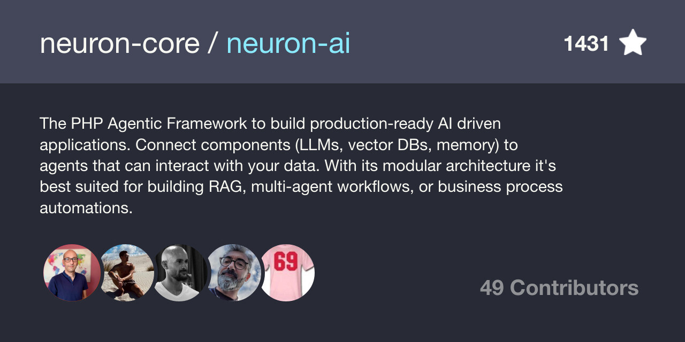

In the breathless race toward AI Agents development, the tech community has collectively overlooked what might be the most interesting news in the AI adoption: PHP’s unexpected renaissance.

While Silicon Valley elites and developers all around the world have been locked in their Python echo chambers, a quiet revolution has been brewing behind the scenes. That revolution is allowing new emerging tools to rise — like [Neuron framework](https://github.com/inspector-apm/neuron-ai) — and it’s about to fundamentally challenge everything we thought we knew about where AI Agents development is heading.

In the last few years, the narrative has been clear and unquestioned: serious Agentic application development happens in Python, with JavaScript picking up here and there. "Learn Python if you want to build AI" became the mantra repeated in bootcamps and developer conferences alike. This perspective wasn't just misleading – it was myopic.

The tech world’s underestimation of PHP’s evolution over the past five years might go down as one of the industry’s most shortsighted misjudgments. In the last few years, the language underwent a transformation so profound that today it bears little resemblance to the language they dismissed years ago. PHP 8.x has a sophisticated type system, attributes, and performance that put it squarely in the realm of modern, high-performance languages. The introduction of Fibers and other features created a development experience at the top of the programming languages  market,  all while maintaining backward compatibility with the massive existing codebase.

## The Untapped AI Deployment Goldmine

While venture capital poured billions into creating new platforms and languages, PHP quietly evolved into perhaps one of the most strategically positioned language for the agentic applications era. With modern PHP’s object oriented design, the best is undoubtedly yet to come for business opportunities, particularly in the AI app development where emerging platforms like Neuron can leverage both the language’s modern features and its unparalleled market penetration.

What the AI community failed to recognize is that real-world adoption doesn’t follow only academic paths or venture capital trend. It follows the path of least resistance to practical implementation. With over 76% of web applications running server-side PHP, and about 20% of all developers worldwide, the language represents not just a massive ecosystem but the single largest deployment opportunity for AI solutions on the planet. Neuron isn’t just a framework, it’s a bridge connecting the future of AI Agents development with the practical reality of the existing web.

**[Stack Overflow Developer Survey 2025](https://survey.stackoverflow.co/2025/technology)**

This opportunity extends far beyond the PHP community itself. For [LLM providers](https://docs.neuron-ai.dev/components/ai-provider) like OpenAI, Anthropic, and Google, vector database companies like [Elasticsearch](https://docs.neuron-ai.dev/components/vector-store#elasticsearch) and [Qdrant](https://docs.neuron-ai.dev/components/vector-store#qdrant), and the entire ecosystem of AI infrastructure providers, agentic frameworks represents something crucial: a direct gateway to the largest server-side deployment platform in existence.

While these companies have been fighting for adoption among the Python developer base, Neuron offers them immediate access to millions of production PHP applications already running. This isn’t merely a new market, it’s potentially their largest untapped customer base. A PHP developer can now use Neuron framework to integrate production-ready Agentic capabilities into existing applications without rewriting their stack, creating an exponentially lower barrier to adoption for the entire AI supply chain.

For Redis, MongoDB, and other data storage providers who have been enhancing their offerings with AI-specific features, Neuron becomes the missing link that connects their technologies to the PHP ecosystem that has historically been underserved in the AI Agents revolution. The framework doesn’t just benefit PHP developers — it creates an entirely new distribution channel for the full spectrum of AI technologies that have, until now, primarily targeted Python implementations.

## The Graveyard of Framework-Locked PHP AI Projects

The path to PHP’s AI awakening is littered with the remains of well-intentioned but fundamentally flawed attempts. Previous PHP projects consistently failed to gain traction not because PHP was unsuitable for agentic systems development, but because of three critical strategic missteps that Neuron deliberately avoids.

First and perhaps most limiting was the framework lock-in problem.

Many PHP libraries for AI Agents development made the fatal mistake of tightly coupling themselves to specific PHP frameworks like Laravel or Symfony. While this approach might have provided short-term attention, it effectively alienated the vast majority of the PHP ecosystem. A Laravel-specific AI solution immediately becomes irrelevant to Symfony developers, or WordPress and custom PHP applications that represent the majority of production deployments. This fractured approach ensured that no single PHP solution could ever achieve the critical mass necessary to drive ecosystem-wide innovation.

Second, previous attempts frequently employed architectural patterns that do not leverage PHP’s modern capabilities. Clinging to outdated approaches resulted in awkward abstractions, procedural implementations, and performance limitations that reinforced the myth that PHP wasn’t suitable for modern AI development.

These projects often felt like PHP translations of Python libraries rather than solutions built from the ground up to leverage PHP 8’s unique strengths. The result was precisely the “spaghetti code” problem that critics incorrectly attribute to the language itself rather than these poorly conceived implementations.

Perhaps most damning, the vast majority were hobby projects or side ventures without the backing of established businesses. Companies deploying AI Agents need assurance that the underlying frameworks have proper support structures, documentation, and long-term maintenance plans.

Without commercial backing, even technically impressive projects inevitably withered as maintainer enthusiasm naturally fluctuated or professional responsibilities shifted toward other interests.

The Neuron and Inspector ecosystem stands apart precisely because it systematically addresses these three historical failures. By maintaining a solid architecture, Neuron can be adopted by any PHP project regardless of underlying environment. Built on modern PHP patterns that fully embrace the language’s latest capabilities encouraging encapsulation and maintainability, it delivers a developer experience that probably exceeds Python alternatives. And perhaps most importantly, it’s backed by an established business with skin in the game — a proven company with enterprise customers, support infrastructure, and a financial incentive to ensure its long-term success.

If you want to see an example of the Agent syntax on Neuron, you can check out this example project:

[Building Multi-Agent Systems in Laravel - A Practical Demo](/building-multi-agent-systems-in-laravel-a-practical-demo/)

## From Inspector to Neuron: A Personal Journey

Six months ago, I never imagined I’d find myself at the forefront of this revolution. As the creator of [Inspector](/), an established observability tool in the PHP ecosystem, I had a front-row seat to the challenges developers faced when attempting to implement AI in production PHP environments.

The gap wasn’t just apparent, it was glaring. While other languages boasted multiple frameworks and tools, PHP developers were left cobbling together solutions without proper support.

The release of Neuron was the natural evolution of Inspector’s mission. By integrating [**first-party monitoring service**](https://docs.neuron-ai.dev/advanced/observability) specifically designed for AI Agents in PHP, we’ve addressed one of the most critical barrier to business grade AI development: production reliability.

Large-scale projects can now confidently deploy AI agents in production PHP environments with the same level of monitoring, debugging, and performance optimization capabilities that Python developers have long taken for granted.

The uncomfortable truth that Pythonist and other developers don’t want to confront is that PHP still in the competition. It simply evolved quietly. PHP 8.x emerged as a modern, performance-oriented language. Neuron framework exploits this perfect storm of circumstances: enterprise-grade language features, unmatched deployment possibilities, and a massive developer base hungry for AI Agents capabilities without retooling their skills around other programming languages.

I’ve made my intention clear: to establish Neuron as the premier AI development platform for the technology that powers over three-quarters of backend applications worldwide. It’s a big untapped opportunity that the developer community has inexplicably ignored for so long. The dark horse has entered the race, and the finish line might be much closer than the other ecosystem is prepared to admit
