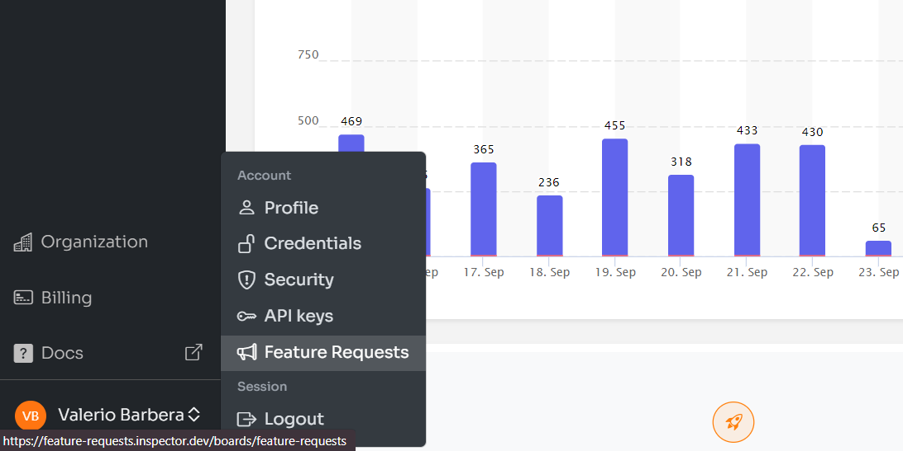
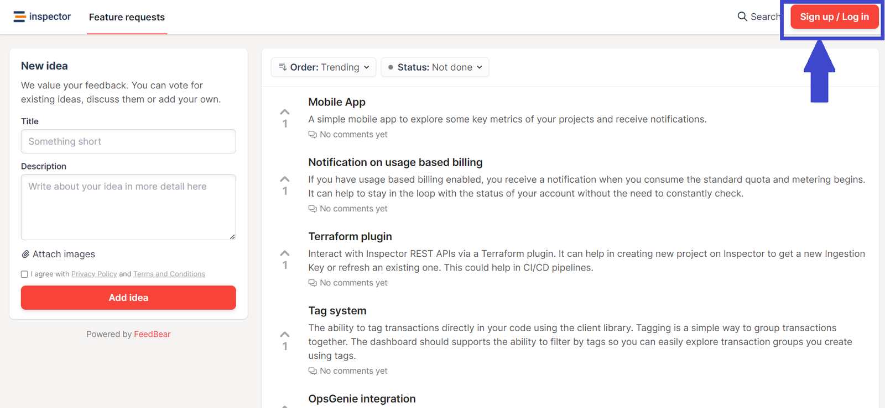
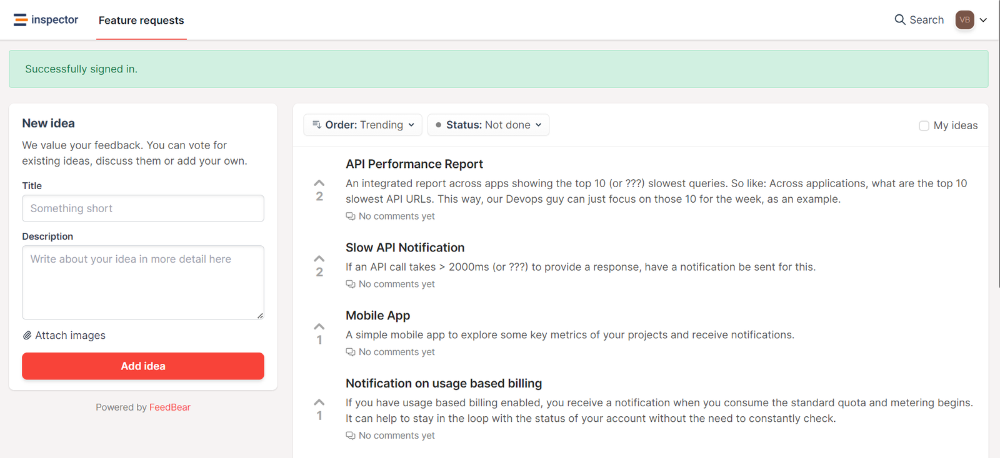

I've recently been thinking about the best way to allow Inspector's users to share the features they'd like to find in Inspector. Often I ask for feedback or investigate new feature requests during live chat sessions.

In the first instance developers drop in a live chat asking for support. Very often these chats lead to bug fixes, sometimes even to the development of new features. So I loved the idea to make this process more organic and let the Inspector users free to publicly share what features they think would give Inspector an edge. And make it an even better investment for them overtime.

For this reason we've integrated Inspector with [**FeedBear**](https://www.feedbear.com/), a tool to collect and prioritize customers' ideas for new product features. Now you can actively contribute to choosing which features we should implement to make Inspector an increasingly effective tool to make developers' lives easier.

You can also vote and support features requested by others if you share their point of view, and add your comments to ensure we direct the development of the feature the way you and other developers expect.

## How to access the Feature Requests dashboard

We added a new link in your personal account menu. To see it click on your name in the left-bottom corner of the screen:

It will opne a new tab to: [https://feature-requests.inspector.dev/boards/feature-requests](https://feature-requests.inspector.dev/boards/feature-requests)

The dashboard contains all the idea posted by users that you can vote or comment in order to contribute to their planning on our roadmap.

## Log-in to post your idea

To be able to post your idea for new features you should be identified as Inspector users. The dashboard is integrated with your account with a Single-Sign-On system. You only need to click on the login button as shown in the image below:

It will redirects your browser to our SSO endpoint to verify your Inspector account, and than return back to the "Feature Requests" dashboard with your authenticated user.

You don't need to make any registration or access external platforms.

I can't wait to see what your ideas will be to create an amazing monitoring tool that you and other developers love!

## New to Inspector? Try it for free now

Are you responsible for software development in your company? Consider trying my product [**Inspector**](/) to find out bugs and bottlenecks in your code automatically. Before your customers stumble onto the problem.

Inspector is usable by any IT leader who doesn’t need anything complicated. If you want effective automation, deep insights, and the ability to forward alerts and notifications into your messaging environment try Inspector for free. [**Register your account**](https://app.inspector.dev/register).

Or learn more on the website: [**https://inspector.dev**](/)
