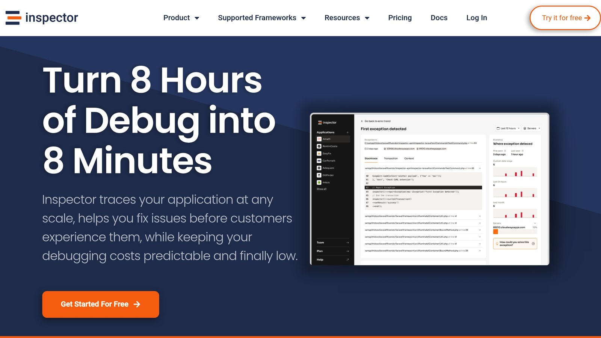

Cross-Site Scripting (XSS) is a major security risk for [Laravel](https://laravel.com/) applications. It happens when attackers inject malicious scripts into your app, targeting sensitive data or user trust. Even with Laravel's built-in security features, real-time detection tools like [**Inspector**](/) can help you block these threats before they cause harm.

### Key Takeaways:

- **Types of XSS Attacks**: Stored (via user content), Reflected (via URL parameters), and DOM-based (via JavaScript vulnerabilities).
- **Why Real-Time Detection?**: Prevent costly data breaches and ransomware attacks by identifying and responding to threats instantly.
- **How to Secure Laravel**:
  - Install and configure **Inspector** for real-time XSS monitoring.
  - Use Laravel's middleware to sanitize inputs and escape outputs.
  - Set up alerts to track suspicious activity and respond quickly.
- **Long-Term Protection**: Regular security testing, dependency updates, and developer training are essential for ongoing safety.

### Quick Comparison of XSS Protection Tools:

| Feature | Inspector | Laravel Built-in Tools |
| --- | --- | --- |
| Real-Time Detection | Yes | No |
| Middleware Integration | Yes | Yes |
| Customization Options | High | Moderate |
| Performance Impact | Minimal | Minimal |

By combining Laravel's built-in tools with Inspector, you can safeguard your app against XSS vulnerabilities, ensuring data integrity and user trust. Ready to secure your Laravel app? Let’s dive in.

## Setting Up XSS Detection Tools

Integrating XSS detection into Laravel is crucial for safeguarding your application from potential threats. Here's how to set it up effectively.

### Choosing the Right Monitoring Tool

When selecting an XSS monitoring tool for Laravel, focus on features that enhance security without compromising performance. Here's a quick comparison:

| Feature | Purpose | Effect |
| --- | --- | --- |
| Real-time Detection | Identifies potential XSS attacks instantly | Helps prevent data breaches |
| Laravel Integration | Native support for Laravel middleware | Simplifies setup and maintenance |
| Performance Impact | Minimal impact on application speed | Preserves user experience |
| Customization Options | Adjustable rules and settings | Tailors security to your needs |

**Inspector** is a great choice, offering real-time monitoring of HTTP traffic and code execution tailored for Laravel. Follow these steps to get started.

### Installing [Inspector](/)



1. **Clear Configuration Cache**  
   Clear the Laravel configuration cache to ensure smooth installation:

   ```bash
   php artisan config:clear
   ```

2. **Install the Package**  
   Add Inspector to your project using [Composer](https://getcomposer.org/):

   ```bash
   composer require inspector-apm/inspector-laravel
   ```

3. **Set Up Environment Variables**  
   Add your Inspector ingestion key to the `.env` file:

   ```env
   INSPECTOR_INGESTION_KEY=[your-ingestion-key]
   ```

Once installed, connect Inspector to Laravel for real-time threat monitoring.

### Connecting Laravel to Inspector

The connection process differs slightly depending on your Laravel version:

- **For Laravel 10 or earlier**, update `app/Http/Kernel.php` to include the middleware:

  ```php
  protected $middlewareGroups = [
      'web' => [
          \Inspector\Laravel\Middleware\WebRequestMonitoring::class,
      ],
      'api' => [
          \Inspector\Laravel\Middleware\WebRequestMonitoring::class,
      ]
  ];
  ```

- **For Laravel 11 and above**, modify `bootstrap/app.php` as follows:

  ```php
  use \Inspector\Laravel\Middleware\WebRequestMonitoring;

  return Application::configure(basePath: dirname(__DIR__))
      ->withMiddleware(function ($middleware) {
          $middleware->appendToGroup('web', WebRequestMonitoring::class)
              ->appendToGroup('api', WebRequestMonitoring::class);
      })
      ->create();
  ```

To confirm everything is set up correctly, run:

```bash
php artisan inspector:test
```

### Enhancing Security with Middleware

Pairing Inspector with Laravel's XSS Protection Middleware strengthens your application's defenses. This combination allows you to:

- Automatically sanitize incoming request data
- Log and monitor suspicious activity
- Customize protection rules based on your needs
- Securely manage file uploads
- Trigger events when malicious input is detected

This setup ensures your Laravel application is well-equipped to handle XSS threats in real time.

## Setting Up XSS Monitoring

With Inspector connected to your Laravel app, it's time to set up XSS monitoring to identify and block potential threats.

### Creating Detection Rules

Here's an example of a custom validation rule to spot harmful content:

```php
// Custom validation rule example
class XSSProtectionRule implements Rule
{
    public function passes($attribute, $value)
    {
        return strip_tags($value) === $value;
    }

    public function message()
    {
        return 'The :attribute must not contain HTML tags.';
    }
}
```

When defining detection rules, focus on these areas:

| Detection Area | Implementation Method | Purpose |
| --- | --- | --- |
| HTML Injection | Strip tags validation | Blocks unauthorized HTML content |
| Script Tags | Pattern matching | Stops harmful JavaScript |
| Encoded Attacks | URI scheme validation | Detects encoded XSS attempts |
| Attribute Injection | Input sanitization | Prevents attribute-based attacks |

After setting up these rules, sanitize inputs and ensure outputs are rendered securely.

### Input and Output Tracking

To keep user content safe, sanitize inputs and escape outputs effectively:

```php
// Middleware for input sanitization
public function handle($request, Closure $next)
{
    $input = $request->all();
    array_walk_recursive($input, function(&$value) {
        $value = filter_var($value, FILTER_SANITIZE_STRING);
    });
    $request->merge($input);

    return $next($request);
}
```

For output, use Laravel's [Blade](https://laravel.com/docs/11.x/blade) syntax:

```php
{{-- Escaping output safely --}}
{{ $userInput }}

{{-- For trusted HTML content --}}
{!! htmlentities($userInput, ENT_QUOTES, 'UTF-8') !!}
```

### Alert Configuration

Set up alerts allows you to respond to XSS threats quickly and effectively. With Inspector you can create alerts using complex query to detect unexpected behavior inside your applicaiton.

Make sure alerts are informative and actionable. Inspector's aggregation of similar incidents ensures you can focus on real threats while minimizing false positives.

## Managing XSS Threats

When Inspector identifies potential XSS threats, use the detailed alert data it provides to take immediate action.

### Reading Alert Data

Inspector's monitoring dashboard offers comprehensive details about detected XSS attempts. Pay attention to these key components:

| Alert Component | What to Look For | Why It Matters |
| --- | --- | --- |
| **Request Path** | Patterns in URLs indicating attack attempts | Pinpoints vulnerable routes |
| **Input Payload** | Suspicious content or data patterns | Shows how the attack is being executed |
| **User Context** | IP addresses and user agents | Helps trace the source of attacks |
| **Timestamp** | Timing and frequency of attacks | Highlights trends and patterns |

Carefully review this information to understand the nature of each flagged issue before diving deeper into the analysis.

### Examining Security Issues

Inspector's trace feature helps you locate the entry points of flagged requests. For example, consider this vulnerable endpoint:

```php
public function store(Request $request) {
    $comment = Comment::create([
        'content' => $request->input('content') // Unsafe direct input usage
    ]);
    return view('comments.show', compact('comment'));
}
```

To address this, ensure proper validation and sanitization:

```php
public function store(Request $request) {
    $validated = $request->validate([
        'content' => ['required', 'string', new XSSProtectionRule],
    ]);

    $comment = Comment::create([
        'content' => strip_tags($validated['content'])
    ]);

    return view('comments.show', compact('comment'));
}
```

### Fixing XSS Problems

Once you've analyzed the vulnerabilities, take these structured steps to resolve them:

- **Apply Immediate Fixes**
  - Use Laravel's built-in XSS protection tools.
  - Sanitize all user inputs.
  - Ensure output escaping is consistently applied.
- **Enhance Validation Rules**

Add stricter validation to block malicious inputs:

```php
$validated = $request->validate([
    'content' => [
        'required',
        'string',
        new XSSProtectionRule,
        function($attribute, $value, $fail) {
            if (preg_match('/<script\b[^>]*>(.*?)<\/script>/is', $value)) {
                $fail('The ' . $attribute . ' cannot contain script tags.');
            }
        },
    ]
]);
```

- **Set Up Security Headers**

Use security headers to control what content can be loaded:

```php
public function handle($request, Closure $next) {
    $response = $next($request);
    $response->headers->set('Content-Security-Policy', "default-src 'self'; script-src 'self' 'unsafe-inline' 'unsafe-eval'; style-src 'self' 'unsafe-inline';");
    return $response;
}
```

These steps will help neutralize vulnerabilities and reduce the risk of XSS attacks.

## Long-term XSS Protection

Keeping your Laravel applications safe from XSS attacks requires consistent effort and a clear plan. Below are some strategies to maintain strong defenses over time.

### Security Testing Schedule

Set up a regular testing routine to catch and fix XSS vulnerabilities before they become problems. Inspector's real-time alerts can help you stay on track.

| Testing Frequency | Assessment Type | Focus Areas |
| --- | --- | --- |
| Weekly | Automated Scans | Input validation, output escaping |
| Monthly | Code Reviews | New features, third-party integrations |
| Quarterly | Penetration Testing | Complex attack vectors, edge cases |
| Bi-annual | Security Audit | Overall application security posture |

Using Inspector to monitor and log these assessments can help you track progress, identify trends, and refine your security strategies. Regular tests also highlight areas where updates or additional training might be needed.

### Developer Security Training

Beyond testing and updates, invest in your development team's skills to strengthen your defenses. Practical, hands-on training is especially effective.

> "I believe the **best way** to learn how to defend against the hackers, is to first **learn how to hack** *(ethically, of course...)*."

Focus on these areas to build expertise:

- **Hands-on XSS Prevention**: Let developers practice using Inspector's tools to spot and resolve vulnerabilities.
- **Laravel-Specific Security Features**: Train your team on Laravel's built-in tools like Blade's automatic escaping, Content Security Policy, and input validation middleware.
- **Security Monitoring Skills**: Teach developers how to interpret Inspector's alerts, analyze attack patterns, and apply the right countermeasures. Early detection and response are key to minimizing risks.

These combined efforts - testing, updates, and training - create a solid foundation for long-term XSS protection.

## Summary

Detecting XSS attacks in real-time with Laravel requires combining the right tools, consistent monitoring, and regular maintenance. **Inspector** offers real-time tracking and automated XSS detection to strengthen your application's defenses.

To get started, install Inspector via Composer and configure your ingestion key in the `.env` file. Pair Inspector with Laravel's built-in security tools - like Blade's automatic escaping and real-time alerts - to bolster your protection against XSS vulnerabilities.

> "Implementing robust security protocols in a Laravel application is crucial for protecting sensitive data, maintaining user trust, and ensuring compliance with various legal and industry standards." - Acquaint Softtech

Key areas to focus on for XSS protection include:

| Protection Layer | Implementation | Purpose |
| --- | --- | --- |
| Input Validation | Use Laravel middleware with Inspector monitoring | Detect threats as they occur |
| Output Encoding | Rely on Blade's automatic escaping | Block harmful code injection |
| Monitoring | Leverage Inspector's real-time tracking | Respond to threats immediately |

Protecting against XSS is not a one-time task. Inspector's continuous monitoring ensures your application stays secure over time. By following these practices, you can keep your Laravel application resilient against XSS threats.

## Related Blog Posts

- [Symfony file upload examples and best practices](/symfony-file-upload-examples-and-best-practices/)
- [How to Automate PHP Security Patch Management](/how-to-automate-php-security-patch-management/)
- [5 Common Laravel Exceptions Explained](/5-common-laravel-exceptions-explained/)
- [Common Causes of Lock Contention in Laravel](/common-causes-of-lock-contention-in-laravel/)
