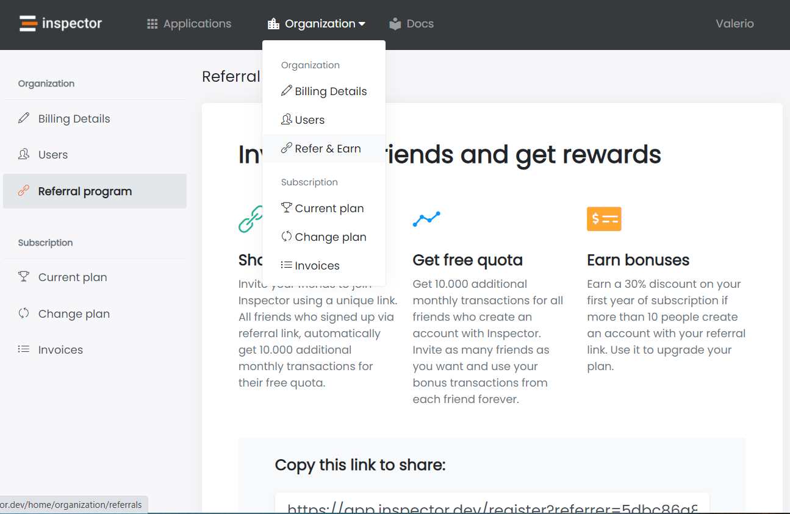

From the first day [Inspector](/) goes public I decided to not spend thousends of euro in direct advertising, but instead I wanted to build a real relationship with my users and talk openly about their needs and how the Inspector should improve to provide even more value.

This is why I decided to start writing articles on value and benefits that other developers could get using my product in their real life. Moreover, we offer a “completely free access tier”, with no credit card and no deadline.

We aim to grow organically by focusing on our customers and our technology.

Many of the organizations we work with have joined based on recommendations from others, and **we’ve been hard at work brainstorming a good way to say thank you to folks who have encouraged new groups to sign up.**

## How the Inspector referral program works

Navigate to: *Organization -> Refer & Earn*

We provide you a link with a unique code attached.

> Simply share this link in your preferred social networks or via a blog post to get **50,000 monthly transactions forever** scaling up your plan on each new user sign up.

As you can imagine it works with cookies. When people visit the registration page through your link, Inspector set a coockie in their browser to remember that this user come from your recommendation.

**This coockie does not have an expiration date, to give you the maximum chance of getting the free quota even if the user registers his account two months later.**

## Conclusion

If you want learn more about Inspector visit our website ([https://inspector.dev](/)) and start monitoring your application for free in just two minutes to find out issues before your application users do.

Thank you so much for reading it. To make Inspector more sophisticated and mature, it will not be possible to accomplish without your help. Don’t hesitate to share your thoughts on the comment below or drop in live chat on our website!
