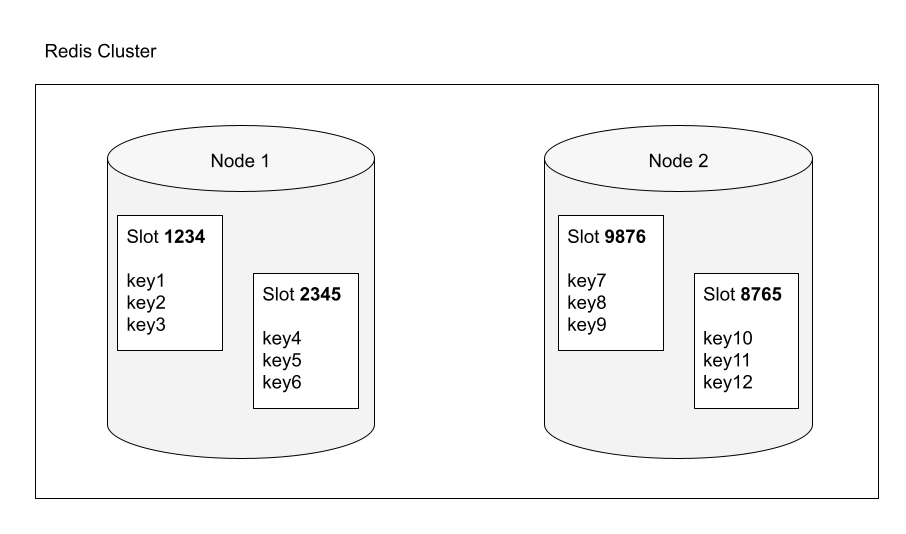

Recently we decided to move our cache system from a single [Redis](https://redis.io/) server to an AWS managed Redis cluster.

Amazon ElastiCache is a fully managed caching service that can be configured in cluster mode with a simple click so it can be easily scaled-in and out.

Running a Redis cluster isn't an easy task. Orchestrating multiple Redis nodes with the same efficiency of a managed service requires a lot of vertical skills. A managed service help us to stay focused on application development instead of dealing with infrastructure management issues.

But moving from a single server instance to a cluster enabled configuration caused a new error to appear:

```php
CROSSSLOT Keys in request don't hash to the same slot
```

## Where does this new error come from?

When Redis operates in cluster mode, it handles data storage differently than when it operates as a single instance.

This because it should be ready to distribute data across multiple nodes enabling horizontal scalability.

A Redis Cluster, if you are comparing it to the standalone Redis which is the non-distributed setup, use the "**HASH SLOT**" concept for key management, which implies some restrictions on key operations, **necessary to ensure data consistency in a distributed environment**.

If you take a look at the error description, it says "*Keys in request don't hash to the same slot*", it means that we are running some commands not comaptible with "HASH SLOT" restrictions mentioned above.

## What is a Hash Slot in Redis?

Redis Cluster determine what instance the particular key shall be assigned to using a specfic algorithm.

To make it simple, when you create a new key, Redis will assign an integer to it , called hash-slot. Keys with the same hash-slot will reside on the same Redis node inside the cluster.



*Keys distribution based on their hash slot*

You can verify it by yourself with a quick example.

Connect to your Redis Cluster:

```php
redis-cli -h [CLUSTER_ADDRESS] -p 6379
```

Create two new keys and checkout their assigned hash-slot:

```php
redis> SET mykey1 "Hello"
"OK"
redis> SET mykey2 "Hello 2"
"OK"
redis> CLUSTER KEYSLOT mykey1
(integer) 650
redis> CLUSTER KEYSLOT mykey2
(integer) 8734
```

As you can see the cluster has assigned two different hash-slots to the keys, so they are probably stored on different nodes within the cluster.

This is exactly what happens when your application create or changes keys in Redis.

## Why does the CROSSSLOT error occur?

This error occurs because the application is trying to run a command on multiple keys, but the keys involved in the operation aren't in the same hash-slot.

This result in a "CROSS-SLOT" operation which is not allowed in a cluster.

Hash slots control how data is distributed within the cluster, so this constraint is necessary to avoid information corruption in a distributed environment.

In the example above we have verified that the two keys (*mykey1*, *mykey2*) have obtained two different hashes slots.

Trying to run a command that involve both keys we will get the error:

```php
redis> SUNION mykey1 mykey2
(error) CROSSSLOT Keys in request don't hash to the same slot
```

## How to solve CROSSSLOT error at the application level

When creating keys that could be used by multi-key operations, use hashtags ({...}) to force the keys into the same hash slot.

When the key contains a "{...}" pattern, only the substring between the braces, "{" and "}", is considered to calculate the hash slot.

For example, the keys **{user1}:mykey1** and **{user1}:mykey2** are hashed to the same hash-slot, because only the string inside the braces "{" and "}", that is, "user1", is used to compute the hash-slot.

```php
redis> CLUSTER KEYSLOT {user1}:mykey1
(integer) 8006
redis> CLUSTER KEYSLOT {user1}:mykey2
(integer) 8006

redis> SUNION {user1}:mykey1 {user1}:mykey2
1) "Hello"
2) "Hello 2"
```

Now multi-key operations can be performed since both keys are placed in the same hash-slot.

Almost all Redis client support the "tag" feature, so you should explore the documentation of your framework/library to understand how to use it.
