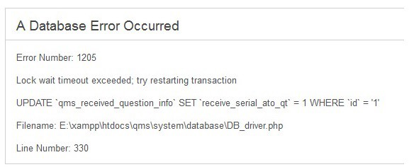

One of the most-read articles I've posted on our blog relates to a [queue and jobs configuration in a Laravel application](/what-worked-for-me-using-laravel-queues-from-the-basics-to-horizon/). So I decided to write about some side effects that Laravel queues adoption can cause in your application that is the raise of "MySQL lock wait timeout" error. I also want to provide solutions based on my real-life experience.

Queues and Jobs introduce parallel tasks execution in your app. And it's also the most important step to enable a new level of scalability while keeping server resources cost-friendly.

## Use MySQL database transactions

One of the best-known uses of [database transaction](https://laravel.com/docs/master/database#database-transactions)s is when an error occurs, the transaction can be rolled back. Any changes you made to the database within that transaction are rolled back as well.

### Data Integrity

```php
DB::transaction(function () {
    DB::table('users')->update(['votes' => 1]);

    DB::table('posts')->delete();
});
```

This result is beneficial when your code needs to update several tables. Or to run some complicated tasks that could produce exceptions.

If an error occurs in one statement all previous data changes will not apply to the database, keeping your data consistent with itself.

### Concurrency

Another thing database transaction can help us with is "concurrency".

In a highly concurrent environment (that's what we want to build using Laravel queues), where the application needs to update resources on the database (such as multiple jobs that want to update the same record in the same table), you can handle this situation retrying to execute the blocked transaction:

```php
DB::transaction(function () {
    DB::table('users')->update(['votes' => 1]);

    DB::table('posts')->delete();
}, 5); // <-- Number of tries
```

Here, the second parameter, "5" is the number of times a transaction should reattempt before closing it (rolled back).

And than throwing the "Lock wait timeout" exception.

After becoming familiar with queues and jobs, you may see more exceptions appearing in your log files.



That was my case.

## My experience using the Laravel Queue system

I struggled with this issue in a scenario where I needed to update a date-time field in a table called "**recently_executed_at**". As described above, many **concurrent** jobs trying to execute the update on the same record caused the "Lock wait timeout" exception.

The code abelow is not a solution:

```php
DB::transaction(function () use ($task) {
    $task->update(['recently_executed_at' => now()]);
}, 5);
```

because after attempting the execution five times, it throws an exception.

In my case, it was not essential to have this field update with the last execution time from the previously executed job. I only needed a reasonable recent timestamp to show in the frontend as extra information.

**When another job is locking the row for an update, I want to skip this statement in my other jobs.**

Reading and dealing with Pessimistic/Optimistic locking sent me off the rails for several days. In such a scenario, the solution was to deal with "*Race Condition*". This is when multiple jobs try to update the same database record at the same time.

In the Laravel documentation, you can find the solution in the Cache section as "[Atomic Lock](https://laravel.com/docs/6.x/cache#atomic-locks)". Unfortunately, it took me almost a week of research to understand that the Atomic Lock in the Cache driver could solve my problem 🤕 🤕 🤕.

## Final code

```php
Cache::lock("task-{$task->id}-update")->get(function () use ($task) {
    $task->update(['recently_executed_at' => now()]);
});
```

It was enough to wrap the update statement in a closure where the LOCK conditions the execution. The code block will be skipped if the lock isn't available (another job is executing the update).

Note that you need to create the lock name based on the "record id". This strategy lets you manage the race condition on one record at a time and not on the entire table.

## Conclusion

Efficient interaction with your database at scale isn't easy. The database is a shared resource. Yet, we often forget that each request is not independent of other requests.

If one request is slow, it's unlikely to affect the other, right?

Your database uses all the processes that run in your application. So, even one poorly designed access can hurt the whole system’s performance. So, be careful when thinking, "it's okay if this piece of code isn't optimized".

One slow database access can strain your database, causing a negative experience for your users.

You can follow me on [**Linkedin**](https://www.linkedin.com/in/valeriobarbera/) or **[X](https://x.com/Barbalerio)**. I post about building my SaaS business.
